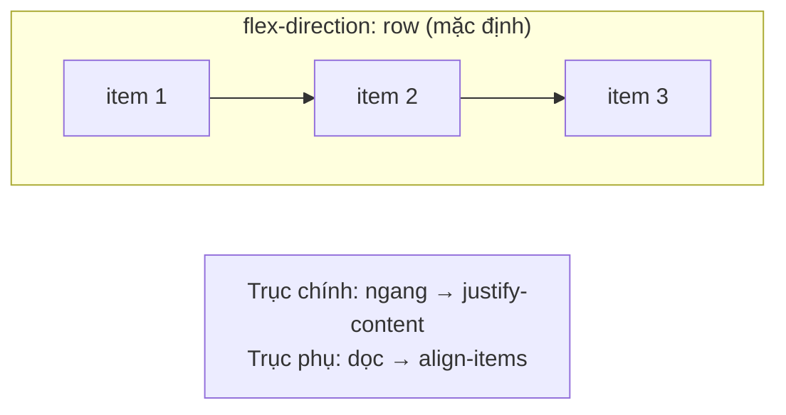

# Flexbox — bố cục một chiều

::: info Mục tiêu bài học
- Hiểu **flex container**, **flex item**, **trục chính** và **trục phụ**.
- Căn chỉnh với `justify-content`, `align-items`, `align-self` và tạo khoảng cách bằng `gap`.
- Cho phép xuống dòng với `flex-wrap`.
- Điều khiển kích thước item với `flex-grow`, `flex-shrink`, `flex-basis` (viết gọn là `flex`).
- Dựng các mẫu bố cục hay gặp: thanh điều hướng, căn giữa, thẻ có footer dính đáy, hàng thẻ tự xuống dòng.
:::

## 1. Vì sao cần Flexbox?

Trước Flexbox, xếp vài phần tử thành một hàng, căn giữa theo chiều dọc hay chia đều khoảng trống là một cực hình (dùng `float`, `inline-block`, bảng...). **Flexbox** sinh ra để giải quyết bài toán **xếp các phần tử theo một chiều** (một hàng hoặc một cột) và phân chia khoảng trống giữa chúng.

Chỉ cần một dòng:

```html live
<div class="hang">
  <div>Một</div>
  <div>Hai</div>
  <div>Ba</div>
</div>

<style>
  body { font-family: system-ui, sans-serif; }
  .hang { display: flex; gap: 8px; padding: 8px; background: #f4f4f5; }
  .hang > div { padding: 16px; background: #fdba74; border-radius: 6px; }
</style>
```

- Phần tử có `display: flex` là **flex container**.
- Các **con trực tiếp** của nó là **flex item**. Cháu chắt không bị ảnh hưởng.

## 2. Trục chính và trục phụ



Mọi thứ trong Flexbox xoay quanh hai trục:

- **Trục chính** (main axis): hướng các item được xếp. Mặc định là chiều ngang, từ trái sang phải.
- **Trục phụ** (cross axis): vuông góc với trục chính.

`flex-direction` đổi trục chính:

| Giá trị | Trục chính |
| --- | --- |
| `row` (mặc định) | Ngang, trái → phải |
| `row-reverse` | Ngang, phải → trái |
| `column` | Dọc, trên → dưới |
| `column-reverse` | Dọc, dưới → trên |

## 3. Căn chỉnh

Thử đổi giá trị trong Playground để thấy rõ từng kiểu:

```html live
<p>justify-content: space-between · align-items: center</p>
<div class="khung">
  <div class="item">A</div>
  <div class="item cao">B</div>
  <div class="item">C</div>
</div>

<style>
  body { font-family: system-ui, sans-serif; }
  .khung {
    display: flex;
    justify-content: space-between;  /* trục chính */
    align-items: center;             /* trục phụ */
    height: 140px;
    padding: 8px;
    background: #f5f3ff;
    border: 2px dashed #a78bfa;
  }
  .item { padding: 12px 20px; background: #8b5cf6; color: white; border-radius: 6px; }
  .cao { padding-block: 36px; }
</style>
```

**`justify-content`** (trục chính):

| Giá trị | Kết quả |
| --- | --- |
| `flex-start` (mặc định) | Dồn về đầu |
| `flex-end` | Dồn về cuối |
| `center` | Ở giữa |
| `space-between` | Item đầu và cuối sát mép, khoảng trống chia đều ở giữa |
| `space-around` | Mỗi item có khoảng trống bằng nhau hai bên (ở mép bằng một nửa) |
| `space-evenly` | Mọi khoảng trống bằng nhau, kể cả ở mép |

**`align-items`** (trục phụ):

| Giá trị | Kết quả |
| --- | --- |
| `stretch` (mặc định) | Kéo giãn item cho đầy chiều trục phụ (nếu item không đặt kích thước) |
| `flex-start` / `flex-end` | Sát đầu / cuối trục phụ |
| `center` | Ở giữa |
| `baseline` | Thẳng hàng theo đường chân chữ, hợp khi các item có cỡ chữ khác nhau |

`align-self` trên **một item** ghi đè `align-items` của container cho riêng item đó.

**`gap`** tạo khoảng cách **giữa** các item (không thừa ở hai mép): `gap: 16px`, hoặc `gap: 16px 24px` (hàng, cột) khi có xuống dòng.

::: tip Căn giữa tuyệt đối — "bài toán kinh điển" chỉ còn ba dòng
```css
.khung {
  display: flex;
  justify-content: center;
  align-items: center;
}
```
Đây chính là bài **Căn giữa với Flexbox** trong [Code Playground](/thuc-hanh/playground).
:::

## 4. Xuống dòng với `flex-wrap`

Mặc định (`nowrap`), mọi item bị ép lên **một dòng**, co lại hết mức có thể. `flex-wrap: wrap` cho phép xuống dòng:

```html live
<div class="ds">
  <div class="the">Thẻ 1</div><div class="the">Thẻ 2</div><div class="the">Thẻ 3</div>
  <div class="the">Thẻ 4</div><div class="the">Thẻ 5</div>
</div>

<style>
  body { font-family: system-ui, sans-serif; }
  .ds { display: flex; flex-wrap: wrap; gap: 12px; }
  .the {
    flex: 1 1 160px;   /* giãn, co, và bề rộng cơ sở 160px */
    padding: 24px 12px;
    background: #ffedd5;
    border-radius: 8px;
    text-align: center;
  }
</style>
```

Kéo hẹp khung (hoặc mở trong Playground và thu nhỏ cửa sổ): các thẻ tự xuống dòng và **giãn ra** lấp đầy hàng, không cần media query nào. Để ý thẻ ở hàng cuối giãn rộng hơn các thẻ khác. Nếu muốn mọi ô đều nhau như một lưới thật sự, hãy dùng [Grid](/css/grid).

`flex-flow: row wrap` là cách viết gọn của `flex-direction` + `flex-wrap`.

## 5. Kích thước item: grow, shrink, basis

Ba thuộc tính trên **item** quyết định nó chiếm bao nhiêu chỗ:

| Thuộc tính | Ý nghĩa | Mặc định |
| --- | --- | --- |
| `flex-basis` | Kích thước "khởi điểm" trước khi chia khoảng trống | `auto` (theo `width` hoặc nội dung) |
| `flex-grow` | Hệ số **nhận thêm** khoảng trống thừa | `0` (không giãn) |
| `flex-shrink` | Hệ số **co lại** khi thiếu chỗ | `1` (được co) |

Viết gọn bằng `flex: grow shrink basis`:

```html live
<div class="hang"><div class="a">flex: 1</div><div class="b">flex: 2</div><div class="c">flex: 1</div></div>
<div class="hang"><div class="co-dinh">flex: none (200px)</div><div class="gian">flex: 1 — lấp đầy phần còn lại</div></div>
<div class="hang"><div class="c">flex: auto — theo nội dung rồi chia phần thừa</div><div class="c">ngắn</div></div>

<style>
  body { font-family: system-ui, sans-serif; }
  .hang { display: flex; gap: 6px; margin-bottom: 8px; }
  .hang > div { padding: 12px; border-radius: 6px; background: #ccfbf1; }
  .a, .c { flex: 1; }
  .hang > .b { flex: 2; background: #99f6e4; }   /* nhận gấp đôi so với a và c */
  .hang > .co-dinh { flex: none; width: 200px; background: #fde68a; }
  .gian { flex: 1; }
  .hang:last-child > div { flex: auto; }
</style>
```

| Viết gọn | Tương đương | Dùng khi |
| --- | --- | --- |
| `flex: 1` | `1 1 0%` | Chia đều tuyệt đối, bỏ qua độ dài nội dung |
| `flex: auto` | `1 1 auto` | Giãn theo nội dung rồi chia phần thừa |
| `flex: none` | `0 0 auto` | Giữ nguyên kích thước, không co không giãn (icon, avatar, sidebar cố định) |
| `flex: 0 0 200px` | | Đúng 200px |

::: warning Item flex có nội dung dài không chịu co
Item flex mặc định không co nhỏ hơn **nội dung dài nhất** của nó (`min-width: auto`). Một URL dài hay một khối code có thể đẩy tràn cả hàng. Cách sửa: đặt `min-width: 0` cho item (thường kèm `overflow-wrap: anywhere`).
:::

## 6. `order` và margin `auto`

- `order: -1` đưa item lên đầu, `order: 1` xuống cuối (mặc định là `0`). Chỉ đổi **thứ tự hiển thị**: thứ tự đọc của trình đọc màn hình và thứ tự `Tab` vẫn theo HTML. Hạn chế dùng cho nội dung quan trọng.
- `margin-left: auto` (hoặc `margin-inline-start: auto`) trên một item **đẩy nó và mọi item phía sau** về cuối hàng. Mẹo này rất hay dùng trong thanh điều hướng.

## 7. Các mẫu bố cục hay gặp

**Thanh điều hướng:**

```html live
<header class="nav">
  <a class="logo" href="#">WebBasic</a>
  <nav class="menu">
    <a href="#">Bài học</a>
    <a href="#">Playground</a>
    <a href="#">Blog</a>
  </nav>
  <a class="dang-nhap" href="#">Đăng nhập</a>
</header>

<style>
  body { margin: 0; font-family: system-ui, sans-serif; }
  .nav { display: flex; align-items: center; gap: 24px; padding: 12px 20px; background: #1c1917; }
  .nav a { color: white; text-decoration: none; }
  .logo { font-weight: 800; font-size: 1.25rem; }
  .menu { display: flex; gap: 16px; }
  .dang-nhap { margin-left: auto; padding: 6px 14px; border: 1px solid #a8a29e; border-radius: 999px; }
</style>
```

**Thẻ có nút luôn nằm ở đáy** (dù mô tả dài ngắn khác nhau):

```html live
<div class="hang">
  <article class="the">
    <h3>HTML</h3>
    <p>Ngắn gọn.</p>
    <a href="#" class="nut">Vào học</a>
  </article>
  <article class="the">
    <h3>CSS</h3>
    <p>Mô tả dài hơn hẳn, chiếm vài dòng, nhưng nút vẫn thẳng hàng với các thẻ bên cạnh nhờ flex-direction: column và margin-top: auto.</p>
    <a href="#" class="nut">Vào học</a>
  </article>
</div>

<style>
  body { font-family: system-ui, sans-serif; }
  .hang { display: flex; gap: 12px; }
  .the {
    flex: 1;
    display: flex;
    flex-direction: column;     /* trục chính thành dọc */
    padding: 16px;
    border: 1px solid #e7e5e4;
    border-radius: 10px;
  }
  .the h3 { margin: 0; }
  .nut { margin-top: auto; padding: 8px; text-align: center; background: #c2410c; color: white; border-radius: 6px; text-decoration: none; }
</style>
```

Để ý hai thẻ cao bằng nhau mà không cần đặt chiều cao: đó là nhờ `align-items: stretch` mặc định của hàng ngoài.

**Ô nhập kèm nút** (ô nhập giãn, nút giữ nguyên):

```css
.tim-kiem { display: flex; gap: 8px; }
.tim-kiem input { flex: 1; min-width: 0; }
.tim-kiem button { flex: none; }
```

## 8. Flexbox hay Grid?

| Flexbox | Grid |
| --- | --- |
| **Một chiều**: một hàng *hoặc* một cột | **Hai chiều**: hàng *và* cột cùng lúc |
| Kích thước đi từ **nội dung** ra ngoài | Kích thước đi từ **khung lưới** vào trong |
| Thanh menu, nhóm nút, căn giữa, hàng thẻ linh hoạt | Bố cục trang, lưới sản phẩm đều ô, dashboard |

Hai thứ không loại trừ nhau: rất thường gặp Grid cho bố cục lớn, Flexbox cho các thành phần nhỏ bên trong.

## Thực hành

**Bài 1.** Làm hai bài **Căn giữa với Flexbox** và **Thanh điều hướng** trong [Code Playground](/thuc-hanh/playground).

::: details Xem gợi ý
Thanh điều hướng cần **hai** flex container: `.nav` (logo và menu, `justify-content: space-between`) và `.menu` (các mục, `gap: 16px`). Nhớ bỏ dấu chấm đầu dòng bằng `list-style: none` và xóa `padding`/`margin` mặc định của `<ul>`.
:::

**Bài 2.** Làm "media object": avatar 48px bên trái (không co), nội dung bình luận bên phải chiếm phần còn lại, avatar căn theo đỉnh nội dung.

::: details Xem lời giải
```html live
<div class="binh-luan">
  
  <div class="noi-dung">
    <strong>Minh Anh</strong>
    <p>Bài viết rất dễ hiểu! Phần flex-basis mình đọc mấy lần mới thấm, giờ thì rõ rồi.</p>
  </div>
</div>

<style>
  body { font-family: system-ui, sans-serif; }
  .binh-luan { display: flex; gap: 12px; align-items: flex-start; }
  .avatar { flex: none; border-radius: 50%; }
  .noi-dung { flex: 1; min-width: 0; }
  .noi-dung p { margin: 4px 0 0; }
</style>
```
Ảnh avatar dùng `alt=""` vì tên người viết đã có ngay bên cạnh.
:::

**Bài 3.** Làm footer có 3 cột (Giới thiệu, Liên kết, Liên hệ) chia đều trên màn hình rộng, và tự xếp thành 1 cột khi mỗi cột không đủ 200px. Chỉ dùng Flexbox, không dùng media query.

::: details Xem lời giải
```html live
<footer class="footer">
  <section><h4>Giới thiệu</h4><p>WebBasic — học web bằng tiếng Việt.</p></section>
  <section><h4>Liên kết</h4><p>Bài học · Playground · Blog</p></section>
  <section><h4>Liên hệ</h4><p>hotro@example.com</p></section>
</footer>

<style>
  body { font-family: system-ui, sans-serif; }
  .footer { display: flex; flex-wrap: wrap; gap: 24px; padding: 16px; background: #fafaf9; }
  .footer > section { flex: 1 1 200px; }
  .footer h4 { margin: 0 0 4px; }
</style>
```
`flex: 1 1 200px` nghĩa là "cơ sở 200px, dư thì giãn ra". Khi hàng không chứa nổi 3 × 200px cộng khoảng `gap`, item tự xuống dòng.
:::

## Lỗi thường gặp

- **Đặt `display: flex` lên item thay vì container** (hoặc ngược lại). Flex chỉ tác động lên **con trực tiếp**.
- **Nhầm `justify-content` với `align-items`**, nhất là sau khi đổi `flex-direction: column`.
- **`align-items: center` không có tác dụng** vì container không cao hơn nội dung. Phải có chiều cao (hoặc item khác cao hơn) thì mới có chỗ để căn.
- **Quên `flex-wrap: wrap`** → item co bé lại thay vì xuống dòng.
- **Item bị tràn vì nội dung dài** → `min-width: 0`.
- **Dùng `order` đảo nội dung** khiến thứ tự đọc và thứ tự phím Tab không khớp với thứ tự nhìn thấy.

## Tóm tắt

- `display: flex` trên container; con trực tiếp là item.
- `flex-direction` chọn trục chính; `justify-content` căn theo trục chính, `align-items` theo trục phụ; `gap` cho khoảng cách.
- `flex-wrap: wrap` để xuống dòng.
- `flex: 1` chia đều, `flex: auto` theo nội dung, `flex: none` giữ nguyên kích thước.
- `margin-left: auto` đẩy item về cuối; `min-width: 0` khi nội dung dài làm tràn.
- Flexbox cho bố cục **một chiều**, Grid cho bố cục **hai chiều**.

## Kiểm tra kiến thức

<Quiz />
