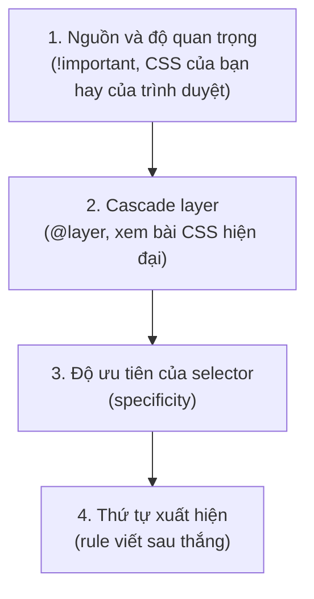

# Selector, cascade & độ ưu tiên

::: info Mục tiêu bài học
- Dùng **selector kết hợp** (con cháu, con, anh em) và **selector thuộc tính**.
- Dùng **pseudo-class** theo trạng thái (`:hover`, `:focus-visible`...), theo vị trí (`:nth-child`...) và các hàm `:not()`, `:is()`, `:where()`, `:has()`.
- Dùng **pseudo-element** `::before`, `::after` và các phần tử ảo khác.
- Hiểu **cascade**: khi nhiều rule cùng nhắm một phần tử, rule nào thắng?
- Tính được **độ ưu tiên** (specificity) và tránh các bẫy hay gặp.
:::

## 1. Selector kết hợp

```html live
<nav>
  <a href="#">Trang chủ</a>
  <ul>
    <li><a href="#">Bài học</a></li>
    <li><a href="#">Playground</a></li>
  </ul>
</nav>
<h2>Tiêu đề</h2>
<p>Đoạn ngay sau h2.</p>
<p>Đoạn thứ hai.</p>
<p>Đoạn thứ ba.</p>

<style>
  body { font-family: system-ui, sans-serif; }
  nav a { color: #c2410c; }               /* mọi <a> ở bất kỳ cấp nào trong nav */
  nav > a { font-weight: bold; }          /* chỉ <a> là con trực tiếp của nav */
  h2 + p { background: #fef3c7; }         /* <p> đứng NGAY sau h2 */
  h2 ~ p { border-left: 3px solid #a8a29e; padding-left: 8px; }  /* mọi <p> đứng sau h2, cùng cha */
</style>
```

| Selector | Tên | Chọn |
| --- | --- | --- |
| `A B` | Con cháu (descendant) | `B` nằm ở **bất kỳ cấp nào** bên trong `A` |
| `A > B` | Con (child) | `B` là **con trực tiếp** của `A` |
| `A + B` | Anh em liền kề | `B` đứng **ngay sau** `A`, cùng cha |
| `A ~ B` | Anh em | Mọi `B` đứng **sau** `A`, cùng cha |

## 2. Selector thuộc tính

```html live
<p><a href="https://developer.mozilla.org">MDN (link ngoài)</a></p>
<p><a href="/bai-hoc">Bài học (link trong)</a></p>
<p><a href="bang-gia.pdf">Bảng giá</a></p>
<p><input type="email" placeholder="email"> <input type="text" placeholder="văn bản"></p>

<style>
  a[href^="https://"]::after { content: " ↗"; }      /* bắt đầu bằng */
  a[href$=".pdf"]::after { content: " (PDF)"; }       /* kết thúc bằng */
  input[type="email"] { border: 2px solid #7c3aed; }  /* bằng đúng */
</style>
```

| Selector | Khớp khi thuộc tính |
| --- | --- |
| `[disabled]` | Có mặt (giá trị gì cũng được) |
| `[type="email"]` | Bằng đúng giá trị |
| `[href^="https"]` | Bắt đầu bằng |
| `[href$=".pdf"]` | Kết thúc bằng |
| `[class*="icon"]` | Chứa chuỗi con |

## 3. Pseudo-class — chọn theo trạng thái và vị trí

Pseudo-class bắt đầu bằng **một dấu hai chấm** và mô tả **trạng thái** hoặc **vị trí** của phần tử.

**Trạng thái tương tác.** Di chuột, bấm, và dùng phím `Tab` trong khung kết quả:

```html live
<a href="#">Liên kết</a>
<button type="button">Nút bấm</button>
<input placeholder="Gõ gì đó...">

<style>
  body { font-family: system-ui, sans-serif; display: flex; gap: 12px; align-items: center; }
  a:hover { color: #c2410c; }                       /* đang di chuột */
  button:active { transform: scale(0.95); }         /* đang nhấn giữ */
  :focus-visible { outline: 3px solid #7c3aed; outline-offset: 2px; }  /* focus bằng bàn phím */
  input:focus { background: #f5f3ff; }              /* đang được focus (cả chuột lẫn phím) */
  input:placeholder-shown { border-style: dashed; } /* đang trống, hiện placeholder */
</style>
```

- `:hover` (di chuột), `:active` (đang nhấn), `:focus` (đang focus), `:visited` (liên kết đã xem).
- `:focus-visible`: chỉ hiện khi trình duyệt cho rằng người dùng **cần thấy** focus (thường là khi dùng bàn phím). Đây là cách hiện đại để có viền focus đẹp mà không làm người dùng chuột khó chịu.
- Trạng thái form: `:checked`, `:disabled`, `:required`, `:placeholder-shown`, `:user-invalid`, `:user-valid`.

**Theo vị trí trong nhóm anh em:**

```html live
<ul>
  <li>Một</li><li>Hai</li><li>Ba</li><li>Bốn</li><li>Năm</li><li>Sáu</li>
</ul>

<style>
  li:first-child { font-weight: bold; }
  li:last-child { color: #c2410c; }
  li:nth-child(even) { background: #f4f4f5; }    /* chẵn: 2, 4, 6 */
  li:nth-child(3n) { text-decoration: underline; } /* 3, 6 */
  li:not(:last-child) { border-bottom: 1px solid #e4e4e7; }
</style>
```

| Selector | Chọn |
| --- | --- |
| `:first-child`, `:last-child` | Con đầu tiên / cuối cùng của cha |
| `:nth-child(2)` | Con thứ 2 |
| `:nth-child(odd)`, `:nth-child(even)` | Con lẻ / chẵn (bảng kẻ sọc) |
| `:nth-child(3n+1)` | Thứ 1, 4, 7... |
| `:nth-of-type(2)` | Phần tử thứ 2 **cùng loại thẻ** |
| `:only-child` | Con duy nhất |
| `:empty` | Không có con nào (kể cả chữ) |

**Các hàm selector:**

- `:not(X)`: phần tử **không** khớp X. Ví dụ `li:not(:last-child)`: mọi mục trừ mục cuối.
- `:is(A, B, C)`: viết gọn danh sách. `:is(h1, h2, h3) a` thay cho `h1 a, h2 a, h3 a`.
- `:where(A, B)`: giống `:is()` nhưng **độ ưu tiên bằng 0** (mục 6).
- `:has(X)`: chọn phần tử **chứa** (hoặc đứng trước) thứ khớp X. Đây là "selector cha" mà CSS thiếu suốt hơn 20 năm, nay đã có trên mọi trình duyệt chính.

```html live
<div class="the"><p>Thẻ có ảnh</p></div>
<div class="the"><p>Thẻ không có ảnh</p></div>
<label class="dong-y"><input type="checkbox"> Tôi đồng ý với điều khoản</label>

<style>
  body { font-family: system-ui, sans-serif; }
  .the { border: 1px solid #d4d4d8; padding: 8px; margin-bottom: 8px; }
  .the:has(img) { display: flex; gap: 12px; align-items: center; background: #fff7ed; }
  .dong-y:has(input:checked) { color: #15803d; font-weight: bold; }
</style>
```

## 4. Pseudo-element — phần tử "ảo"

Pseudo-element bắt đầu bằng **hai dấu hai chấm**, cho phép định kiểu một **phần** của phần tử hoặc chèn thêm nội dung trang trí:

```html live
<p class="trich">Học, học nữa, học mãi.</p>
<p class="bat-dau">Ngày xửa ngày xưa, ở một ngôi làng nhỏ ven sông, có một cậu bé rất thích đọc sách. Mỗi tối cậu đều thắp đèn đọc tới khuya.</p>
<p>Bôi đen đoạn này để thấy màu chọn chữ đã được đổi.</p>
<ul><li>Mục có dấu đầu dòng tùy chỉnh</li></ul>

<style>
  body { font-family: system-ui, sans-serif; }
  .trich::before { content: "“"; font-size: 2em; color: #c2410c; vertical-align: -0.3em; }
  .trich::after { content: "”"; font-size: 2em; color: #c2410c; vertical-align: -0.3em; }
  .bat-dau::first-letter { font-size: 2.4em; float: left; line-height: 1; margin-right: 6px; color: #7c3aed; }
  .bat-dau::first-line { font-weight: bold; }
  ::selection { background: #fde68a; }
  li::marker { content: "✔ "; color: #16a34a; }
</style>
```

- `::before`, `::after`: tạo phần tử con đầu/cuối, **bắt buộc có `content`** (có thể là `content: ''`). Dùng cho trang trí: icon, ngoặc kép, mũi tên. Đừng đặt nội dung quan trọng vào đây vì nó không chọn/copy được và không phải trình đọc màn hình nào cũng đọc.
- `::first-letter`, `::first-line`: chữ cái đầu, dòng đầu.
- `::placeholder`: chữ placeholder của ô nhập. `::marker`: dấu đầu dòng của `<li>`. `::selection`: vùng chữ đang được bôi đen.

## 5. Cascade — khi nhiều rule cùng nhắm một phần tử

Chữ "C" trong CSS là **Cascading** (thác đổ). Khi nhiều khai báo cùng đặt một thuộc tính cho một phần tử, trình duyệt chọn **một** khai báo thắng theo thứ tự sau:



Trình duyệt chỉ xét bước sau khi bước trước **hòa nhau**. Trong thực tế hằng ngày, hai bước bạn gặp nhiều nhất là **độ ưu tiên** và **thứ tự xuất hiện**:

```html live
<p class="thong-bao">Tôi màu gì?</p>

<style>
  .thong-bao { color: green; }
  p { color: blue; }            /* viết sau nhưng yếu hơn .thong-bao */
  .thong-bao { color: purple; } /* cùng độ ưu tiên với rule đầu, viết sau → thắng */
</style>
```

## 6. Độ ưu tiên (specificity)

Độ ưu tiên được tính như một bộ ba số **(A, B, C)**:

- **A**: số **id** (`#tieu-de`).
- **B**: số **class**, **thuộc tính** (`[type]`) và **pseudo-class** (`:hover`).
- **C**: số **thẻ** (`p`) và **pseudo-element** (`::before`).

So sánh từ trái sang phải, giống so số trang rồi số dòng: **một id thắng mọi số lượng class**, một class thắng mọi số lượng thẻ.

| Selector | (A, B, C) |
| --- | --- |
| `p` | (0, 0, 1) |
| `ul li a` | (0, 0, 3) |
| `.nut` | (0, 1, 0) |
| `a:hover` | (0, 1, 1) |
| `.menu .muc.hien` | (0, 3, 0) |
| `input[type="email"]` | (0, 1, 1) |
| `#tieu-de` | (1, 0, 0) |
| `#menu .muc a` | (1, 1, 1) |
| `*`, `:where(...)` | (0, 0, 0) |
| `:is(.a, #b)`, `:not(#b)`, `:has(#b)` | Bằng selector **mạnh nhất** bên trong: (1, 0, 0) |

Ngoài bộ ba còn hai "trùm cuối":

- Thuộc tính `style="..."` trên thẻ thắng mọi selector.
- `!important` (`color: red !important;`) thắng cả `style="..."`. Khi hai khai báo cùng `!important`, lại so độ ưu tiên như thường.

::: tip Xem độ ưu tiên trong DevTools
Trong bảng **Styles** của Chrome/Edge, di chuột lên selector của một rule để thấy độ ưu tiên dạng `Specificity: (0,1,1)`.
:::

## 7. Viết CSS dễ bảo trì

- **Giữ độ ưu tiên thấp và đều nhau.** Ưu tiên selector một class: `.the`, `.the-tieu-de`, `.nut-chinh`. Khi mọi rule cùng (0,1,0), thứ tự viết quyết định, rất dễ đoán.
- **Tránh dùng id để định kiểu** và **tránh lồng sâu** kiểu `.trang .noi-dung .the ul li a`: vừa mạnh quá mức, vừa gắn chặt CSS vào cấu trúc HTML.
- **`!important` chỉ là lối thoát hiểm**: ghi đè CSS của thư viện, hoặc vài lớp tiện ích như `.an { display: none !important; }`.
- Dùng `:where()` cho CSS nền/mặc định để mọi thứ khác dễ ghi đè.

## Thực hành

**Bài 1.** Cho HTML sau. Viết CSS: (a) các hàng chẵn của bảng có nền xám; (b) di chuột vào hàng thì nền vàng nhạt; (c) ô cuối mỗi hàng căn phải; (d) hàng có ô chứa class `het-hang` thì chữ xám và gạch ngang.

```html
<table>
  <tr><td>Bàn phím</td><td>450.000 ₫</td></tr>
  <tr><td>Chuột</td><td>150.000 ₫</td></tr>
  <tr><td class="het-hang">Tai nghe</td><td>700.000 ₫</td></tr>
  <tr><td>Lót chuột</td><td>50.000 ₫</td></tr>
</table>
```

::: details Xem lời giải
```html live
<table>
  <tr><td>Bàn phím</td><td>450.000 ₫</td></tr>
  <tr><td>Chuột</td><td>150.000 ₫</td></tr>
  <tr><td class="het-hang">Tai nghe</td><td>700.000 ₫</td></tr>
  <tr><td>Lót chuột</td><td>50.000 ₫</td></tr>
</table>

<style>
  table { border-collapse: collapse; font-family: system-ui, sans-serif; }
  td { padding: 6px 12px; }
  tr:nth-child(even) { background: #f4f4f5; }
  tr:hover { background: #fef9c3; }
  td:last-child { text-align: right; }
  tr:has(.het-hang) { color: #a1a1aa; text-decoration: line-through; }
</style>
```
:::

**Bài 2.** Tính độ ưu tiên và cho biết đoạn văn có màu gì:

```html
<div id="noi-dung" class="bai-viet">
  <p class="mo-dau">Xin chào</p>
</div>
```

```css
#noi-dung p { color: red; }
.bai-viet .mo-dau { color: green; }
div p.mo-dau { color: blue; }
p.mo-dau:first-child { color: orange; }
```

::: details Xem lời giải
- `#noi-dung p`: (1, 0, 1)
- `.bai-viet .mo-dau`: (0, 2, 0)
- `div p.mo-dau`: (0, 1, 2)
- `p.mo-dau:first-child`: (0, 2, 1)

(1, 0, 1) lớn nhất vì có một id, nên chữ **màu đỏ**. Nếu bỏ rule đầu, `p.mo-dau:first-child` (0, 2, 1) thắng `.bai-viet .mo-dau` (0, 2, 0) ở cột thứ ba, nên chữ màu cam.
:::

**Bài 3.** Dùng `::before` thêm biểu tượng 📄 trước mọi liên kết tới tệp `.pdf`, và biểu tượng ↗ sau mọi liên kết mở tab mới (`target="_blank"`).

::: details Xem lời giải
```html live
<p><a href="bang-gia.pdf">Bảng giá 2026</a></p>
<p><a href="https://developer.mozilla.org" target="_blank" rel="noopener">MDN</a></p>

<style>
  a[href$=".pdf"]::before { content: "📄 "; }
  a[target="_blank"]::after { content: " ↗"; }
</style>
```
:::

## Lỗi thường gặp

- **Nhầm `.a .b` (con cháu) với `.a.b` (cùng phần tử có hai class).**
- **Quên `content`** cho `::before`/`::after`.
- **Đặt `:hover` cho phần tử cha nhưng muốn đổi phần tử con**: phải viết `.the:hover .tieu-de`, không phải `.tieu-de:hover`.
- **Chạy đua độ ưu tiên**: thêm id, rồi thêm `!important` để thắng, rồi thêm `!important` nữa... Hãy giữ selector đơn giản ngay từ đầu.
- **`:nth-child()` tính mọi loại thẻ anh em**, không chỉ loại bạn viết. `p:nth-child(2)` chỉ khớp khi phần tử thứ 2 *là* `<p>`. Muốn đếm riêng thẻ `p` thì dùng `:nth-of-type()`.

## Tóm tắt

- Kết hợp: `A B` (con cháu), `A > B` (con), `A + B` (liền sau), `A ~ B` (anh em sau).
- Thuộc tính: `[attr]`, `[attr="x"]`, `^=`, `$=`, `*=`.
- Pseudo-class (`:`) cho trạng thái/vị trí: `:hover`, `:focus-visible`, `:checked`, `:nth-child()`, `:not()`, `:is()`, `:where()`, `:has()`.
- Pseudo-element (`::`): `::before`/`::after` (cần `content`), `::first-letter`, `::marker`, `::placeholder`, `::selection`.
- Cascade: nguồn và `!important` → layer → độ ưu tiên (A, B, C) → thứ tự viết.
- Giữ độ ưu tiên thấp và đều, tránh id và `!important` khi định kiểu.

## Kiểm tra kiến thức

<Quiz />
