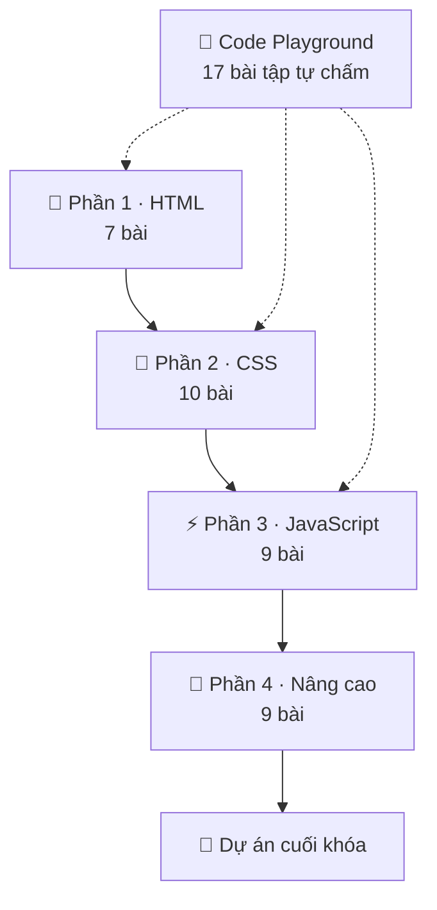

# Giới thiệu & lộ trình học

Chào mừng bạn đến với **WebBasic**, bộ tài liệu tự học làm web bằng tiếng Việt. Khóa học đi từ "trang web là gì" đến JavaScript bất đồng bộ, module, hiệu năng và bảo mật. Nội dung bám theo chuẩn web hiện hành (HTML Living Standard, CSS và ECMAScript 2025) và chỉ dùng những tính năng đã chạy trên mọi trình duyệt phổ biến. Tính năng mới hơn sẽ được ghi chú riêng.

## Khóa học này dành cho ai?

- **Người mới bắt đầu** chưa từng viết code, muốn tự làm được trang web của mình.
- **Sinh viên CNTT** cần nền tảng front-end vững trước khi học React, Vue hay Angular.
- **Lập trình viên back-end, tester, designer** muốn hiểu cách trình duyệt hiển thị và chạy trang web.

## Bạn cần chuẩn bị gì?

| Thứ cần có | Gợi ý | Ghi chú |
| --- | --- | --- |
| Máy tính | Windows, macOS hoặc Linux | Máy văn phòng là đủ, không cần cấu hình mạnh |
| Trình duyệt | Chrome, Edge hoặc Firefox bản mới | Có sẵn DevTools (phím `F12`) |
| Trình soạn code | [Visual Studio Code](https://code.visualstudio.com) | Cách cài và tiện ích cần thiết có ở [bài 1](/html/web-hoat-dong-the-nao#chuan-bi-cong-cu) |
| Kiến thức trước | Không cần | Biết dùng máy tính, gõ phím và tạo thư mục là đủ |

::: tip Chưa muốn cài gì?
Mọi ví dụ trong bài đều chạy ngay trên trang. Bạn có thể học hết phần HTML và CSS chỉ với trình duyệt và [Code Playground](/thuc-hanh/playground). Từ phần JavaScript, bạn nên cài VS Code để quen với cách làm việc thật.
:::

## Cấu trúc khóa học



- **Phần 1, HTML.** Web hoạt động thế nào, cấu trúc trang, văn bản, liên kết, ảnh, bảng, form, HTML ngữ nghĩa và thẻ `<head>`. Học xong bạn dựng được khung một trang web hoàn chỉnh.
- **Phần 2, CSS.** Làm trang đẹp và dàn trang: selector, cascade, box model, màu sắc và chữ, Flexbox, Grid, định vị, responsive, animation, biến CSS. Học xong bạn chuyển được một bản thiết kế thành trang web chạy tốt trên cả điện thoại.
- **Phần 3, JavaScript.** Ngôn ngữ lập trình của trình duyệt: biến, điều kiện, vòng lặp, hàm, mảng, object, DOM và sự kiện. Học xong bạn làm được trang web có tương tác.
- **Phần 4, Nâng cao.** Closure, class, bất đồng bộ, gọi API, module và Vite, xử lý lỗi, hiệu năng, bảo mật, Web Components. Đây là nền tảng để đi tiếp lên framework hoặc làm dự án thật.
- **Dự án cuối khóa.** Ứng dụng **Sổ chi tiêu** dùng gần như mọi thứ đã học.

## Mỗi bài học gồm những gì?

1. **Mục tiêu**: bạn sẽ làm được gì sau bài học.
2. **Khái niệm**: giải thích "vì sao" trước "làm thế nào", có sơ đồ khi cần.
3. **Ví dụ chạy được**: khối code có khung *Kết quả* hoặc nút **▶ Chạy**.
4. **Thực hành**: bài tập có lời giải (bấm để mở).
5. **Lỗi thường gặp**: những cái bẫy người mới hay vướng.
6. **Quiz**: kiểm tra nhanh, có giải thích cho từng đáp án.

Cuối mỗi bài có nút **Đánh dấu hoàn thành**. Tiến độ và điểm quiz được lưu trong trình duyệt (localStorage), không cần đăng nhập. Đổi máy hoặc xóa dữ liệu trình duyệt thì tiến độ sẽ mất.

## Quy ước trong tài liệu

Ví dụ có khung **Kết quả** ngay bên dưới là code HTML/CSS đã được chạy thật trong một khung an toàn (iframe sandbox):

```html live
<h1 style="color: #c2410c">Xin chào!</h1>
<p>Đây là kết quả trình duyệt hiển thị từ đoạn code phía trên.</p>
```

Ví dụ JavaScript có nút **▶ Chạy**, và những gì `console.log()` in ra sẽ hiện ở ô *Console*:

```js run
const ten = 'bạn';
console.log(`Chào ${ten}, hôm nay mình học JavaScript!`);
console.log(1 + 2, [1, 2, 3], { khoaHoc: 'WebBasic' });
```

Ngoài ra:

- Khối **Mẹo** chứa kinh nghiệm thực tế, khối **Lưu ý** chỉ ra chỗ dễ sai, khối **Cảnh báo** dành cho lỗi có thể gây mất dữ liệu hoặc lỗ hổng bảo mật.
- Thuật ngữ tiếng Anh (element, selector, function...) được giữ nguyên vì bạn sẽ gặp chúng trong tài liệu và thông báo lỗi. Lần đầu xuất hiện, thuật ngữ được giải thích bằng tiếng Việt. Xem thêm [bảng thuật ngữ](/tham-khao/thuat-ngu).
- Code JavaScript trong khóa học dùng dấu nháy đơn `'...'`, kết thúc câu lệnh bằng `;` và thụt lề 2 dấu cách.

## Kế hoạch học gợi ý (8 tuần)

| Tuần | Nội dung | Mục tiêu đầu ra |
| --- | --- | --- |
| 1 | Phần 1 (HTML) | Viết được trang hồ sơ cá nhân có ảnh, bảng và form liên hệ |
| 2 | Phần 2, bài 1–5 | Hiểu cascade, box model; dàn trang một chiều bằng Flexbox |
| 3 | Phần 2, bài 6–10 | Dàn trang bằng Grid, responsive, thêm hiệu ứng và chế độ tối |
| 4 | Phần 3, bài 1–5 | Viết được hàm, xử lý mảng dữ liệu |
| 5 | Phần 3, bài 6–9 | Làm trang có tương tác: lọc danh sách, form, bộ đếm, todo |
| 6 | Phần 4, bài 1–4 | Hiểu closure, class, Promise; gọi được API thật |
| 7 | Phần 4, bài 5–9 | Dùng Vite, debug, tối ưu hiệu năng, viết code an toàn |
| 8 | Dự án cuối khóa | Hoàn thành và đưa Sổ chi tiêu lên Internet |

Mỗi ngày 45–60 phút là đủ. Điều quan trọng là học **đều đặn** và **tự viết code**.

## Tiến độ của bạn

<Roadmap />
