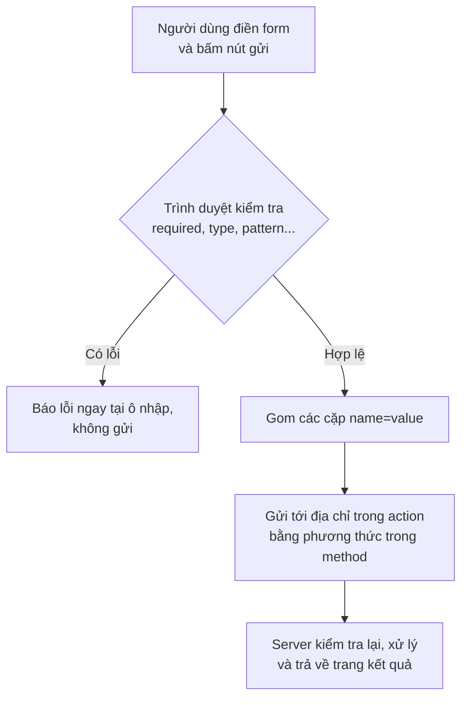

# Form & các ô nhập liệu

::: info Mục tiêu bài học
- Hiểu form **gửi dữ liệu** thế nào: `action`, `method`, cặp `name=value`.
- Gắn **label** đúng cách cho mọi ô nhập.
- Chọn đúng **loại ô nhập**: text, email, password, number, date, checkbox, radio, select, textarea...
- Dùng **kiểm tra dữ liệu có sẵn** của trình duyệt: `required`, `minlength`, `pattern`, `min`/`max`.
- Tránh các bẫy hay gặp: nút gửi nhầm, thiếu `name`, placeholder thay label.
:::

## 1. Form gửi dữ liệu thế nào?

Form là cách người dùng **gửi dữ liệu** lên server: đăng nhập, tìm kiếm, đặt hàng, bình luận...

```html
<form action="/tim-kiem" method="get">
  <label for="q">Tìm khóa học</label>
  <input id="q" name="q" type="search">
  <button>Tìm</button>
</form>
```

Người dùng gõ `css grid` rồi bấm **Tìm**, trình duyệt mở địa chỉ `/tim-kiem?q=css+grid`.



| Thuộc tính của `<form>` | Ý nghĩa |
| --- | --- |
| `action` | Địa chỉ nhận dữ liệu. Bỏ trống thì gửi về chính trang hiện tại |
| `method="get"` | Dữ liệu nằm trên **URL** (`?q=...`). Dùng cho tìm kiếm, lọc: có thể bookmark, chia sẻ link |
| `method="post"` | Dữ liệu nằm trong **thân request**, không hiện trên URL. Dùng cho đăng nhập, đặt hàng, mọi thứ làm thay đổi dữ liệu |

::: warning `post` không có nghĩa là bảo mật
Dữ liệu `post` không hiện trên thanh địa chỉ nhưng vẫn đi qua mạng. Chỉ có **HTTPS** mới mã hóa nó. Mật khẩu chỉ được gửi bằng `post` qua HTTPS.
:::

Ở [Phần 3](/javascript/su-kien), bạn sẽ dùng JavaScript bắt sự kiện gửi form để xử lý ngay trên trang, không cần tải lại.

## 2. Label — nhãn cho ô nhập

Mọi ô nhập đều cần một `<label>`. Có hai cách gắn:

```html live
<!-- Cách 1: for trùng id (phổ biến nhất) -->
<p>
  <label for="ho-ten">Họ và tên</label>
  <input id="ho-ten" name="hoTen" type="text">
</p>

<!-- Cách 2: bọc ô nhập bên trong label -->
<p>
  <label>
    <input name="dongY" type="checkbox"> Tôi đồng ý với điều khoản
  </label>
</p>
```

Label gắn đúng mang lại ba lợi ích:

1. Trình đọc màn hình đọc "Họ và tên, ô nhập văn bản" khi người dùng vào ô.
2. **Bấm vào chữ** cũng chọn được ô. Thử bấm vào chữ "Tôi đồng ý" ở khung trên: ô checkbox nhỏ xíu có thêm cả một vùng bấm lớn.
3. Code dễ đọc, công cụ kiểm tra tự động không báo lỗi.

## 3. Các loại `<input>`

Đổi thuộc tính `type` là được một ô nhập khác hẳn. Trên điện thoại, mỗi loại còn mở **bàn phím phù hợp** (bàn phím số cho `tel`, có phím `@` cho `email`):

```html live
<form>
  <p><label>Văn bản <input type="text" name="ten"></label></p>
  <p><label>Email <input type="email" name="email"></label></p>
  <p><label>Mật khẩu <input type="password" name="matKhau"></label></p>
  <p><label>Số lượng <input type="number" name="soLuong" min="1" max="10" value="1"></label></p>
  <p><label>Điện thoại <input type="tel" name="sdt"></label></p>
  <p><label>Website <input type="url" name="web"></label></p>
  <p><label>Ngày sinh <input type="date" name="ngaySinh"></label></p>
  <p><label>Giờ hẹn <input type="time" name="gio"></label></p>
  <p><label>Màu yêu thích <input type="color" name="mau" value="#c2410c"></label></p>
  <p><label>Độ sáng <input type="range" name="doSang" min="0" max="100"></label></p>
  <p><label>Ảnh đại diện <input type="file" name="anh" accept="image/*"></label></p>
  <p><label>Tìm kiếm <input type="search" name="q"></label></p>
</form>
```

**Checkbox** (chọn nhiều) và **radio** (chọn một). Các radio cùng `name` là một nhóm:

```html live
<form>
  <p>Sở thích:</p>
  <label><input type="checkbox" name="soThich" value="doc-sach"> Đọc sách</label>
  <label><input type="checkbox" name="soThich" value="du-lich" checked> Du lịch</label>
  <label><input type="checkbox" name="soThich" value="nau-an"> Nấu ăn</label>

  <p>Giao hàng:</p>
  <label><input type="radio" name="giaoHang" value="tieu-chuan" checked> Tiêu chuẩn</label>
  <label><input type="radio" name="giaoHang" value="nhanh"> Nhanh</label>
  <label><input type="radio" name="giaoHang" value="hoa-toc"> Hỏa tốc</label>
</form>
```

`value` là giá trị được **gửi đi** khi ô được chọn. Với text, value là nội dung mặc định. `checked` chọn sẵn một ô.

## 4. Ô chọn, ô nhập nhiều dòng và nút

```html live
<form>
  <p>
    <label for="tinh">Tỉnh/thành</label>
    <select id="tinh" name="tinh">
      <option value="">-- Chọn --</option>
      <optgroup label="Miền Bắc">
        <option value="hn">Hà Nội</option>
        <option value="hp">Hải Phòng</option>
      </optgroup>
      <optgroup label="Miền Nam">
        <option value="hcm" selected>TP. Hồ Chí Minh</option>
        <option value="ct">Cần Thơ</option>
      </optgroup>
    </select>
  </p>
  <p>
    <label for="ghi-chu">Ghi chú</label><br>
    <textarea id="ghi-chu" name="ghiChu" rows="3" cols="40" placeholder="Giao giờ hành chính..."></textarea>
  </p>
  <p>
    <label for="ngon-ngu">Ngôn ngữ lập trình</label>
    <input id="ngon-ngu" name="ngonNgu" list="ds-ngon-ngu">
    <datalist id="ds-ngon-ngu">
      <option value="JavaScript"></option>
      <option value="Python"></option>
      <option value="Java"></option>
    </datalist>
  </p>
  <button type="submit">Gửi</button>
  <button type="reset">Nhập lại</button>
  <button type="button">Nút thường (không làm gì)</button>
</form>
```

- `<select>` với các `<option>`; `<optgroup>` để nhóm; `selected` chọn sẵn; thêm thuộc tính `multiple` để chọn nhiều.
- `<textarea>` cho văn bản nhiều dòng. Nội dung mặc định nằm **giữa** hai thẻ, không dùng `value`.
- `<datalist>` gợi ý giá trị nhưng vẫn cho gõ tự do.
- `<button>` có ba loại: `submit` (gửi form, **mặc định**), `reset` (trả form về ban đầu, ít khi nên dùng), `button` (không làm gì, để JavaScript xử lý).

::: danger Bẫy: nút không ghi `type`
Trong form, `<button>Xem mật khẩu</button>` vẫn là nút **submit**. Bấm vào nó là form bị gửi đi. Mọi nút không dùng để gửi form phải ghi rõ `type="button"`.
:::

## 5. Nhóm các ô với `<fieldset>`

```html live
<form>
  <fieldset>
    <legend>Thông tin người nhận</legend>
    <p><label>Họ tên <input name="hoTen" autocomplete="name"></label></p>
    <p><label>Điện thoại <input name="sdt" type="tel" autocomplete="tel"></label></p>
  </fieldset>
  <fieldset>
    <legend>Phương thức thanh toán</legend>
    <label><input type="radio" name="thanhToan" value="cod" checked> Tiền mặt khi nhận hàng</label><br>
    <label><input type="radio" name="thanhToan" value="chuyen-khoan"> Chuyển khoản</label>
  </fieldset>
</form>
```

`<legend>` là tiêu đề của nhóm. Với nhóm radio, trình đọc màn hình đọc kèm legend: "Phương thức thanh toán, Tiền mặt khi nhận hàng, nút chọn 1 trên 2". Thêm `disabled` vào `<fieldset>` để vô hiệu cả nhóm.

## 6. Kiểm tra dữ liệu có sẵn của trình duyệt

Không cần JavaScript, trình duyệt đã biết kiểm tra nhiều thứ trước khi gửi:

| Thuộc tính | Kiểm tra |
| --- | --- |
| `required` | Không được bỏ trống |
| `type="email"`, `type="url"` | Đúng định dạng email, URL |
| `minlength`, `maxlength` | Độ dài chuỗi |
| `min`, `max`, `step` | Giá trị số, ngày; bước nhảy |
| `pattern` | Khớp biểu thức chính quy (regex), ví dụ `pattern="0[0-9]{9}"` cho số điện thoại 10 chữ số bắt đầu bằng 0 |

Bấm **Đăng ký** khi chưa điền gì để xem trình duyệt báo lỗi:

```html live
<form id="dang-ky">
  <p>
    <label for="email">Email</label>
    <input id="email" name="email" type="email" required autocomplete="email">
  </p>
  <p>
    <label for="sdt">Số điện thoại</label>
    <input id="sdt" name="sdt" type="tel" pattern="0[0-9]{9}" title="10 chữ số, bắt đầu bằng 0" placeholder="vd: 0901234567">
  </p>
  <p>
    <label for="mk">Mật khẩu (ít nhất 8 ký tự)</label>
    <input id="mk" name="matKhau" type="password" minlength="8" required autocomplete="new-password">
  </p>
  <p>
    <label for="tuoi">Tuổi</label>
    <input id="tuoi" name="tuoi" type="number" min="16" max="100">
  </p>
  <button>Đăng ký</button>
</form>

<style>
  input:user-invalid { border: 2px solid #dc2626; }
  input:user-valid { border: 2px solid #16a34a; }
</style>

<script>
  // Chỉ để xem dữ liệu sẽ được gửi đi. Bạn sẽ học cách viết ở Phần 3.
  document.querySelector('#dang-ky').addEventListener('submit', (event) => {
    event.preventDefault();
    console.log('Dữ liệu gửi đi:', Object.fromEntries(new FormData(event.target)));
  });
</script>
```

Pseudo-class `:user-invalid` / `:user-valid` (bài [Selector](/css/selector-cascade)) cho phép tô màu ô sai hoặc đúng **sau khi** người dùng đã tương tác. Dùng `:invalid` thì ô bắt buộc bị tô đỏ ngay từ lúc trang vừa mở, khá khó chịu.

::: warning Đừng tin dữ liệu từ trình duyệt
Ai cũng có thể mở DevTools xóa `required`, hoặc gửi request thẳng tới server mà không qua form. Kiểm tra ở trình duyệt giúp **người dùng** sửa lỗi nhanh; server **luôn phải kiểm tra lại**.
:::

## 7. Giúp người dùng điền nhanh hơn

- `autocomplete` cho trình duyệt điền sẵn thông tin đã lưu: `name`, `email`, `tel`, `street-address`, `current-password` (đăng nhập), `new-password` (đăng ký, trình duyệt sẽ gợi ý mật khẩu mạnh), `one-time-code` (mã OTP).
- `inputmode` chọn bàn phím trên điện thoại mà không đổi kiểu dữ liệu: `inputmode="numeric"` cho mã OTP, số tài khoản.
- `placeholder` chỉ là **ví dụ** định dạng, không thay được label.
- `autofocus` đặt con trỏ sẵn vào ô đầu tiên. Chỉ dùng cho trang mà việc chính là điền form (trang đăng nhập).
- Đừng bắt người dùng nhập lại email hai lần hay cấm dán (paste) vào ô mật khẩu: điều đó chỉ làm khó người dùng trình quản lý mật khẩu.

## Thực hành

**Bài 1.** Làm form **Đặt bàn nhà hàng** gồm: họ tên (bắt buộc), số điện thoại (bắt buộc, 10 số), ngày đặt (`date`), số khách (1–20), khu vực (`select`: Trong nhà, Sân vườn, Phòng riêng), dịp đặc biệt (radio: Không, Sinh nhật, Kỷ niệm), ghi chú (`textarea`) và nút gửi. Mọi ô có label và `name`.

::: details Xem lời giải
```html live
<form id="dat-ban">
  <p>
    <label for="ten">Họ tên</label>
    <input id="ten" name="hoTen" required autocomplete="name">
  </p>
  <p>
    <label for="dt">Điện thoại</label>
    <input id="dt" name="sdt" type="tel" required pattern="0[0-9]{9}" autocomplete="tel">
  </p>
  <p>
    <label for="ngay">Ngày đặt</label>
    <input id="ngay" name="ngay" type="date" required>
  </p>
  <p>
    <label for="khach">Số khách</label>
    <input id="khach" name="soKhach" type="number" min="1" max="20" value="2">
  </p>
  <p>
    <label for="khu">Khu vực</label>
    <select id="khu" name="khuVuc">
      <option value="trong-nha">Trong nhà</option>
      <option value="san-vuon">Sân vườn</option>
      <option value="phong-rieng">Phòng riêng</option>
    </select>
  </p>
  <fieldset>
    <legend>Dịp đặc biệt</legend>
    <label><input type="radio" name="dip" value="khong" checked> Không</label>
    <label><input type="radio" name="dip" value="sinh-nhat"> Sinh nhật</label>
    <label><input type="radio" name="dip" value="ky-niem"> Kỷ niệm</label>
  </fieldset>
  <p>
    <label for="gc">Ghi chú</label><br>
    <textarea id="gc" name="ghiChu" rows="3"></textarea>
  </p>
  <button type="submit">Đặt bàn</button>
</form>

<script>
  document.querySelector('#dat-ban').addEventListener('submit', (event) => {
    event.preventDefault();
    console.log(Object.fromEntries(new FormData(event.target)));
  });
</script>
```
:::

**Bài 2.** Form sau có 4 lỗi khiến nó khó dùng hoặc gửi thiếu dữ liệu. Tìm và sửa.

```html
<form action="/dang-nhap" method="get">
  <input type="text" placeholder="Email">
  <input type="password" name="matKhau" placeholder="Mật khẩu">
  <button>Hiện mật khẩu</button>
  <button>Đăng nhập</button>
</form>
```

::: details Xem lời giải
1. Đăng nhập phải dùng `method="post"`, nếu không mật khẩu sẽ hiện trên URL và lưu vào lịch sử trình duyệt.
2. Ô email thiếu `name` (không được gửi đi), nên dùng `type="email"` và `autocomplete="email"`.
3. Không có `<label>`, placeholder không thay được label.
4. Nút "Hiện mật khẩu" thiếu `type="button"` nên sẽ gửi form.

```html
<form action="/dang-nhap" method="post">
  <label for="email">Email</label>
  <input id="email" name="email" type="email" required autocomplete="email">
  <label for="mk">Mật khẩu</label>
  <input id="mk" name="matKhau" type="password" required autocomplete="current-password">
  <button type="button">Hiện mật khẩu</button>
  <button type="submit">Đăng nhập</button>
</form>
```
:::

## Lỗi thường gặp

- **Thiếu `name`** → dữ liệu không được gửi.
- **Thiếu `<label>`** hoặc `for` không khớp `id` → trình đọc màn hình không biết ô dùng để làm gì, bấm vào chữ không chọn được ô.
- **`<button>` không có `type`** trong form → gửi form ngoài ý muốn.
- **Radio khác `name`** → chọn được nhiều ô cùng lúc.
- **Gửi mật khẩu bằng `get`** → mật khẩu nằm trên URL, trong lịch sử và log của server.
- **Chỉ kiểm tra ở trình duyệt** → server nhận dữ liệu bẩn.

## Tóm tắt

- `<form action method>` gửi các cặp `name=value`. Dùng `get` cho tìm kiếm/lọc, `post` cho dữ liệu thay đổi trạng thái.
- Mọi ô nhập cần `<label>` (qua `for`/`id` hoặc bọc trong label) và `name`.
- Chọn đúng `type`: email, tel, number, date, checkbox (chọn nhiều), radio cùng `name` (chọn một)...
- `<select>`, `<textarea>`, `<datalist>`, `<fieldset>` + `<legend>`.
- `<button>` mặc định là `submit`; nút khác ghi `type="button"`.
- `required`, `minlength`, `min`/`max`, `pattern` giúp người dùng sửa lỗi ngay; server vẫn phải kiểm tra lại.

## Kiểm tra kiến thức

<Quiz />
