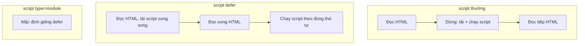

# Thẻ head, SEO & đa phương tiện

::: info Mục tiêu bài học
- Viết phần `<head>` đầy đủ: `meta`, `title`, `link`, `script` và hiểu từng dòng.
- Nắm **SEO cơ bản** và **Open Graph** để link chia sẻ trông đẹp.
- Dùng **ảnh responsive** với `srcset`, `sizes`, `<picture>`, và tải ảnh trễ (lazy loading).
- Chèn **video**, **audio** kèm phụ đề; nhúng nội dung bằng `<iframe>`.
:::

## 1. Bên trong `<head>`

```html
<!DOCTYPE html>
<html lang="vi">
<head>
  <meta charset="UTF-8">
  <meta name="viewport" content="width=device-width, initial-scale=1.0">
  <title>Áo thun cotton trắng – Shop Mây</title>
  <meta name="description" content="Áo thun 100% cotton, thoáng mát, đủ size S–XXL. Miễn phí đổi trả 30 ngày.">

  <link rel="icon" href="/favicon.svg" type="image/svg+xml">
  <link rel="stylesheet" href="/css/style.css">
  <script src="/js/app.js" defer></script>
</head>
```

| Thẻ | Vai trò |
| --- | --- |
| `<meta charset="UTF-8">` | Bảng mã, phải nằm trong 1024 byte đầu tiên của tệp, nên đặt đầu tiên |
| `<meta name="viewport">` | Hiển thị đúng bề rộng trên điện thoại (bài [Responsive](/css/responsive)) |
| `<title>` | Tiêu đề tab, bookmark, kết quả tìm kiếm. Mỗi trang một tiêu đề **riêng**, khoảng 50–60 ký tự |
| `<meta name="description">` | Đoạn mô tả dưới tiêu đề trong kết quả tìm kiếm, khoảng 150–160 ký tự |
| `<link rel="icon">` | Biểu tượng trên tab (favicon). SVG hiện nét ở mọi kích thước |
| `<link rel="stylesheet">` | Nạp tệp CSS (học ở [Phần 2](/css/nhap-mon-css)) |
| `<script src defer>` | Nạp JavaScript mà không chặn việc hiển thị trang |

**Script đặt ở đâu?** Mặc định, gặp `<script>` là trình duyệt **dừng đọc HTML** để tải và chạy script. Ba cách thường dùng:



- `defer`: tải song song, chạy **sau khi** đọc xong HTML, theo đúng thứ tự viết. Đây là lựa chọn mặc định tốt.
- `async`: tải song song, chạy **ngay khi tải xong**, không theo thứ tự. Hợp với script độc lập như thống kê truy cập.
- `type="module"`: JavaScript dạng module ([bài Module](/nang-cao/module-cong-cu)), mặc định đã giống `defer`.

## 2. SEO cơ bản

**SEO** (Search Engine Optimization) là làm cho trang dễ được tìm thấy. Phần lớn công việc nằm ở chỗ **viết HTML đúng**:

1. `<title>` và `<meta name="description">` riêng cho từng trang, mô tả đúng nội dung.
2. Một `<h1>` rõ ràng, tiêu đề phân cấp hợp lý.
3. HTML ngữ nghĩa, ảnh có `alt`, liên kết có chữ rõ nghĩa.
4. URL dễ đọc: `/khoa-hoc/html-co-ban` thay vì `/page.php?id=8231`.
5. Trang **tải nhanh** và dùng tốt trên điện thoại. Google xếp hạng dựa trên phiên bản mobile.
6. `<link rel="canonical" href="https://shop.vn/ao-thun-trang">` khi một nội dung có nhiều URL (ví dụ có thêm `?utm_source=...`), để báo URL chính thức.
7. `<meta name="robots" content="noindex">` cho những trang không muốn xuất hiện trong kết quả tìm kiếm (trang quản trị, trang kết quả lọc).

::: tip Nội dung vẫn là quan trọng nhất
Không thẻ nào thay được nội dung hữu ích, viết cho người đọc. Đừng nhồi từ khóa: các công cụ tìm kiếm hiện đại phát hiện và hạ hạng kiểu trang như vậy.
:::

## 3. Open Graph: link chia sẻ trông đẹp

Khi dán link vào Facebook, Zalo, Messenger, Slack hay Discord, khung xem trước được dựng từ các thẻ **Open Graph**:

```html
<meta property="og:type" content="website">
<meta property="og:title" content="Áo thun cotton trắng – giảm 30%">
<meta property="og:description" content="Vải 100% cotton, đủ size S–XXL. Đổi trả 30 ngày.">
<meta property="og:image" content="https://shop.vn/images/ao-thun-1200x630.jpg">
<meta property="og:url" content="https://shop.vn/ao-thun-trang">
```

- `og:image` phải là **URL tuyệt đối**. Kích thước khuyến nghị 1200 × 630 px.
- Facebook lưu bộ đệm khung xem trước. Sửa thẻ xong, hãy dùng [Sharing Debugger](https://developers.facebook.com/tools/debug/) của Facebook để làm mới.

## 4. Ảnh responsive

Điện thoại không cần tải ảnh 2000px dành cho màn hình máy tính. `srcset` cho trình duyệt **tự chọn** tệp phù hợp:

```html

```

- `srcset`: danh sách tệp kèm **bề rộng thật** của từng tệp (`480w` = 480 pixel).
- `sizes`: ảnh sẽ **hiển thị** rộng bao nhiêu. Ở đây là cả màn hình (`100vw`) khi màn hình hẹp hơn 600px, còn lại là nửa màn hình.
- Trình duyệt kết hợp hai thông tin trên với mật độ điểm ảnh (màn hình Retina gấp 2, gấp 3) để chọn tệp nhỏ nhất mà vẫn nét. `src` là phương án dự phòng.

**`<picture>`** cho phép chọn **định dạng** hoặc **khung hình khác nhau**:

```html
<picture>
  <!-- Trình duyệt hỗ trợ AVIF thì dùng AVIF, không thì WebP, cuối cùng là JPEG -->
  <source srcset="banner.avif" type="image/avif">
  <source srcset="banner.webp" type="image/webp">
  <!-- Điện thoại dùng ảnh cắt dọc cho vừa màn hình -->
  <source media="(width < 600px)" srcset="banner-doc.jpg">
  
</picture>
```

Trình duyệt dùng `<source>` **phù hợp đầu tiên**, và `` bên trong là bắt buộc (nơi đặt `alt`, kích thước và là phương án dự phòng).

**Tải ảnh thông minh:**

- `loading="lazy"`: chỉ tải ảnh khi sắp cuộn tới. Dùng cho ảnh **bên dưới** màn hình đầu tiên.
- Ảnh lớn nhất ở màn hình đầu tiên (banner chính) thì **không** lazy, có thể thêm `fetchpriority="high"` để tải sớm nhất.
- Luôn ghi `width` và `height` để trang không bị nhảy khi ảnh tải xong.

```html live height=260
<p>Cuộn xuống trong khung này để thấy ảnh lazy được tải:</p>
<div style="height: 500px; background: linear-gradient(#fff7ed, #ede9fe)">↓ khoảng trống ↓</div>

```

## 5. Video và audio

```html live
<video controls width="400" preload="metadata">
  <source src="https://interactive-examples.mdn.mozilla.net/media/cc0-videos/flower.webm" type="video/webm">
  <source src="https://interactive-examples.mdn.mozilla.net/media/cc0-videos/flower.mp4" type="video/mp4">
  Trình duyệt của bạn không phát được video này.
  <a href="https://interactive-examples.mdn.mozilla.net/media/cc0-videos/flower.mp4">Tải video về</a>.
</video>
```

| Thuộc tính | Ý nghĩa |
| --- | --- |
| `controls` | Hiện nút phát, tạm dừng, âm lượng, toàn màn hình |
| `poster` | Ảnh hiển thị trước khi phát |
| `autoplay muted playsinline` | Tự phát. Trình duyệt chỉ cho tự phát khi **tắt tiếng**; `playsinline` để iPhone không bật toàn màn hình |
| `loop` | Phát lặp lại |
| `preload` | `none` (không tải trước), `metadata` (chỉ thông tin độ dài), `auto` |

`<audio>` dùng giống hệt: `<audio controls src="podcast.mp3"></audio>`.

**Phụ đề** với `<track>` và tệp WebVTT (`.vtt`):

```html
<video controls src="bai-giang.mp4">
  <track kind="subtitles" src="phu-de-vi.vtt" srclang="vi" label="Tiếng Việt" default>
  <track kind="subtitles" src="sub-en.vtt" srclang="en" label="English">
</video>
```

```text
WEBVTT

00:00:01.000 --> 00:00:04.000
Xin chào, hôm nay chúng ta học HTML.

00:00:04.500 --> 00:00:08.000
Trước hết, hãy mở VS Code.
```

Phụ đề cần cho người khiếm thính, và cũng cho người đang xem video nơi công cộng không bật được tiếng.

::: tip Video dài nên đưa lên nền tảng chuyên dụng
Tự phục vụ video từ server của bạn tốn băng thông và không tự đổi chất lượng theo tốc độ mạng. Với video dài, hãy đưa lên YouTube/Vimeo rồi nhúng bằng `<iframe>`.
:::

## 6. Nhúng nội dung với `<iframe>`

`<iframe>` hiển thị **một trang web khác** bên trong trang của bạn: video YouTube, bản đồ Google Maps, bài đăng mạng xã hội...

```html
<iframe
  width="560" height="315"
  src="https://www.youtube-nocookie.com/embed/VIDEO_ID"
  title="Video: Hướng dẫn HTML cho người mới"
  loading="lazy"
  allow="accelerometer; encrypted-media; picture-in-picture"
  allowfullscreen>
</iframe>
```

- `title` là **bắt buộc** về mặt accessibility: trình đọc màn hình đọc nó để người dùng biết khung này chứa gì.
- `loading="lazy"` cũng dùng được cho iframe. Iframe rất nặng, đừng để chúng làm chậm màn hình đầu tiên.
- Thuộc tính `sandbox` giới hạn quyền của trang được nhúng. Chính các ví dụ "Kết quả" và Playground của khóa học này chạy trong `<iframe sandbox>`.
- Nhiều website **cấm** bị nhúng (header `X-Frame-Options` hoặc CSP `frame-ancestors`), khi đó iframe hiện trang trống hoặc báo lỗi.

## Thực hành

**Bài 1.** Viết phần `<head>` hoàn chỉnh cho trang giới thiệu khóa học "Lập trình web cơ bản" của trung tâm *Tin học Sao Mai*: charset, viewport, title, description, favicon SVG, tệp CSS `css/style.css`, script `js/main.js` không chặn hiển thị, và 4 thẻ Open Graph (type, title, description, image).

::: details Xem lời giải
```html
<head>
  <meta charset="UTF-8">
  <meta name="viewport" content="width=device-width, initial-scale=1.0">
  <title>Lập trình web cơ bản – Tin học Sao Mai</title>
  <meta name="description" content="Khóa học HTML, CSS, JavaScript 8 tuần cho người mới bắt đầu. Học qua dự án thật, lớp tối đa 15 học viên.">
  <link rel="icon" href="/favicon.svg" type="image/svg+xml">
  <link rel="stylesheet" href="css/style.css">
  <script src="js/main.js" defer></script>

  <meta property="og:type" content="website">
  <meta property="og:title" content="Lập trình web cơ bản – khai giảng tháng 11">
  <meta property="og:description" content="8 tuần học HTML, CSS, JavaScript qua dự án thật.">
  <meta property="og:image" content="https://saomai.edu.vn/images/khoa-web-1200x630.jpg">
</head>
```
:::

**Bài 2.** Bạn có ba bản của một ảnh sản phẩm: `sp-400.webp` (400px), `sp-800.webp` (800px), `sp-1600.webp` (1600px). Ảnh hiển thị rộng hết màn hình trên điện thoại (dưới 700px) và rộng 400px trên máy tính. Viết thẻ `` phù hợp, ảnh nằm dưới màn hình đầu tiên.

::: details Xem lời giải
```html

```
Trên máy tính có màn hình Retina (mật độ 2x), ảnh hiển thị 400px nên trình duyệt sẽ chọn `sp-800.webp` cho nét.
:::

**Bài 3.** Nhúng một video YouTube bất kỳ (lấy mã ở nút **Chia sẻ → Nhúng** của YouTube), thêm `title` mô tả và `loading="lazy"`.

::: details Xem gợi ý
YouTube cung cấp sẵn đoạn `<iframe>`. Bạn chỉ cần thêm `title="..."` (YouTube có tự điền nhưng thường chung chung) và `loading="lazy"`. Tên miền `youtube-nocookie.com` hạn chế cookie theo dõi cho tới khi người xem bấm phát.
:::

## Lỗi thường gặp

- **Mọi trang dùng chung một `<title>`** → kết quả tìm kiếm và các tab trình duyệt không phân biệt được.
- **Quên thẻ viewport** → trang trên điện thoại bị thu nhỏ như màn hình máy tính.
- **Script không `defer` đặt trong `<head>`** → trang trắng lâu hơn; hoặc script chạy khi DOM chưa có, `querySelector` trả về `null`.
- **`og:image` dùng đường dẫn tương đối** → khung xem trước không có ảnh.
- **Lazy-load ảnh banner đầu trang** → ảnh quan trọng nhất lại tải chậm nhất.
- **`<iframe>` thiếu `title`**.

## Tóm tắt

- `<head>` chứa siêu dữ liệu: charset, viewport, title, description, favicon, CSS, script `defer`.
- SEO bắt đầu từ HTML đúng: title/description riêng, một `<h1>`, ngữ nghĩa, alt, tốc độ, mobile.
- Open Graph (`og:title`, `og:image`...) quyết định khung xem trước khi chia sẻ link.
- `srcset` + `sizes` để trình duyệt chọn kích thước ảnh; `<picture>` để chọn định dạng hoặc khung hình; `loading="lazy"` cho ảnh dưới màn hình đầu.
- `<video>`/`<audio>` với `controls`, `<source>`, `<track>` phụ đề; tự phát phải `muted`.
- `<iframe>` nhúng trang khác, luôn có `title`, nên `loading="lazy"`.

## Kiểm tra kiến thức

<Quiz />
