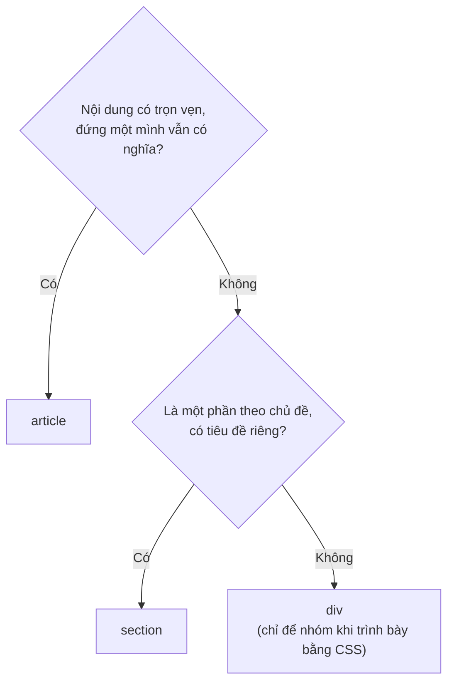

# HTML ngữ nghĩa & khả năng truy cập

::: info Mục tiêu bài học
- Hiểu **HTML ngữ nghĩa** (semantic HTML) là gì và vì sao nó quan trọng.
- Dựng bố cục trang bằng `<header>`, `<nav>`, `<main>`, `<article>`, `<section>`, `<aside>`, `<footer>`.
- Xây dựng **cấu trúc tiêu đề** hợp lý.
- Dùng các thẻ ngữ nghĩa nhỏ: `<time>`, `<address>`, `<details>`...
- Nắm các nguyên tắc **khả năng truy cập** (accessibility, viết tắt a11y) nền tảng và cách kiểm tra.
:::

## 1. Vì sao cần ngữ nghĩa?

Hai đoạn code dưới đây trông **giống hệt nhau** sau khi thêm CSS:

```html
<!-- "Div soup": toàn div -->
<div class="header">
  <div class="menu">...</div>
</div>
<div class="content">
  <div class="post">...</div>
</div>
<div class="footer">...</div>
```

```html
<!-- Ngữ nghĩa: mỗi thẻ nói rõ vai trò của nó -->
<header>
  <nav>...</nav>
</header>
<main>
  <article>...</article>
</main>
<footer>...</footer>
```

Nhưng với **máy**, chúng khác xa nhau:

- **Trình đọc màn hình** (NVDA, VoiceOver, TalkBack) dùng thẻ ngữ nghĩa để cho người khiếm thị nhảy nhanh: "tới phần điều hướng", "tới nội dung chính", "tiêu đề tiếp theo".
- **Công cụ tìm kiếm** hiểu đâu là nội dung chính, đâu là menu lặp lại.
- **Chế độ đọc** (Reader mode) của trình duyệt, ứng dụng dịch, trợ lý AI lấy đúng nội dung.
- **Lập trình viên** đọc code hiểu ngay cấu trúc, không phải đoán ý nghĩa của từng `class`.

Ở Việt Nam có hàng triệu người khuyết tật, chưa kể người lớn tuổi mắt kém, người dùng bàn phím vì chấn thương tay, người dùng điện thoại dưới nắng... Trang web dễ tiếp cận tốt cho **tất cả mọi người**.

## 2. Các thẻ bố cục

```html live
<header>
  <a href="#">🏠 Blog của Lan</a>
  <nav aria-label="Menu chính">
    <a href="#">Trang chủ</a> · <a href="#">Bài viết</a> · <a href="#">Giới thiệu</a>
  </nav>
</header>

<main>
  <article>
    <h1>Học HTML trong 7 ngày</h1>
    <p>Đăng ngày <time datetime="2026-10-27">27/10/2026</time></p>
    <section>
      <h2>Ngày 1: Cấu trúc trang</h2>
      <p>...</p>
    </section>
    <section>
      <h2>Ngày 2: Liên kết và hình ảnh</h2>
      <p>...</p>
    </section>
  </article>
  <aside>
    <h2>Bài viết liên quan</h2>
    <ul><li><a href="#">CSS cho người mới</a></li></ul>
  </aside>
</main>

<footer>
  <p>© 2026 Lan · <a href="mailto:lan@example.com">Liên hệ</a></p>
</footer>

<style>
  body { font-family: system-ui, sans-serif; }
  header, nav, main, article, section, aside, footer {
    display: block; margin: 6px 0; padding: 6px 10px 6px; border: 2px dashed;
    position: relative;
  }
  header::before, nav::before, main::before, article::before, section::before, aside::before, footer::before {
    font: 700 11px monospace; color: #fff; padding: 1px 6px; border-radius: 4px; position: absolute; top: -9px; right: 8px;
  }
  header { border-color: #ea580c; } header::before { content: 'header'; background: #ea580c; }
  nav { border-color: #2563eb; } nav::before { content: 'nav'; background: #2563eb; }
  main { border-color: #16a34a; } main::before { content: 'main'; background: #16a34a; }
  article { border-color: #7c3aed; } article::before { content: 'article'; background: #7c3aed; }
  section { border-color: #db2777; } section::before { content: 'section'; background: #db2777; }
  aside { border-color: #0891b2; } aside::before { content: 'aside'; background: #0891b2; }
  footer { border-color: #57534e; } footer::before { content: 'footer'; background: #57534e; }
</style>
```

| Thẻ | Dùng cho |
| --- | --- |
| `<header>` | Phần đầu của trang (logo, menu, ô tìm kiếm) hoặc phần đầu của một `<article>` (tiêu đề, tác giả) |
| `<nav>` | Nhóm liên kết **điều hướng chính**: menu, mục lục, phân trang. Không cần bọc mọi nhóm liên kết |
| `<main>` | Nội dung **chính, duy nhất** của trang. Mỗi trang một `<main>` |
| `<article>` | Nội dung **trọn vẹn, độc lập**: bài viết, bình luận, thẻ sản phẩm, bài đăng mạng xã hội |
| `<section>` | Một **phần theo chủ đề** của nội dung lớn hơn, thường có tiêu đề riêng |
| `<aside>` | Nội dung **bên lề**, liên quan gián tiếp: bài liên quan, quảng cáo, chú thích |
| `<footer>` | Phần cuối của trang (bản quyền, liên hệ) hoặc của một `<article>` |

Khi một trang có nhiều `<nav>` (menu chính và mục lục chẳng hạn), đặt `aria-label` để phân biệt: `<nav aria-label="Mục lục">`.

## 3. `<article>`, `<section>` hay `<div>`?



`<div>` và `<span>` **không sai**: chúng là lựa chọn đúng khi bạn chỉ cần một cái hộp để CSS bám vào, không mang ý nghĩa gì. Chỉ đừng dùng chúng khi đã có thẻ phù hợp hơn.

## 4. Cấu trúc tiêu đề

Tiêu đề tạo dàn ý cho trang. Trình đọc màn hình có thể liệt kê tất cả tiêu đề, giống một mục lục:

```text
h1  Học HTML trong 7 ngày
  h2  Ngày 1: Cấu trúc trang
    h3  Khung chuẩn
    h3  Lồng thẻ
  h2  Ngày 2: Liên kết và hình ảnh
h2  Bài viết liên quan          ← trong <aside>
```

- Một `<h1>` cho chủ đề chính của trang.
- Không nhảy cấp (`<h2>` rồi tới `<h4>`).
- Đừng dùng thẻ tiêu đề cho chữ chỉ cần **to** (khẩu hiệu, số liệu nổi bật); dùng `<p>` kèm CSS.

## 5. Thẻ ngữ nghĩa nhỏ

```html live
<article>
  <h2>Hội thảo "Web hiện đại 2026"</h2>
  <p>Thời gian: <time datetime="2026-11-15T08:30">8 giờ 30, ngày 15/11/2026</time></p>
  <address>
    Liên hệ ban tổ chức: <a href="mailto:btc@example.com">btc@example.com</a>
  </address>
  <p>Giá vé sớm <del>500.000 ₫</del> <ins>350.000 ₫</ins></p>
  <details>
    <summary>Chương trình chi tiết</summary>
    <ol>
      <li>8:30 — Khai mạc</li>
      <li>9:00 — CSS năm 2026</li>
      <li>10:30 — JavaScript và hiệu năng</li>
    </ol>
  </details>
</article>
```

- `<time datetime="...">`: thời gian dạng máy đọc được (chuẩn ISO `2026-11-15T08:30`), hiển thị thì tùy bạn.
- `<address>`: thông tin **liên hệ** của tác giả hoặc chủ trang. Đây không phải nơi ghi mọi địa chỉ bưu điện.
- `<del>` / `<ins>`: nội dung bị xóa / thêm vào (giá cũ, giá mới).
- `<details>` + `<summary>`: khối **ẩn/hiện** không cần một dòng JavaScript nào, dùng được bằng bàn phím. Hợp cho câu hỏi thường gặp, "xem thêm". Bạn đang thấy nó trong các khối "Xem lời giải" của khóa học này.

## 6. Khả năng truy cập: những nguyên tắc nền tảng

**Dùng đúng phần tử tương tác.** `<button>` cho hành động, `<a href>` cho điều hướng. Chúng có sẵn focus bằng phím `Tab`, kích hoạt bằng `Enter`/`Space`, và có vai trò rõ ràng với trình đọc màn hình.

```html live
<button type="button" onclick="alert('Đã thêm vào giỏ!')">Thêm vào giỏ (button)</button>
<div onclick="alert('Đã thêm vào giỏ!')" style="display:inline-block; padding: 2px 8px; background:#e4e4e7; cursor:pointer">
  Thêm vào giỏ (div)
</div>
<p>Thử bấm phím <kbd>Tab</kbd> trong khung này: chỉ nút <code>&lt;button&gt;</code> nhận được focus.</p>
```

**Các nguyên tắc khác:**

1. `<html lang="vi">` để trình đọc màn hình đọc đúng giọng.
2. Mọi ảnh có `alt` phù hợp ([bài 3](/html/van-ban-lien-ket-hinh-anh#_7-hinh-anh-voi-img)); mọi ô nhập có `<label>` ([bài 5](/html/form)).
3. **Dùng được bằng bàn phím**: thử dùng trang chỉ bằng `Tab`, `Shift` + `Tab`, `Enter`, `Space`, phím mũi tên. Phải luôn **thấy được** mình đang ở đâu (viền focus). Đừng xóa viền focus bằng CSS mà không thay bằng kiểu khác.
4. **Không chỉ dùng màu** để truyền đạt thông tin ("các ô màu đỏ là bắt buộc"): thêm chữ hoặc biểu tượng.
5. **Đủ tương phản** giữa chữ và nền: tối thiểu 4,5:1 với chữ thường (chuẩn WCAG). DevTools hiển thị tỉ lệ này khi bạn chọn màu chữ.
6. Liên kết và nút có **chữ rõ nghĩa**: "Tải bảng giá (PDF, 2 MB)" thay vì "Bấm vào đây".

## 7. ARIA — dùng khi HTML không đủ

**ARIA** (Accessible Rich Internet Applications) là bộ thuộc tính `role`, `aria-*` bổ sung thông tin cho công nghệ hỗ trợ khi HTML không có sẵn phần tử phù hợp (ví dụ một tab panel tự làm bằng JavaScript).

```html
<!-- Nút chỉ có icon: thêm tên cho trình đọc màn hình -->
<button type="button" aria-label="Đóng hộp thoại">✕</button>

<!-- Trạng thái đóng/mở của menu -->
<button type="button" aria-expanded="false" aria-controls="menu">Menu</button>
<ul id="menu" hidden>...</ul>
```

::: warning Quy tắc số 1 của ARIA
**Không dùng ARIA nếu đã có phần tử HTML phù hợp.** `<div role="button">` vẫn không nhận focus và không bấm được bằng bàn phím: ARIA chỉ đổi cái "nghe thấy", không thêm hành vi. Dùng ARIA sai còn tệ hơn không dùng. Bài [Bảo mật & accessibility chuyên sâu](/nang-cao/bao-mat-a11y) sẽ đi sâu hơn.
:::

## 8. Kiểm tra khả năng truy cập

- **Bàn phím**: rút chuột ra và thử dùng trang.
- **DevTools → Lighthouse → Accessibility**: chấm điểm và liệt kê lỗi (thiếu alt, thiếu label, tương phản thấp...).
- **DevTools → Elements → Accessibility**: xem **cây truy cập** (accessibility tree), tức trang "trong mắt" trình đọc màn hình: vai trò, tên, trạng thái của từng phần tử.
- **Trình đọc màn hình thật**: NVDA (miễn phí, Windows), VoiceOver (có sẵn trên macOS/iPhone), TalkBack (Android).

Công cụ tự động chỉ bắt được khoảng một phần ba các lỗi. Thử bằng bàn phím và trình đọc màn hình vẫn là cách chắc chắn nhất.

## Thực hành

**Bài 1.** Trong [Code Playground](/thuc-hanh/playground), làm bài tập **Bố cục ngữ nghĩa**: chuyển trang blog "toàn div" thành thẻ ngữ nghĩa và để trình chấm kiểm tra.

::: details Xem gợi ý
Mỗi `<div>` trong bài đều có `class` gợi ý vai trò: `header` → `<header>`, `menu` → `<nav>`, `content` → `<main>`, `post` → `<article>`, `title` → `<h1>`, `footer` → `<footer>`. Bấm **Xem lời giải** trong Playground nếu bí.
:::

**Bài 2.** Trang chi tiết sản phẩm của một cửa hàng gồm: logo và menu; ảnh, tên, giá, nút mua; phần "Mô tả" và phần "Đánh giá", mỗi đánh giá có tên người viết và ngày; khối "Sản phẩm tương tự" bên phải; chân trang. Hãy phác thảo cấu trúc thẻ (chưa cần nội dung chi tiết).

::: details Xem lời giải
```html
<header>
  <a href="/">Logo cửa hàng</a>
  <nav aria-label="Menu chính">...</nav>
</header>
<main>
  <article>
    <h1>Áo thun cotton trắng</h1>
    
    <p>199.000 ₫</p>
    <button type="button">Thêm vào giỏ</button>

    <section>
      <h2>Mô tả</h2>
      <p>...</p>
    </section>
    <section>
      <h2>Đánh giá</h2>
      <article>
        <h3>Vải mát, đúng size</h3>
        <p>Chị Mai · <time datetime="2026-10-20">20/10/2026</time></p>
        <p>...</p>
      </article>
    </section>
  </article>
  <aside>
    <h2>Sản phẩm tương tự</h2>
    ...
  </aside>
</main>
<footer>...</footer>
```
Mỗi đánh giá đứng độc lập vẫn có nghĩa, nên là một `<article>` lồng trong `<section>` "Đánh giá".
:::

**Bài 3.** Mở một website bạn hay dùng, chạy **Lighthouse → Accessibility**. Ghi lại 3 lỗi được báo và cách sửa từng lỗi.

::: details Xem gợi ý
Lỗi hay gặp: *Image elements do not have [alt] attributes*, *Form elements do not have associated labels*, *Background and foreground colors do not have a sufficient contrast ratio*, *Links do not have a discernible name* (liên kết chỉ có icon). Bấm vào từng lỗi, Lighthouse chỉ ra phần tử cụ thể và có link hướng dẫn cách sửa.
:::

## Lỗi thường gặp

- **Div soup**: mọi thứ là `<div>` → trình đọc màn hình không có mốc nào để điều hướng.
- **Nhiều `<main>`** hoặc đặt header/footer chung vào trong `<main>`.
- **Dùng `<section>` thay cho `<div>`** chỉ để "trông ngữ nghĩa", dù khối đó không có tiêu đề hay chủ đề riêng.
- **`<div>`/`<span>` có `onclick`** thay cho `<button>`.
- **Xóa viền focus** (`outline: none`) mà không có kiểu thay thế → người dùng bàn phím bị "lạc".
- **Rải ARIA khắp nơi**, ví dụ `role="button"` trên `<button>` (thừa) hoặc trên `<div>` (thiếu hành vi).

## Tóm tắt

- HTML ngữ nghĩa = chọn thẻ theo **ý nghĩa**. Lợi cho trình đọc màn hình, SEO, người bảo trì code.
- Bố cục: `<header>`, `<nav>`, `<main>` (một), `<article>` (độc lập), `<section>` (phần có chủ đề), `<aside>` (bên lề), `<footer>`.
- `<div>`/`<span>` chỉ dùng để nhóm khi trình bày, khi không có thẻ phù hợp hơn.
- Một `<h1>`, không nhảy cấp tiêu đề.
- `<button>` cho hành động, `<a href>` cho điều hướng; trang phải dùng được bằng bàn phím.
- ARIA chỉ bổ sung khi HTML không đủ; kiểm tra bằng bàn phím, Lighthouse và trình đọc màn hình.

## Kiểm tra kiến thức

<Quiz />
