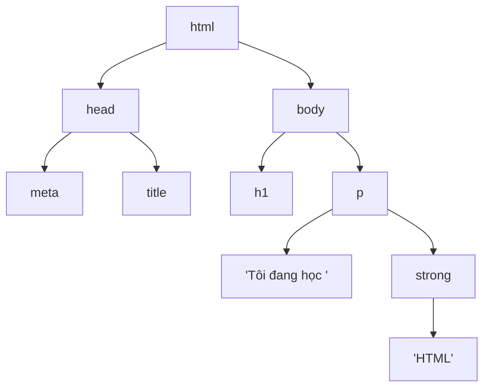

# Trang HTML đầu tiên

::: info Mục tiêu bài học
- Hiểu **element**, **thẻ** (tag) và **thuộc tính** (attribute).
- Viết được khung chuẩn của một tài liệu HTML và biết từng dòng dùng để làm gì.
- Lồng thẻ đúng cách, phân biệt phần tử **khối** (block) và **nội tuyến** (inline).
- Biết cách trình duyệt xử lý khoảng trắng, viết chú thích và kiểm tra lỗi HTML.
- Viết HTML nhanh hơn với **Emmet** trong VS Code.
:::

## 1. Element, thẻ và thuộc tính

HTML (HyperText Markup Language) dùng **thẻ** để "đánh dấu" từng phần nội dung, cho trình duyệt biết đâu là tiêu đề, đâu là đoạn văn, đâu là liên kết.

```text
<p class="ghi-chu">Học HTML thật vui!</p>
└───────┬─────────┘└────────┬───────┘└┬─┘
     thẻ mở             nội dung   thẻ đóng
└────────────── element (phần tử) ──────┘
```

- **Element** (phần tử) = thẻ mở + nội dung + thẻ đóng. Ở đây `class="ghi-chu"` là một thuộc tính: `class` là tên, `ghi-chu` là giá trị.
- **Thẻ đóng** có dấu `/`: `</p>`.
- **Thuộc tính** nằm trong thẻ mở, dạng `ten="gia-tri"`, bổ sung thông tin cho phần tử. Một phần tử có thể có nhiều thuộc tính, cách nhau bằng dấu cách.
- Tên thẻ không phân biệt hoa thường, nhưng quy ước chung là **viết thường**.

Một số phần tử không có nội dung nên **không có thẻ đóng**. Chúng được gọi là phần tử rỗng (*void element*), ví dụ `<br>` (xuống dòng), `` (ảnh), `<input>` (ô nhập):

```html

<input type="email" placeholder="Email của bạn">
```

Có những thuộc tính **boolean** chỉ cần ghi tên: có mặt là bật, vắng mặt là tắt.

```html
<input type="checkbox" checked>   <!-- ô đã được tích -->
<button disabled>Gửi</button>     <!-- nút bị vô hiệu -->
```

## 2. Khung chuẩn của một trang HTML

Mọi trang HTML đều bắt đầu bằng cùng một khung:

```html live
<!DOCTYPE html>
<html lang="vi">
<head>
  <meta charset="UTF-8">
  <meta name="viewport" content="width=device-width, initial-scale=1.0">
  <title>Trang đầu tiên của tôi</title>
</head>
<body>
  <h1>Xin chào, thế giới!</h1>
  <p>Đây là trang web đầu tiên của tôi.</p>
</body>
</html>
```

| Dòng | Ý nghĩa |
| --- | --- |
| `<!DOCTYPE html>` | Báo trình duyệt dùng chuẩn HTML hiện đại. Thiếu dòng này, trang rơi vào *quirks mode* và CSS chạy khác thường |
| `<html lang="vi">` | Phần tử gốc bao toàn bộ trang. `lang="vi"` cho trình đọc màn hình đọc đúng giọng tiếng Việt, giúp dịch tự động và tìm kiếm |
| `<head>` | Thông tin **về** trang, phần lớn không hiển thị |
| `<meta charset="UTF-8">` | Bảng mã UTF-8, chứa được mọi ký tự, kể cả tiếng Việt và emoji. Nên đặt đầu tiên trong `<head>` |
| `<meta name="viewport" ...>` | Hiển thị đúng trên điện thoại thay vì thu nhỏ cả trang (học kỹ ở bài [Responsive](/css/responsive)) |
| `<title>` | Tiêu đề hiện trên tab trình duyệt, trong kết quả tìm kiếm và khi lưu bookmark |
| `<body>` | Mọi thứ người dùng **nhìn thấy** |

::: tip Thử ngay
Bấm **✎ Sửa trong Playground** ở khung trên, đổi nội dung `<h1>` rồi xem kết quả thay đổi. Thử xóa dòng `<meta charset="UTF-8">` xem sao: trong Playground chữ vẫn đúng vì nội dung được nạp sẵn dưới dạng Unicode. Nhưng với tệp thật trên máy, thiếu khai báo bảng mã có thể làm chữ có dấu bị lỗi kiểu "Xin chà o".
:::

## 3. Lồng thẻ và cây phần tử

Phần tử có thể chứa phần tử khác. Quy tắc: **mở sau thì đóng trước**, giống các hộp lồng vào nhau.

```html
<!-- ✅ Đúng -->
<p>Tôi đang học <strong>HTML</strong>.</p>

<!-- ❌ Sai: strong mở trong p nhưng lại đóng sau p -->
<p>Tôi đang học <strong>HTML.</p></strong>
```

Nhờ lồng nhau, trang HTML là một **cây** (tree). Phần tử bao ngoài là **cha** (parent), phần tử bên trong là **con** (child), các phần tử cùng cha là **anh em** (sibling):



Cây này chính là **DOM** mà JavaScript sẽ đọc và thay đổi ở [Phần 3](/javascript/dom). Thụt lề code theo đúng cấp lồng nhau giúp bạn nhìn ra cây này ngay khi đọc code.

## 4. Phần tử khối và phần tử nội tuyến

Theo cách hiển thị mặc định, phần lớn phần tử thuộc một trong hai nhóm:

- **Khối** (block): chiếm trọn chiều ngang và bắt đầu trên dòng mới. Ví dụ `<h1>`–`<h6>`, `<p>`, `<div>`, `<ul>`, `<section>`.
- **Nội tuyến** (inline): nằm trong dòng chữ, chỉ rộng vừa nội dung. Ví dụ `<a>`, `<strong>`, `<em>`, `<span>`, ``.

```html live
<div style="background: #fde68a">div là khối</div>
<p style="background: #bfdbfe">p cũng là khối — chiếm hết chiều ngang</p>
<span style="background: #bbf7d0">span là nội tuyến</span>
<a href="#" style="background: #fecaca">a cũng vậy</a>
<strong style="background: #ddd6fe">nằm cùng một dòng</strong>
```

`<div>` (khối) và `<span>` (nội tuyến) là hai phần tử **không mang ý nghĩa gì**, chỉ dùng để nhóm nội dung khi cần trình bày bằng CSS. Bài [HTML ngữ nghĩa](/html/html-ngu-nghia) sẽ chỉ ra khi nào nên dùng thẻ có ý nghĩa rõ ràng hơn. CSS có thể đổi cách hiển thị của bất kỳ phần tử nào (thuộc tính `display`, ở bài [Box model](/css/box-model)).

## 5. Khoảng trắng và chú thích

Trình duyệt **gộp mọi khoảng trắng liên tiếp** (dấu cách, tab, xuống dòng) thành **một** dấu cách:

```html live
<p>Dòng này     có rất nhiều
   dấu cách     và
   xuống dòng.</p>
<p>Muốn xuống dòng<br>thì dùng thẻ br.</p>
<pre>Thẻ pre   giữ nguyên
      mọi khoảng trắng.</pre>
```

Nhờ quy tắc này, bạn thoải mái xuống dòng và thụt lề cho code dễ đọc mà không ảnh hưởng tới trang.

**Chú thích** (comment) đặt trong `<!-- ... -->`. Trình duyệt bỏ qua, nhưng ai xem mã nguồn (`Ctrl` + `U`) cũng đọc được, nên đừng ghi mật khẩu hay thông tin nhạy cảm vào đó.

```html
<!-- Phần đầu trang: logo và menu -->
<header>...</header>
```

## 6. Trình duyệt "tha lỗi", nhưng đừng dựa vào điều đó

HTML được thiết kế để **không bao giờ dừng vì lỗi**: quên thẻ đóng hay lồng sai, trình duyệt vẫn đoán và hiển thị. Nhưng mỗi trình duyệt có thể đoán theo cách riêng, và lỗi kiểu này thường gây ra những vấn đề CSS hay JavaScript rất khó hiểu về sau.

```html live
<p>Đoạn một
<p>Đoạn hai, quên đóng thẻ p nhưng trình duyệt tự đóng giúp.
<p>Đoạn ba có <strong>chữ đậm bị quên đóng
<p>Và lỗi "lan" sang cả đoạn này.
```

Hãy kiểm tra HTML bằng **W3C Validator** ([validator.w3.org](https://validator.w3.org/#validate_by_input)): dán code vào, nó liệt kê từng lỗi kèm số dòng. Trong DevTools, tab **Elements** cho thấy cây DOM mà trình duyệt đã "sửa" từ code của bạn.

## 7. Viết HTML nhanh với Emmet

VS Code có sẵn **Emmet**: gõ chữ viết tắt rồi nhấn `Tab` hoặc `Enter`.

| Gõ | Kết quả |
| --- | --- |
| `!` | Toàn bộ khung trang HTML chuẩn |
| `p` | `<p></p>` |
| `.the` | `<div class="the"></div>` |
| `#menu` | `<div id="menu"></div>` |
| `ul>li*3` | `<ul>` chứa 3 `<li>` |
| `a[href=#]{Trang chủ}` | `<a href="#">Trang chủ</a>` |
| `section>h2+p` | `<section>` chứa `<h2>` rồi tới `<p>` |

Thêm hai phím tắt hữu ích: `Alt` + `Shift` + `F` để định dạng lại tệp, `Ctrl` + `/` để biến dòng thành chú thích.

## Thực hành

**Bài 1.** Tạo tệp `gioi-thieu.html` có khung chuẩn, tiêu đề tab là tên bạn, một `<h1>` và hai đoạn văn giới thiệu bản thân. Trong đoạn thứ hai có một từ in đậm bằng `<strong>`.

::: details Xem lời giải
```html live
<!DOCTYPE html>
<html lang="vi">
<head>
  <meta charset="UTF-8">
  <meta name="viewport" content="width=device-width, initial-scale=1.0">
  <title>Nguyễn Thị Lan</title>
</head>
<body>
  <h1>Xin chào, mình là Lan</h1>
  <p>Mình 20 tuổi, đang học năm hai ngành kế toán.</p>
  <p>Mục tiêu năm nay của mình là tự làm được <strong>trang web cá nhân</strong>.</p>
</body>
</html>
```
:::

**Bài 2.** Đoạn HTML sau có 4 lỗi. Tìm và sửa.

```html
<!DOCTYPE html>
<html lang="vi">
<head>
  <title>Cửa hàng<title>
</head>
<body>
  <h1>Chào mừng</h2>
  <p>Giảm giá <strong>50%</p></strong>
  </img>
</body>
```

::: details Xem lời giải
1. `<title>` thứ hai phải là thẻ đóng `</title>`.
2. `<h1>` lại đóng bằng `</h2>`: sửa thành `</h1>`.
3. Lồng sai: `<strong>` phải đóng trước `</p>`, tức `<p>Giảm giá <strong>50%</strong></p>`.
4. `` là phần tử rỗng, không có `</img>`. Ngoài ra nên thêm `<meta charset="UTF-8">` vào `<head>` và đóng `</html>` ở cuối. Hãy dán vào W3C Validator để tự kiểm tra.
:::

**Bài 3.** Trong VS Code, tạo tệp mới, dùng Emmet gõ `!` để có khung trang, rồi gõ `ul>li*5` để có danh sách 5 mục. Ghi tên 5 món ăn bạn thích vào các mục.

::: details Xem gợi ý
Nếu Emmet không bung ra: kiểm tra góc dưới bên phải VS Code, chế độ ngôn ngữ phải là **HTML** (tệp phải có đuôi `.html`). Gõ xong viết tắt, nhấn `Tab` ngay, đừng gõ thêm dấu cách.
:::

## Lỗi thường gặp

- **Quên `<!DOCTYPE html>`** → trang chạy ở quirks mode, CSS (đặc biệt là chiều cao và box model) cư xử lạ.
- **Quên `<meta charset="UTF-8">`** hoặc lưu tệp bằng bảng mã khác UTF-8 → tiếng Việt thành ký tự lạ. VS Code mặc định lưu UTF-8, xem ở thanh trạng thái phía dưới.
- **Lồng thẻ sai** hoặc **quên thẻ đóng** → trình duyệt tự "sửa" theo cách bạn không ngờ tới.
- **Đặt nội dung hiển thị vào `<head>`** → trình duyệt dời nó sang `<body>` hoặc bỏ qua.

## Tóm tắt

- Element = thẻ mở + nội dung + thẻ đóng. Thuộc tính bổ sung thông tin, dạng `ten="gia-tri"`.
- Khung chuẩn: `<!DOCTYPE html>`, `<html lang="vi">`, `<head>` (charset, viewport, title) và `<body>`.
- Mở sau đóng trước; trang HTML là một cây phần tử (DOM).
- Phần tử khối bắt đầu dòng mới và chiếm hết chiều ngang; phần tử nội tuyến nằm trong dòng chữ.
- Khoảng trắng liên tiếp được gộp thành một. Chú thích viết trong `<!-- -->`.
- Kiểm tra lỗi bằng W3C Validator; viết nhanh bằng Emmet.

## Kiểm tra kiến thức

<Quiz />
