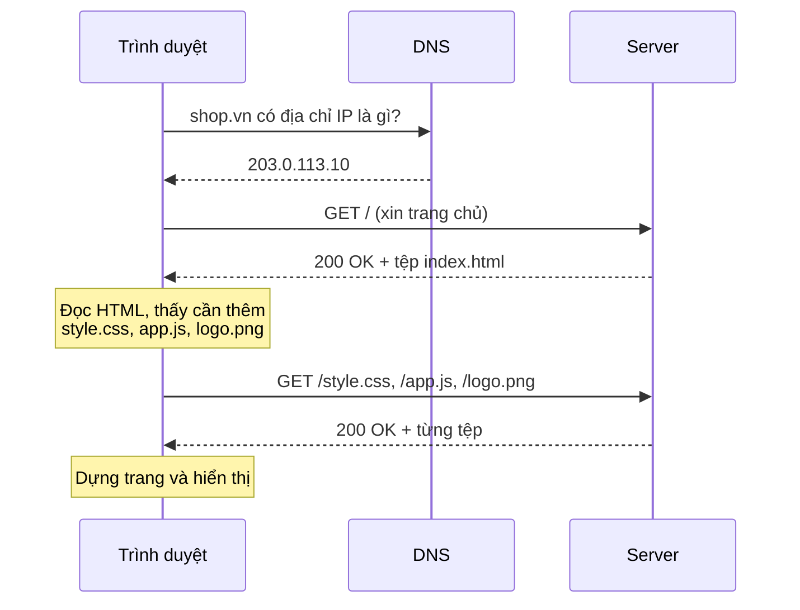
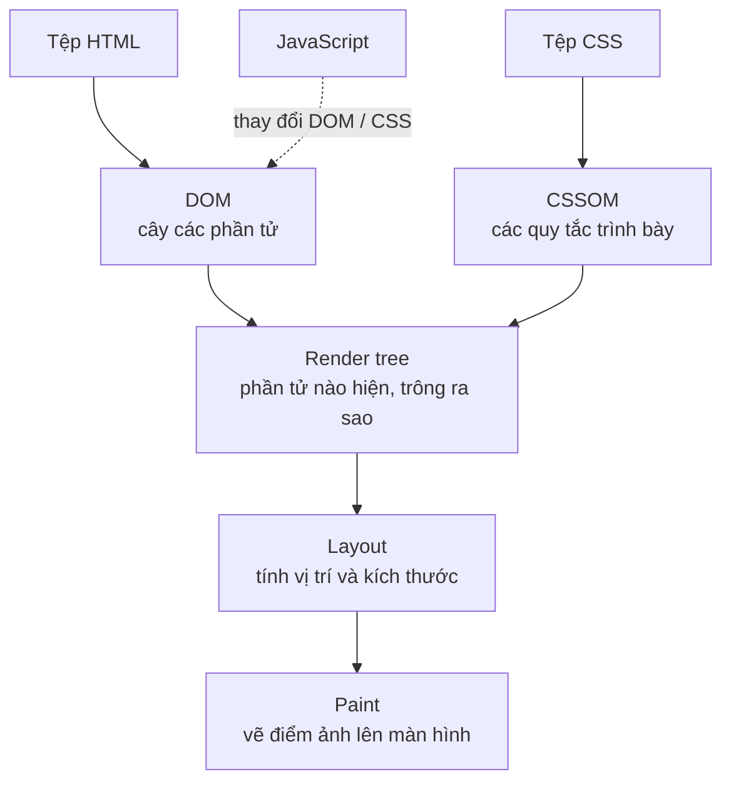

# Web hoạt động thế nào?

::: info Mục tiêu bài học
- Hiểu chuyện gì xảy ra từ lúc gõ địa chỉ web đến lúc trang hiện lên.
- Đọc được các phần của một **URL** và ý nghĩa của **HTTP request/response**, mã trạng thái.
- Phân biệt vai trò của **HTML**, **CSS** và **JavaScript**.
- Dùng **DevTools** của trình duyệt để xem "hậu trường" một trang web.
- Cài đặt **VS Code** và tạo trang web đầu tiên trên máy.
:::

## 1. Internet và Web không phải là một

**Internet** là mạng lưới toàn cầu nối các máy tính lại với nhau. **Web** (World Wide Web) là *một dịch vụ* chạy trên Internet, gồm hàng tỷ **trang web** liên kết với nhau. Email, game online hay ứng dụng chat cũng dùng Internet nhưng không phải là Web.

Trên Web có hai vai chính:

- **Client** (máy khách): thường là **trình duyệt** (Chrome, Edge, Firefox, Safari) trên máy bạn. Nó *gửi yêu cầu* và *hiển thị* kết quả.
- **Server** (máy chủ): máy tính luôn bật ở đâu đó, giữ các tệp của trang web và *trả lời* yêu cầu.

## 2. Từ lúc gõ địa chỉ đến lúc trang hiện ra



1. **Tra DNS**: máy tính chỉ liên lạc bằng địa chỉ IP (kiểu `203.0.113.10`). DNS giống danh bạ điện thoại, đổi tên miền `shop.vn` thành IP.
2. **Gửi HTTP request** tới server: "cho tôi trang `/`".
3. **Server trả HTTP response**: mã trạng thái và nội dung, đầu tiên là tệp **HTML**.
4. Trình duyệt đọc HTML, phát hiện trang cần thêm CSS, JavaScript, ảnh, font... và **gửi tiếp request** cho từng tệp.
5. Có đủ thứ cần thiết, trình duyệt **dựng và vẽ trang** lên màn hình.

Một trang web bình thường tải vài chục tệp như vậy. Đó là lý do trang nặng tải chậm, và là chủ đề của bài [Hiệu năng web](/nang-cao/hieu-nang).

## 3. URL — địa chỉ của một tài nguyên

```text
https://shop.vn:443/san-pham/ao-thun?mau=do&size=M#danh-gia
└─┬─┘   └──┬──┘└┬┘└──────┬───────┘└──────┬───────┘└───┬───┘
scheme    host port     path           query       fragment
```

| Phần | Ví dụ | Ý nghĩa |
| --- | --- | --- |
| scheme | `https` | Giao thức. `https` là HTTP có mã hóa, nên luôn dùng |
| host | `shop.vn` | Tên miền (hoặc IP) của server |
| port | `443` | Cổng kết nối, thường bị ẩn vì mặc định (`443` cho https, `80` cho http) |
| path | `/san-pham/ao-thun` | Đường dẫn tới tài nguyên trên server |
| query | `?mau=do&size=M` | Tham số gửi kèm, dạng `ten=gia-tri`, nối nhau bằng `&` |
| fragment | `#danh-gia` | Vị trí trong trang. **Không** được gửi lên server |

## 4. HTTP — cuộc hội thoại giữa trình duyệt và server

Mỗi lần trao đổi gồm một **request** (yêu cầu) và một **response** (phản hồi):

```text
GET /san-pham/ao-thun?mau=do HTTP/1.1      ← phương thức + đường dẫn
Host: shop.vn                              ← header: thông tin kèm theo
Accept: text/html

HTTP/1.1 200 OK                            ← mã trạng thái
Content-Type: text/html; charset=utf-8

<!DOCTYPE html><html>...                   ← nội dung (body)
```

- **Phương thức** thường gặp: `GET` (lấy dữ liệu), `POST` (gửi dữ liệu, ví dụ form đăng ký), `PUT`/`PATCH` (cập nhật), `DELETE` (xóa).
- **Mã trạng thái**: `2xx` thành công (`200 OK`), `3xx` chuyển hướng (`301` chuyển hẳn, `304` dùng bản đã lưu), `4xx` lỗi phía yêu cầu (`404 Not Found`, `403 Forbidden`), `5xx` lỗi phía server (`500`).
- **HTTPS** = HTTP + mã hóa TLS. Người ở giữa (wifi quán cà phê chẳng hạn) không đọc hay sửa được dữ liệu. Ngày nay trang nào cũng nên dùng HTTPS, và nhiều tính năng của trình duyệt chỉ chạy trên HTTPS.

Bạn sẽ tự gửi request bằng JavaScript ở bài [Gọi API với fetch](/nang-cao/fetch-api).

## 5. Ba ngôn ngữ của trình duyệt

Hãy hình dung trang web như một ngôi nhà:

| Ngôn ngữ | Vai trò | Ví von |
| --- | --- | --- |
| **HTML** | Nội dung và cấu trúc: tiêu đề, đoạn văn, ảnh, nút, form | Khung nhà, tường, cửa |
| **CSS** | Trình bày: màu sắc, font chữ, khoảng cách, bố cục | Sơn, nội thất |
| **JavaScript** | Hành vi: phản hồi khi bấm, tải dữ liệu, kiểm tra form | Hệ thống điện, nước |

Ví dụ dưới đây có đủ cả ba. Hãy bấm nút trong khung **Kết quả**:

```html live
<h1>Quán cà phê Phố Cổ</h1>
<p>Mở cửa từ 7:00 đến 22:00.</p>
<button id="nut">Xem món hôm nay</button>
<p id="mon"></p>

<style>
  body { font-family: system-ui, sans-serif; }
  h1 { color: #9a3412; }
  button { padding: 8px 16px; border-radius: 8px; border: 0; background: #c2410c; color: white; }
</style>

<script>
  document.querySelector('#nut').addEventListener('click', () => {
    document.querySelector('#mon').textContent = '☕ Cà phê trứng giảm 20%!';
  });
</script>
```

- Bỏ khối `<style>` thì trang vẫn đủ nội dung, chỉ kém đẹp.
- Bỏ khối `<script>` thì nút vẫn hiện nhưng bấm không có tác dụng.
- Bỏ HTML thì chẳng còn gì để trình bày hay tương tác.

Đó là lý do khóa học đi theo thứ tự **HTML → CSS → JavaScript**.

::: tip HTML không phải ngôn ngữ lập trình
HTML là **ngôn ngữ đánh dấu** (markup language): nó *mô tả* nội dung chứ không có biến, điều kiện hay vòng lặp. CSS là ngôn ngữ định kiểu (style sheet). JavaScript mới là ngôn ngữ lập trình thật sự.
:::

## 6. Trình duyệt dựng trang thế nào?



Trình duyệt đọc HTML thành một cây gọi là **DOM** (Document Object Model), đọc CSS thành **CSSOM**, ghép lại để biết phần tử nào hiện và trông ra sao, tính vị trí (layout) rồi vẽ (paint). JavaScript có thể thay đổi DOM bất cứ lúc nào, khi đó trình duyệt tính và vẽ lại phần bị ảnh hưởng. Bạn sẽ gặp lại sơ đồ này ở bài [DOM](/javascript/dom) và [Hiệu năng web](/nang-cao/hieu-nang).

## 7. Xem "hậu trường" với DevTools

Mọi trình duyệt hiện đại đều có bộ công cụ cho lập trình viên (**DevTools**). Mở bằng phím `F12`, hoặc `Ctrl` + `Shift` + `I` (macOS: `Cmd` + `Option` + `I`), hoặc chuột phải vào trang → **Kiểm tra** (Inspect).

| Tab | Dùng để |
| --- | --- |
| **Elements** | Xem cây HTML và CSS của từng phần tử. Sửa thử trực tiếp, tải lại trang là mất |
| **Console** | Xem lỗi JavaScript, chạy thử lệnh JavaScript |
| **Network** | Xem các request: địa chỉ, mã trạng thái, kích thước, thời gian |
| **Sources** | Xem mã nguồn, đặt điểm dừng (breakpoint) để debug |
| **Lighthouse** | Chấm điểm hiệu năng, khả năng truy cập, SEO |

Ngoài ra, `Ctrl` + `U` mở **mã nguồn gốc** (view-source) mà server gửi về. Nó có thể khác với tab Elements, vì Elements hiện DOM *hiện tại*, sau khi JavaScript đã thay đổi trang.

## 8. Chuẩn bị công cụ {#chuan-bi-cong-cu}

1. **Trình duyệt**: Chrome, Edge hoặc Firefox bản mới.
2. **Visual Studio Code** (miễn phí, tải tại [code.visualstudio.com](https://code.visualstudio.com)). Khi cài trên Windows, nên tích **Add "Open with Code" action** để chuột phải vào thư mục là mở được bằng VS Code.
3. Tiện ích (Extensions, phím tắt `Ctrl` + `Shift` + `X`) nên cài:
   - **Live Preview** (của Microsoft) hoặc **Live Server**: mở trang và tự tải lại mỗi khi bạn lưu tệp.
   - **Prettier – Code formatter**: tự căn lề code cho gọn.
   - Gói tiếng Việt (*Vietnamese Language Pack*) nếu bạn muốn giao diện tiếng Việt.
4. Tạo thư mục học tập, ví dụ `hoc-web`, rồi mở bằng VS Code (**File → Open Folder**).
5. Tạo tệp `index.html`, gõ vài chữ, lưu (`Ctrl` + `S`) rồi mở bằng trình duyệt (nhấp đúp vào tệp, hoặc chuột phải → **Show Preview** với Live Preview).

```text
hoc-web/
├── index.html      ← trang chủ, tên này được server mở mặc định
├── about.html
├── css/
│   └── style.css
├── js/
│   └── app.js
└── images/
    └── logo.png
```

::: warning Đặt tên tệp và thư mục
Dùng chữ thường, không dấu, không khoảng trắng, nối bằng gạch ngang: `gioi-thieu.html`, `anh-dai-dien.jpg`. Tên kiểu `Giới Thiệu.html` có thể chạy trên máy bạn nhưng dễ lỗi khi đưa lên server (Linux phân biệt chữ hoa, chữ thường; dấu cách thành `%20` trong URL).
:::

## Thực hành

**Bài 1.** Mở một trang báo bất kỳ, bật DevTools → tab **Network**, rồi tải lại trang (`F5`). Trả lời: trang tải bao nhiêu request? Request đầu tiên là loại gì và có mã trạng thái gì? Tệp nào nặng nhất?

::: details Xem gợi ý
- Số request và tổng dung lượng hiện ở thanh trạng thái dưới cùng của tab Network (ví dụ *120 requests, 3.2 MB transferred*).
- Request đầu tiên là tài liệu HTML (cột *Type*: `document`), mã `200`. Có thể có `301`/`302` trước đó nếu bạn gõ `http://` và server chuyển sang `https://`.
- Bấm vào tiêu đề cột *Size* để sắp xếp. Thường ảnh và JavaScript nặng nhất.
:::

**Bài 2.** Tách các phần của URL `https://hoc.vn:8080/khoa-hoc/html?trang=2&sap-xep=moi#bai-3`. Phần nào không được gửi lên server?

::: details Xem lời giải
- scheme `https`, host `hoc.vn`, port `8080`, path `/khoa-hoc/html`
- query `?trang=2&sap-xep=moi` (hai tham số `trang` = `2` và `sap-xep` = `moi`)
- fragment `#bai-3`: **không** gửi lên server, trình duyệt dùng nó để cuộn tới phần tử có `id="bai-3"`.
:::

**Bài 3.** Cài VS Code và Live Preview, tạo thư mục `hoc-web` với tệp `index.html` có một dòng chữ bất kỳ. Mở xem bằng trình duyệt, sửa chữ, lưu lại và xem trang tự cập nhật.

::: details Xem gợi ý
Nếu trang không tự cập nhật: kiểm tra đã lưu tệp chưa (tab tệp trong VS Code có dấu ● là chưa lưu), và có đang mở đúng địa chỉ do Live Preview tạo ra (dạng `http://127.0.0.1:3000/index.html`) thay vì mở trực tiếp tệp hay không. Bật **File → Auto Save** để khỏi phải nhớ `Ctrl` + `S`.
:::

## Lỗi thường gặp

- **Soạn HTML bằng Word hay Notepad rồi lưu thành `.txt`.** Word chèn định dạng riêng, còn Notepad dễ lưu thành `index.html.txt`. Hãy dùng trình soạn code và bật hiện đuôi tệp trong Windows Explorer (*View → Show → File name extensions*).
- **Tưởng thay đổi trong tab Elements được lưu lại.** DevTools chỉ sửa bản trong trình duyệt. Muốn giữ thì sửa trong tệp nguồn.
- **Nhầm `http` và `https`.** Trang `https` mà tải ảnh hay script qua `http` sẽ bị trình duyệt chặn (*mixed content*).

## Tóm tắt

- Trình duyệt (client) gửi **HTTP request**, server trả **response** gồm mã trạng thái và nội dung. DNS đổi tên miền thành IP.
- URL gồm scheme, host, port, path, query và fragment. Fragment không được gửi lên server.
- **HTML** là nội dung và cấu trúc, **CSS** là trình bày, **JavaScript** là hành vi.
- Trình duyệt dựng **DOM** từ HTML, kết hợp CSS, tính layout rồi vẽ trang.
- **DevTools** (`F12`) là công cụ bạn sẽ dùng hằng ngày: Elements, Console, Network.

## Kiểm tra kiến thức

<Quiz />
