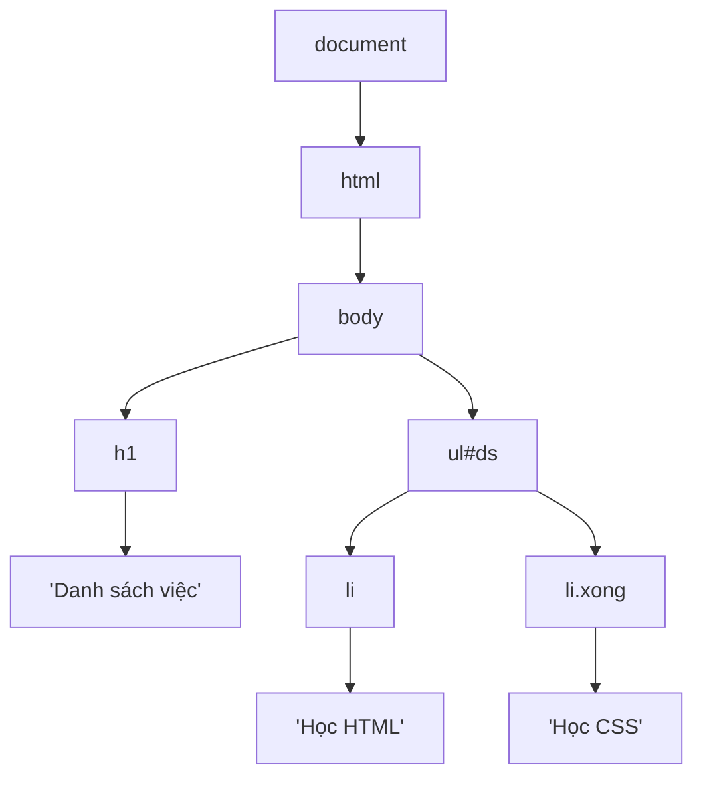

# DOM — đọc và thay đổi trang

::: info Mục tiêu bài học
- Hiểu **DOM** là gì và mối quan hệ giữa HTML, DOM và JavaScript.
- **Chọn** phần tử với `querySelector`, `querySelectorAll`.
- **Đọc và đổi** nội dung (`textContent`, `innerHTML` an toàn), thuộc tính, class, style, `data-*`.
- **Tạo, chèn, xóa** phần tử; dùng `<template>` để dựng giao diện từ dữ liệu.
- Duyệt cây DOM: cha, con, anh em, `closest()`.
:::

## 1. DOM là gì?

Khi tải trang, trình duyệt đọc HTML và dựng nên một **cây đối tượng** trong bộ nhớ, gọi là **DOM** (Document Object Model). Mỗi thẻ là một **node** (nút) trong cây; chữ bên trong thẻ cũng là node.

```html
<body>
  <h1>Danh sách việc</h1>
  <ul id="ds">
    <li>Học HTML</li>
    <li class="xong">Học CSS</li>
  </ul>
</body>
```



JavaScript **không sửa tệp HTML**. Nó sửa **DOM**, và trình duyệt vẽ lại trang theo DOM mới. Đó là lý do tab Elements của DevTools (hiện DOM) có thể khác với mã nguồn gốc (`Ctrl` + `U`).

Điểm bắt đầu là object `document`, đại diện cho cả trang.

## 2. Chọn phần tử

```html live
<h1 id="tieu-de">Thực đơn</h1>
<ul class="menu">
  <li class="mon">Cà phê</li>
  <li class="mon het">Trà đào</li>
  <li class="mon">Bánh mì</li>
</ul>

<script>
  const tieuDe = document.querySelector('#tieu-de');        // phần tử ĐẦU TIÊN khớp selector
  const monDau = document.querySelector('.menu .mon');
  const tatCaMon = document.querySelectorAll('.mon');        // TẤT CẢ → NodeList
  const monHet = document.querySelector('.mon.het');
  const khongCo = document.querySelector('.khong-ton-tai');  // null

  console.log(tieuDe);
  console.log(monDau.textContent, tatCaMon.length, monHet.textContent, khongCo);

  for (const mon of tatCaMon) {
    console.log('-', mon.textContent);
  }
</script>
```

- Dùng **cú pháp selector CSS** bạn đã biết: `#id`, `.class`, `nav a`, `input[type="email"]`, `li:first-child`...
- `querySelector` trả về **một** phần tử hoặc `null`. `querySelectorAll` trả về **NodeList** (giống mảng, duyệt được bằng `for...of`, `forEach`; muốn dùng `map`/`filter` thì chuyển bằng `[...nodeList]`).
- Có thể tìm **bên trong** một phần tử: `menu.querySelectorAll('li')`.
- Các hàm cũ `getElementById`, `getElementsByClassName` vẫn chạy, nhưng `querySelector` linh hoạt hơn và đủ dùng cho mọi trường hợp.

::: warning Luôn tính tới `null`
Gõ sai selector, hoặc script chạy trước khi HTML có phần tử đó, `querySelector` trả về `null`, và dòng tiếp theo báo `TypeError: Cannot read properties of null`. Khi gặp lỗi này, hãy kiểm tra selector và vị trí đặt `<script>` (nhớ `defer`).
:::

## 3. Đọc và đổi nội dung

```html live
<p id="loi-chao">Xin chào!</p>
<div id="hop"></div>

<script>
  const loiChao = document.querySelector('#loi-chao');
  console.log(loiChao.textContent);              // đọc chữ

  loiChao.textContent = 'Chào mừng bạn quay lại 👋';   // đổi chữ

  const hop = document.querySelector('#hop');
  hop.innerHTML = '<strong>In đậm</strong> và <em>nghiêng</em>';   // HTML được hiểu là thẻ

  const tenNguoiDung = '';
  hop.textContent = tenNguoiDung;                // ✅ an toàn: hiện nguyên văn như chữ
</script>
```

| Thuộc tính | Đọc/ghi | Ghi chú |
| --- | --- | --- |
| `textContent` | Chữ thuần | **Mặc định nên dùng**: nhanh, an toàn |
| `innerHTML` | Chuỗi HTML | Nội dung được phân tích thành thẻ. **Không bao giờ** dùng với dữ liệu người dùng nhập |
| `value` | Giá trị ô nhập | Cho `input`, `select`, `textarea` (luôn là chuỗi) |

::: danger XSS — lỗ hổng bảo mật số một của web
Gán dữ liệu không đáng tin (người dùng nhập, dữ liệu từ API, tham số trên URL) vào `innerHTML` cho phép kẻ xấu **chạy JavaScript** trên trang của bạn: đánh cắp phiên đăng nhập, giả mạo nội dung. Thử đổi dòng cuối của ví dụ trên thành `hop.innerHTML = tenNguoiDung` để thấy đoạn mã "độc" chạy. Quy tắc: **chữ thì dùng `textContent`**; cần cấu trúc thì **tạo phần tử** (mục 6). Chi tiết ở [bài Bảo mật](/nang-cao/bao-mat-a11y).
:::

## 4. Thuộc tính, class và style

```html live
<a id="lien-ket" href="https://example.com">Liên kết</a>

<p id="thong-bao" class="thong-bao">Thông báo</p>
<button id="nut" data-id="42" data-gia-goc="99000">Mua</button>

<style>
  .thong-bao { padding: 8px; border-radius: 6px; background: #f4f4f5; }
  .thong-bao.loi { background: #fee2e2; color: #b91c1c; }
  .an { display: none; }
</style>

<script>
  // Thuộc tính HTML
  const lienKet = document.querySelector('#lien-ket');
  console.log(lienKet.getAttribute('href'));
  lienKet.setAttribute('target', '_blank');
  lienKet.href = 'https://developer.mozilla.org';   // phần lớn thuộc tính cũng có dạng property
  document.querySelector('#anh').alt = 'Thác nước đổ giữa rừng xanh';

  // Class: cách nên dùng để đổi giao diện
  const thongBao = document.querySelector('#thong-bao');
  thongBao.classList.add('loi');
  thongBao.classList.toggle('dam');                   // có thì bỏ, chưa có thì thêm
  console.log(thongBao.classList.contains('loi'), thongBao.className);

  // Style trực tiếp: tiện cho giá trị tính toán động
  thongBao.style.marginTop = '12px';                  // tên camelCase: margin-top → marginTop
  thongBao.style.setProperty('--do-mo', '0.8');       // biến CSS

  // data-* → dataset (tên đổi sang camelCase, giá trị luôn là chuỗi)
  const nut = document.querySelector('#nut');
  console.log(nut.dataset.id, Number(nut.dataset.giaGoc) * 0.9);
  nut.dataset.daBam = 'true';                         // thêm data-da-bam="true"

  // Ẩn/hiện
  // nut.hidden = true;                               // thuộc tính HTML hidden
  // nut.classList.add('an');                         // hoặc bằng class
</script>
```

::: tip Đổi giao diện bằng class, không bằng style
Viết sẵn kiểu trong CSS (`.thong-bao.loi { ... }`), JavaScript chỉ bật tắt class. Code JS ngắn, kiểu chữ tập trung một chỗ, dễ đổi sau này, và tận dụng được transition của CSS. Dùng `style` khi giá trị phải tính lúc chạy (vị trí, phần trăm tiến độ), và tốt nhất là gán qua biến CSS.
:::

## 5. Duyệt cây DOM

```html live
<ul id="ds">
  <li>Một <button class="xoa">✕</button></li>
  <li id="hai">Hai <button class="xoa">✕</button></li>
  <li>Ba <button class="xoa">✕</button></li>
</ul>

<script>
  const hai = document.querySelector('#hai');
  console.log(hai.parentElement.id);                 // 'ds' — phần tử cha
  console.log(hai.previousElementSibling.textContent.trim());   // anh em phía trước
  console.log(hai.nextElementSibling.textContent.trim());       // anh em phía sau
  console.log(document.querySelector('#ds').children.length);   // các con: 3

  // closest(): đi NGƯỢC lên tìm tổ tiên gần nhất khớp selector (kể cả chính nó)
  const nutXoa = hai.querySelector('.xoa');
  console.log(nutXoa.closest('li').id);              // 'hai'
  console.log(nutXoa.closest('ul').id);              // 'ds'
  console.log(nutXoa.matches('button.xoa'));         // true — có khớp selector không
</script>
```

`closest()` cực kỳ hữu ích khi xử lý sự kiện: từ cái nút được bấm, tìm ra "thẻ sản phẩm" hay "dòng" chứa nó ([bài Sự kiện](/javascript/su-kien)).

## 6. Tạo, chèn, xóa phần tử

```html live
<ul id="ds-viec">
  <li>Việc có sẵn</li>
</ul>

<script>
  const ds = document.querySelector('#ds-viec');

  // 1. Tạo phần tử
  const li = document.createElement('li');
  li.textContent = 'Việc mới thêm';
  li.classList.add('moi');

  // 2. Chèn vào DOM
  ds.append(li);                                          // vào CUỐI ds
  ds.prepend(document.createElement('hr'));               // vào ĐẦU ds (thử chèn một hr)

  const tieuDe = document.createElement('h3');
  tieuDe.textContent = 'Việc cần làm hôm nay';
  ds.before(tieuDe);                                      // ngay TRƯỚC ds (bên ngoài)

  // Chèn đoạn HTML tĩnh do chính bạn viết (không có dữ liệu người dùng)
  ds.insertAdjacentHTML('beforeend', '<li><em>Mục cuối</em></li>');

  // 3. Xóa
  ds.querySelector('hr').remove();

  // Thay thế, sao chép
  const banSao = li.cloneNode(true);
  banSao.textContent = 'Bản sao';
  ds.append(banSao);
</script>
```

| Phương thức | Chèn vào |
| --- | --- |
| `cha.append(a, b...)` / `cha.prepend(...)` | Cuối / đầu bên trong `cha` (nhận cả chuỗi, tự thành chữ) |
| `el.before(...)` / `el.after(...)` | Ngay trước / sau `el` (bên ngoài) |
| `el.replaceWith(moi)` | Thay `el` bằng `moi` |
| `el.remove()` | Xóa `el` |
| `cha.replaceChildren(...)` | Xóa hết con cũ, đặt con mới (không truyền gì = xóa sạch) |

**Dựng danh sách từ dữ liệu**, cách làm bạn sẽ dùng liên tục:

```html live
<ul id="san-pham"></ul>

<script>
  const duLieu = [
    { ten: 'Bàn phím', gia: 450000 },
    { ten: 'Chuột không dây', gia: 150000 },
    { ten: '<b>Tên lạ</b>', gia: 99000 },        // thử dữ liệu "nguy hiểm"
  ];
  const tien = new Intl.NumberFormat('vi-VN', { style: 'currency', currency: 'VND' });

  function taoDong(sp) {
    const li = document.createElement('li');
    const ten = document.createElement('strong');
    ten.textContent = sp.ten;                          // an toàn với mọi dữ liệu
    li.append(ten, ' — ', tien.format(sp.gia));
    return li;
  }

  document.querySelector('#san-pham').replaceChildren(...duLieu.map(taoDong));
</script>
```

Ghép danh sách bằng `map` rồi chèn **một lần** bằng `replaceChildren(...)` hay `append(...)`. Tránh `innerHTML +=` trong vòng lặp: mỗi lần nó dựng lại toàn bộ nội dung, rất chậm và xóa mất các trình nghe sự kiện bên trong.

## 7. `<template>`: khuôn mẫu HTML

Tạo phần tử phức tạp bằng `createElement` khá dài dòng. Thẻ `<template>` cho phép viết **khuôn HTML** ngay trong trang (không hiển thị), rồi nhân bản và điền dữ liệu:

```html live
<template id="mau-the">
  <article class="the">
    <h3 class="the__ten"></h3>
    <p class="the__mo-ta"></p>
    <span class="the__nhan"></span>
  </article>
</template>

<div id="khoa-hoc"></div>

<style>
  body { font-family: system-ui, sans-serif; }
  #khoa-hoc { display: grid; grid-template-columns: repeat(auto-fit, minmax(160px, 1fr)); gap: 10px; }
  .the { padding: 12px; border: 1px solid #e7e5e4; border-radius: 10px; }
  .the__ten { margin: 0 0 4px; }
  .the__nhan { font-size: 12px; padding: 2px 8px; border-radius: 999px; background: #ffedd5; }
</style>

<script>
  const khoaHoc = [
    { ten: 'HTML', moTa: 'Cấu trúc trang', soBai: 7 },
    { ten: 'CSS', moTa: 'Trình bày & bố cục', soBai: 10 },
    { ten: 'JavaScript', moTa: 'Tương tác', soBai: 9 },
  ];
  const mau = document.querySelector('#mau-the');

  const cacThe = khoaHoc.map((kh) => {
    const the = mau.content.cloneNode(true);          // nhân bản nội dung template
    the.querySelector('.the__ten').textContent = kh.ten;
    the.querySelector('.the__mo-ta').textContent = kh.moTa;
    the.querySelector('.the__nhan').textContent = `${kh.soBai} bài`;
    return the;
  });

  document.querySelector('#khoa-hoc').append(...cacThe);
</script>
```

Đây cũng là nền tảng của Web Components ([Phần 4](/nang-cao/web-components)). Các framework như React, Vue tự động hóa đúng việc này: bạn mô tả giao diện từ dữ liệu, framework lo cập nhật DOM.

## Thực hành

**Bài 1.** Cho HTML `<p id="dem">0</p>`. Viết code đặt chữ của `#dem` thành số lượng thẻ `<p>` có trong trang, và thêm class `noi-bat` cho nó.

::: details Xem lời giải
```html live
<p>Đoạn A</p>
<p>Đoạn B</p>
<p id="dem">0</p>

<style>.noi-bat { font-weight: bold; color: #c2410c; }</style>

<script>
  const dem = document.querySelector('#dem');
  dem.textContent = document.querySelectorAll('p').length;
  dem.classList.add('noi-bat');
</script>
```
:::

**Bài 2.** Từ mảng `['Hà Nội', 'Huế', 'Đà Nẵng', 'Cần Thơ']`, tạo một `<select>` với mỗi thành phố là một `<option>` (giá trị là tên đã bỏ dấu, viết thường, nối bằng gạch ngang), chèn vào `<label>` có sẵn.

::: details Xem lời giải
```html live
<label>Thành phố: </label>

<script>
  const thanhPho = ['Hà Nội', 'Huế', 'Đà Nẵng', 'Cần Thơ'];
  const taoSlug = (s) =>
    s.normalize('NFD').replace(/[̀-ͯ]/g, '').replace(/đ/g, 'd').replace(/Đ/g, 'D')
      .toLowerCase().replace(/\s+/g, '-');

  const select = document.createElement('select');
  select.name = 'thanhPho';
  for (const tp of thanhPho) {
    select.append(new Option(tp, taoSlug(tp)));   // new Option(chữ hiển thị, value)
  }
  document.querySelector('label').append(select);
  console.log([...select.options].map((o) => o.value));
</script>
```
:::

**Bài 3.** Dựng bảng điểm từ mảng `[{ ten: 'An', diem: 8 }, { ten: 'Bình', diem: 4 }, { ten: 'Chi', diem: 9.5 }]`: mỗi học viên một dòng `<tr>`, dòng có điểm dưới 5 thêm class `chua-dat` (tô nền đỏ nhạt).

::: details Xem lời giải
```html live
<table>
  <thead><tr><th>Tên</th><th>Điểm</th></tr></thead>
  <tbody id="bang-diem"></tbody>
</table>

<style>
  table { border-collapse: collapse; font-family: system-ui, sans-serif; }
  th, td { border: 1px solid #d4d4d8; padding: 6px 12px; }
  .chua-dat { background: #fee2e2; }
</style>

<script>
  const hocVien = [{ ten: 'An', diem: 8 }, { ten: 'Bình', diem: 4 }, { ten: 'Chi', diem: 9.5 }];

  const dong = hocVien.map((hv) => {
    const tr = document.createElement('tr');
    const tdTen = document.createElement('td');
    const tdDiem = document.createElement('td');
    tdTen.textContent = hv.ten;
    tdDiem.textContent = hv.diem;
    tr.append(tdTen, tdDiem);
    tr.classList.toggle('chua-dat', hv.diem < 5);   // đối số thứ hai: true thì thêm, false thì bỏ
    return tr;
  });

  document.querySelector('#bang-diem').replaceChildren(...dong);
</script>
```
:::

## Lỗi thường gặp

- **Script chạy trước khi có phần tử** → `null`. Dùng `defer`.
- **Quên dấu `.` hoặc `#`** trong selector: `querySelector('menu')` tìm thẻ `<menu>`.
- **Gọi phương thức của phần tử trên NodeList**: `querySelectorAll('.mon').classList.add(...)` lỗi; phải lặp qua từng phần tử.
- **`innerHTML` với dữ liệu người dùng** → XSS.
- **`innerHTML +=` trong vòng lặp** → chậm, mất trình nghe sự kiện.
- **Quên `dataset` trả về chuỗi** → cộng số bị nối chuỗi.

## Tóm tắt

- DOM là cây đối tượng trình duyệt dựng từ HTML; JavaScript đọc và sửa DOM, trình duyệt vẽ lại.
- `querySelector` (một hoặc `null`), `querySelectorAll` (NodeList), dùng selector CSS.
- `textContent` cho chữ (an toàn), `innerHTML` chỉ cho HTML tĩnh tin cậy, `value` cho ô nhập.
- `classList.add/remove/toggle/contains` để đổi giao diện; `getAttribute/setAttribute`; `dataset` cho `data-*`; `style` cho giá trị động.
- `createElement` + `append`/`prepend`/`before`/`after`/`remove`/`replaceChildren`; chèn một lần thay vì từng cái.
- `closest()` để tìm tổ tiên; `<template>` để dựng giao diện từ dữ liệu.

## Kiểm tra kiến thức

<Quiz />
