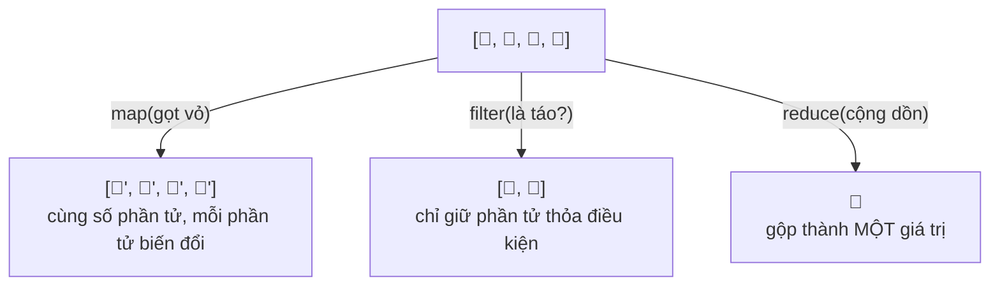

# Mảng & các phương thức xử lý

::: info Mục tiêu bài học
- Tạo, truy cập, thêm, xóa phần tử của **mảng**.
- Phân biệt phương thức **sửa mảng gốc** và phương thức **trả về mảng mới**.
- Tìm kiếm với `includes`, `find`, `findIndex`, `some`, `every`.
- Biến đổi dữ liệu với bộ ba **`map`, `filter`, `reduce`** và nối chuỗi các phương thức.
- **Sắp xếp** đúng cách (số, chuỗi tiếng Việt); dùng destructuring, spread và nhóm dữ liệu.
:::

## 1. Mảng là gì?

**Mảng** (array) là danh sách **có thứ tự** các giá trị. Đây là cấu trúc dữ liệu bạn dùng nhiều nhất: danh sách sản phẩm, tin nhắn, kết quả tìm kiếm...

```js run
const monAn = ['phở', 'bún chả', 'bánh mì'];

console.log(monAn[0]);              // 'phở' — chỉ số bắt đầu từ 0
console.log(monAn[2]);              // 'bánh mì'
console.log(monAn[5]);              // undefined — không có phần tử này
console.log(monAn.length);          // 3
console.log(monAn.at(-1));          // 'bánh mì' — at() nhận chỉ số âm: -1 là phần tử cuối

monAn[1] = 'bún bò';                // sửa phần tử
console.log(monAn);

const tronLan = [1, 'hai', true, null, [5, 6], { ten: 'An' }];   // chứa được mọi kiểu
console.log(tronLan.length);
```

## 2. Thêm và xóa phần tử

```js run
const hang = ['An', 'Bình'];

hang.push('Chi');            // thêm vào CUỐI
hang.unshift('Dũng');        // thêm vào ĐẦU
console.log(hang);           // ['Dũng', 'An', 'Bình', 'Chi']

const cuoi = hang.pop();     // lấy ra phần tử CUỐI
const dau = hang.shift();    // lấy ra phần tử ĐẦU
console.log(cuoi, dau, hang);

// splice(vị-trí, số-lượng-xóa, ...phần-tử-chèn) — sửa mảng gốc
const so = [10, 20, 30, 40, 50];
so.splice(1, 2);             // từ vị trí 1 xóa 2 phần tử
console.log(so);             // [10, 40, 50]
so.splice(1, 0, 15, 25);     // tại vị trí 1, xóa 0, chèn 15 và 25
console.log(so);             // [10, 15, 25, 40, 50]

// slice(đầu, cuối) — CẮT RA mảng mới, không sửa gốc (không lấy phần tử ở vị trí "cuối")
const goc = ['a', 'b', 'c', 'd', 'e'];
console.log(goc.slice(1, 3));   // ['b', 'c']
console.log(goc.slice(-2));     // ['d', 'e']
console.log(goc);               // gốc vẫn nguyên
```

`splice` và `slice` tên gần giống nhau nhưng khác hẳn: **sp**lice **s**ửa mảng gốc, s**l**ice chỉ **l**ấy bản cắt.

## 3. Sửa gốc hay trả về mảng mới?

Đây là điều quan trọng nhất cần nhớ khi làm việc với mảng:

| Sửa mảng gốc (mutating) | Trả về mảng/giá trị mới |
| --- | --- |
| `push`, `pop`, `shift`, `unshift` | `concat`, `slice`, `[...a, x]` |
| `splice` | `toSpliced` |
| `sort`, `reverse` | `toSorted`, `toReversed` |
| `fill`, gán `a[i] = x` | `with(i, x)`, `map`, `filter`, `flat` |

`toSorted`, `toReversed`, `toSpliced`, `with` là phiên bản "không sửa gốc" được thêm vào từ ES2023 và đã có trên mọi trình duyệt hiện đại.

Vì sao lại quan trọng? Mảng là **tham chiếu**: nhiều biến có thể cùng trỏ tới một mảng, sửa ở chỗ này thì chỗ kia cũng đổi theo:

```js run
const a = [1, 2, 3];
const b = a;            // b và a là CÙNG MỘT mảng
b.push(4);
console.log(a);         // [1, 2, 3, 4] 😮

const c = [...a];       // spread: tạo bản sao (một cấp)
c.push(5);
console.log(a, c);      // a không bị ảnh hưởng
```

Trong code giao diện (và đặc biệt trong React, Vue), thói quen **tạo mảng mới thay vì sửa mảng cũ** giúp tránh rất nhiều lỗi khó hiểu.

## 4. Tìm kiếm

```js run
const sanPham = [
  { id: 1, ten: 'Bàn phím', gia: 450000, conHang: true },
  { id: 2, ten: 'Chuột', gia: 150000, conHang: false },
  { id: 3, ten: 'Màn hình', gia: 3200000, conHang: true },
];

console.log(['đỏ', 'xanh'].includes('xanh'));             // true
console.log(['đỏ', 'xanh'].indexOf('vàng'));              // -1: không có

console.log(sanPham.find((sp) => sp.id === 3));           // phần tử đầu tiên thỏa điều kiện
console.log(sanPham.findIndex((sp) => sp.gia > 1000000)); // 2: chỉ số của nó
console.log(sanPham.some((sp) => !sp.conHang));           // true: CÓ ÍT NHẤT MỘT món hết hàng
console.log(sanPham.every((sp) => sp.gia > 100000));      // true: MỌI món đều trên 100 nghìn
```

| Phương thức | Trả về |
| --- | --- |
| `includes(x)` | `true`/`false`: có chứa `x` không |
| `indexOf(x)` | Chỉ số đầu tiên của `x`, hoặc `-1` |
| `find(fn)` / `findLast(fn)` | Phần tử đầu tiên / cuối cùng thỏa `fn`, hoặc `undefined` |
| `findIndex(fn)` | Chỉ số đầu tiên thỏa `fn`, hoặc `-1` |
| `some(fn)` | `true` nếu **ít nhất một** phần tử thỏa |
| `every(fn)` | `true` nếu **mọi** phần tử thỏa |

## 5. Bộ ba `map`, `filter`, `reduce`

Ba phương thức này nhận một **callback**, gọi nó cho từng phần tử, và **không sửa mảng gốc**.



```js run
const donHang = [
  { ten: 'Cà phê', gia: 29000, soLuong: 2 },
  { ten: 'Bánh mì', gia: 25000, soLuong: 1 },
  { ten: 'Trà đào', gia: 35000, soLuong: 3 },
];

// map: biến đổi từng phần tử → mảng MỚI cùng độ dài
const tenMon = donHang.map((mon) => mon.ten);
console.log(tenMon);

const thanhTien = donHang.map((mon) => mon.gia * mon.soLuong);
console.log(thanhTien);

// filter: giữ lại phần tử thỏa điều kiện → mảng MỚI (có thể ngắn hơn)
const monNhieu = donHang.filter((mon) => mon.soLuong >= 2);
console.log(monNhieu.map((m) => m.ten));

// reduce: gộp cả mảng thành MỘT giá trị
const tong = donHang.reduce((tongDon, mon) => tongDon + mon.gia * mon.soLuong, 0);
console.log('Tổng đơn:', tong);
```

**`reduce` hoạt động thế nào?** `reduce((tichLuy, phanTu) => ..., giaTriBanDau)`: callback nhận giá trị **tích lũy** và phần tử hiện tại, trả về giá trị tích lũy mới. Với ví dụ trên: 0 → 58000 → 83000 → 188000. Luôn truyền giá trị ban đầu, nếu không, mảng rỗng sẽ gây lỗi.

`forEach` cũng gọi callback cho từng phần tử nhưng **không trả về gì**, chỉ dùng khi muốn "làm gì đó" (in ra, thêm vào trang) chứ không cần mảng kết quả:

```js run
['HTML', 'CSS', 'JS'].forEach((mon, i) => {
  console.log(`${i + 1}. ${mon}`);
});
```

**Nối chuỗi phương thức**: vì `map` và `filter` trả về mảng, bạn có thể gọi tiếp:

```js run
const hocVien = [
  { ten: 'An', diem: 8.5 },
  { ten: 'Bình', diem: 4.5 },
  { ten: 'Chi', diem: 9 },
  { ten: 'Dũng', diem: 6 },
];

const danhSachDat = hocVien
  .filter((hv) => hv.diem >= 5)          // giữ người đạt
  .map((hv) => `${hv.ten} (${hv.diem})`) // đổi thành chuỗi
  .join(', ');                           // nối thành một chuỗi
console.log(danhSachDat);

const diemTB = hocVien.reduce((t, hv) => t + hv.diem, 0) / hocVien.length;
console.log('Điểm trung bình:', diemTB);
```

## 6. Sắp xếp

::: danger Bẫy kinh điển: `sort()` không có hàm so sánh
Mặc định `sort()` đổi mọi phần tử thành **chuỗi** rồi so từng ký tự: `[10, 1, 5, 100].sort()` ra `[1, 10, 100, 5]`. Ngoài ra `sort()` **sửa mảng gốc**.
:::

```js run
const so = [10, 1, 5, 100];
console.log(so.toSorted());                    // [1, 10, 100, 5] — sai!
console.log(so.toSorted((a, b) => a - b));     // [1, 5, 10, 100] — tăng dần
console.log(so.toSorted((a, b) => b - a));     // [100, 10, 5, 1] — giảm dần

// Hàm so sánh: trả về số âm → a đứng trước; dương → b đứng trước; 0 → giữ nguyên

// Sắp xếp object theo một thuộc tính
const sp = [{ ten: 'Chuột', gia: 150 }, { ten: 'Bàn phím', gia: 450 }, { ten: 'Ổ cứng', gia: 900 }];
console.log(sp.toSorted((a, b) => a.gia - b.gia).map((x) => x.ten));

// Chuỗi tiếng Việt: dùng localeCompare để so đúng thứ tự chữ có dấu
const ten = ['Đức', 'An', 'Ánh', 'Bình', 'Dũng'];
console.log(ten.toSorted());                                      // sai thứ tự: 'Ánh', 'Đức' bị dồn xuống cuối
console.log(ten.toSorted((a, b) => a.localeCompare(b, 'vi')));    // đúng: An, Ánh, Bình, Dũng, Đức
```

Dùng `toSorted` khi muốn giữ nguyên mảng gốc, hoặc `sort` khi chủ ý sắp xếp tại chỗ.

## 7. Destructuring, spread và các tiện ích khác

```js run
// Destructuring: lấy phần tử ra biến
const toaDo = [10.77, 106.7];
const [viDo, kinhDo] = toaDo;
console.log(viDo, kinhDo);

const [dauTien, ...conLai] = ['vàng', 'bạc', 'đồng', 'khuyến khích'];
console.log(dauTien, conLai);

// Hoán đổi hai biến
let x = 1, y = 2;
[x, y] = [y, x];
console.log(x, y);

// Spread: trải mảng ra
const ab = [...['a', 'b'], ...['c', 'd'], 'e'];
console.log(ab);
console.log(Math.max(...[3, 9, 2]));             // 9

// Chuỗi ↔ mảng
console.log('phở,bún,miến'.split(','));          // ['phở', 'bún', 'miến']
console.log(['2026', '10', '27'].join('-'));     // '2026-10-27'

// Tạo mảng
console.log(Array.from({ length: 5 }, (_, i) => i * i));   // [0, 1, 4, 9, 16]
console.log([...new Set([1, 2, 2, 3, 3, 3])]);             // bỏ trùng: [1, 2, 3]
console.log([[1, 2], [3, [4]]].flat(Infinity));            // làm phẳng: [1, 2, 3, 4]

// Nhóm dữ liệu theo một tiêu chí (ES2024)
const giaoDich = [
  { loai: 'thu', soTien: 500 }, { loai: 'chi', soTien: 120 }, { loai: 'chi', soTien: 80 },
];
console.log(Object.groupBy(giaoDich, (gd) => gd.loai));
```

## Thực hành

**Bài 1.** Làm bài **Mảng: giỏ hàng** trong [Code Playground](/thuc-hanh/playground).

::: details Xem gợi ý
Ba dòng: `filter` lấy món còn hàng, `map` lấy tên và `toUpperCase()`, `reduce` cộng `gia * soLuong` với giá trị đầu là `0`. Không dùng `sort`/`splice` lên `gioHang`, vì trình chấm kiểm tra mảng gốc không bị đổi.
:::

**Bài 2.** Cho mảng điểm `[7, 9.5, 4, 8, 5.5, 10, 3]`. Tính: điểm cao nhất, điểm thấp nhất, điểm trung bình (làm tròn 2 chữ số), số bài dưới 5, và mảng điểm đã sắp xếp giảm dần mà không sửa mảng gốc.

::: details Xem lời giải
```js run
const diem = [7, 9.5, 4, 8, 5.5, 10, 3];

const caoNhat = Math.max(...diem);
const thapNhat = Math.min(...diem);
const trungBinh = diem.reduce((t, d) => t + d, 0) / diem.length;
const soBaiDuoi5 = diem.filter((d) => d < 5).length;
const giamDan = diem.toSorted((a, b) => b - a);

console.log({ caoNhat, thapNhat, trungBinh: Number(trungBinh.toFixed(2)), soBaiDuoi5 });
console.log(giamDan, diem);
```
:::

**Bài 3.** Từ danh sách sản phẩm, tạo mảng chuỗi `'Tên — giá'` của các sản phẩm **còn hàng**, sắp xếp theo giá **tăng dần**.

```js
const sanPham = [
  { ten: 'Tai nghe', gia: 700000, conHang: true },
  { ten: 'Chuột', gia: 150000, conHang: true },
  { ten: 'Webcam', gia: 900000, conHang: false },
  { ten: 'Bàn phím', gia: 450000, conHang: true },
];
```

::: details Xem lời giải
```js run
const sanPham = [
  { ten: 'Tai nghe', gia: 700000, conHang: true },
  { ten: 'Chuột', gia: 150000, conHang: true },
  { ten: 'Webcam', gia: 900000, conHang: false },
  { ten: 'Bàn phím', gia: 450000, conHang: true },
];

const ketQua = sanPham
  .filter((sp) => sp.conHang)
  .toSorted((a, b) => a.gia - b.gia)
  .map((sp) => `${sp.ten} — ${sp.gia}`);

console.log(ketQua);
```
Ở đây `filter` đã tạo mảng mới nên dùng `sort` cũng không ảnh hưởng `sanPham`. Nhưng `toSorted` cho thấy rõ ý định hơn.
:::

## Lỗi thường gặp

- **`sort()` số mà không có hàm so sánh.**
- **Quên `sort`, `reverse`, `splice` sửa mảng gốc**, rồi bất ngờ vì dữ liệu ở chỗ khác bị đổi.
- **Dùng `map` chỉ để lặp** (bỏ phí mảng kết quả) → dùng `forEach` hoặc `for...of`.
- **Quên `return`** trong callback có ngoặc nhọn: `arr.map((x) => { x * 2 })` ra toàn `undefined`.
- **`reduce` thiếu giá trị ban đầu.**
- **So sánh mảng bằng `===`**: `[1, 2] === [1, 2]` là `false` vì là hai mảng khác nhau.

## Tóm tắt

- Mảng có chỉ số từ 0; `length`, `at(-1)`.
- Thêm/xóa: `push`/`pop` (cuối), `unshift`/`shift` (đầu), `splice` (giữa, sửa gốc); `slice` cắt ra mảng mới.
- Phân biệt phương thức sửa gốc (`sort`, `splice`...) và trả về mới (`map`, `filter`, `toSorted`...). Gán mảng là gán tham chiếu, sao chép bằng `[...a]`.
- Tìm: `includes`, `find`, `findIndex`, `some`, `every`.
- `map` biến đổi, `filter` lọc, `reduce` gộp; nối chuỗi để xử lý dữ liệu gọn gàng.
- Sắp xếp số `(a, b) => a - b`, chuỗi tiếng Việt `a.localeCompare(b, 'vi')`.

## Kiểm tra kiến thức

<Quiz />
