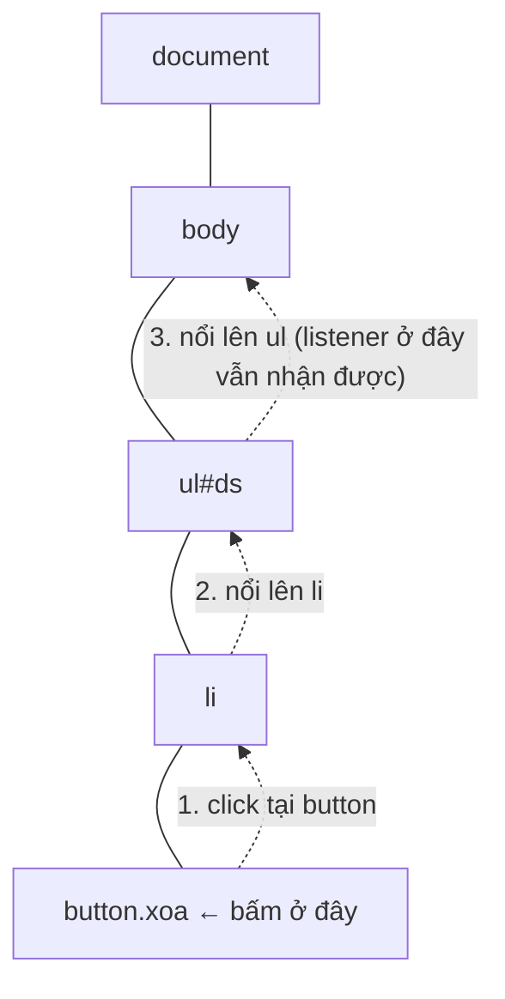

# Sự kiện & tương tác người dùng

::: info Mục tiêu bài học
- Gắn **trình nghe sự kiện** với `addEventListener` và đọc **đối tượng sự kiện**.
- Xử lý sự kiện chuột, bàn phím, form (`submit`, `input`, `change`) và chặn hành vi mặc định.
- Hiểu **nổi bọt** (bubbling) và dùng **ủy quyền sự kiện** (event delegation).
- Gỡ trình nghe đúng cách; xử lý `DOMContentLoaded`, cuộn, đổi kích thước.
- Làm tương tác **dùng được bằng bàn phím**.
:::

## 1. Lắng nghe sự kiện

**Sự kiện** (event) là "điều gì đó vừa xảy ra": người dùng bấm nút, gõ phím, gửi form, cuộn trang, trang tải xong... Bạn đăng ký một hàm để được gọi mỗi khi sự kiện xảy ra:

```html live
<button id="nut" type="button">Bấm tôi</button>
<p id="kq">Chưa bấm lần nào.</p>

<script>
  const nut = document.querySelector('#nut');
  const kq = document.querySelector('#kq');
  let soLan = 0;

  nut.addEventListener('click', () => {
    soLan++;
    kq.textContent = `Đã bấm ${soLan} lần`;
  });
</script>
```

`phanTu.addEventListener(loaiSuKien, hamXuLy)`:

- **Loại sự kiện** là chuỗi không có "on": `'click'`, `'input'`, `'submit'`, `'keydown'`...
- **Hàm xử lý** (listener, handler) là một **callback**: truyền hàm, đừng gọi hàm (`xuLy`, không phải `xuLy()`).
- Một phần tử có thể có nhiều listener cho cùng một sự kiện.

Bạn sẽ còn thấy cách cũ `nut.onclick = ...` hoặc `<button onclick="...">` trong HTML. Hãy dùng `addEventListener`: không bị ghi đè lẫn nhau, và tách được JavaScript khỏi HTML.

| Nhóm | Sự kiện hay dùng |
| --- | --- |
| Chuột / con trỏ | `click`, `dblclick`, `pointerdown`, `pointerup`, `pointermove`, `mouseenter`, `mouseleave`, `contextmenu` |
| Bàn phím | `keydown`, `keyup` |
| Form | `submit`, `input`, `change`, `focus`, `blur`, `reset` |
| Trang | `DOMContentLoaded`, `load`, `scroll`, `resize`, `visibilitychange`, `beforeunload` |
| Khác | `copy`, `paste`, `dragstart`, `drop`, `transitionend`, `animationend` |

Sự kiện **pointer** (`pointerdown`, `pointermove`...) gom chung chuột, bút và cảm ứng; nên dùng thay cho cặp `mouse*`/`touch*` riêng lẻ.

## 2. Đối tượng sự kiện

Hàm xử lý nhận một đối số là **đối tượng sự kiện** chứa thông tin chi tiết:

```html live
<button id="nut" type="button"><span>🛒</span> Thêm vào giỏ</button>
<input id="o" placeholder="Gõ thử, kể cả Enter, Esc, Ctrl+K">

<script>
  document.querySelector('#nut').addEventListener('click', (event) => {
    console.log('type:', event.type);
    console.log('target (phần tử thật sự được bấm):', event.target);
    console.log('currentTarget (nơi gắn listener):', event.currentTarget);
    console.log('vị trí con trỏ:', event.clientX, event.clientY);
  });

  document.querySelector('#o').addEventListener('keydown', (event) => {
    console.log('key:', event.key, '| code:', event.code, '| ctrl:', event.ctrlKey);
  });
</script>
```

Bấm đúng vào biểu tượng 🛒: `target` là `<span>`, còn `currentTarget` là `<button>`. Điều này quan trọng ở mục 5.

## 3. Hành vi mặc định và form

Nhiều sự kiện có **hành vi mặc định**: bấm liên kết thì chuyển trang, gửi form thì tải trang mới, bấm phím Space thì cuộn trang. `event.preventDefault()` chặn hành vi đó:

```html live
<form id="form-dk">
  <label>Email <input name="email" type="email" required></label>
  <label>Tên <input name="ten" required minlength="2"></label>
  <label><input name="nhanTin" type="checkbox" checked> Nhận bản tin</label>
  <button>Đăng ký</button>
</form>
<p id="kq"></p>

<script>
  const form = document.querySelector('#form-dk');

  form.addEventListener('submit', (event) => {
    event.preventDefault();                       // không tải lại trang

    const duLieu = new FormData(form);            // đọc mọi ô có name
    const nguoiDung = Object.fromEntries(duLieu);
    console.log(nguoiDung);

    document.querySelector('#kq').textContent = `Cảm ơn ${nguoiDung.ten}! Đã gửi xác nhận tới ${nguoiDung.email}.`;
    form.reset();
  });
</script>
```

- Sự kiện `submit` gắn trên **form**, không gắn `click` trên nút. Như vậy cả việc nhấn `Enter` trong ô nhập cũng được xử lý, và kiểm tra `required`/`type` của trình duyệt vẫn chạy **trước khi** `submit` xảy ra.
- `new FormData(form)` đọc mọi ô nhập có `name`. Đây lại là lý do mọi ô cần `name` ([bài Form](/html/form)). Checkbox không tích sẽ không có mặt trong `FormData`.

**`input` và `change`:**

```html live
<label for="mo-ta">Mô tả (tối đa 80 ký tự)</label><br>
<textarea id="mo-ta" maxlength="80" rows="3" cols="40"></textarea>
<p id="dem">0/80</p>

<label>Cỡ chữ: <input id="co" type="range" min="12" max="32" value="16"></label>
<p id="mau-chu">Chữ mẫu</p>

<script>
  const moTa = document.querySelector('#mo-ta');
  const dem = document.querySelector('#dem');
  moTa.addEventListener('input', () => {          // mỗi lần nội dung đổi
    dem.textContent = `${moTa.value.length}/80`;
  });

  const co = document.querySelector('#co');
  co.addEventListener('input', () => {
    document.querySelector('#mau-chu').style.fontSize = `${co.value}px`;
  });
  co.addEventListener('change', () => {           // khi người dùng thả thanh trượt
    console.log('Đã chọn cỡ chữ', co.value);
  });
</script>
```

## 4. Bàn phím

```html live
<p>Bấm vào khung này rồi thử: <kbd>Ctrl</kbd> + <kbd>K</kbd>, phím mũi tên, <kbd>Esc</kbd>.</p>
<div id="hop" style="position: relative; height: 90px; border: 1px dashed #a8a29e;">
  <div id="cuc" style="position: absolute; left: 0; top: 30px; width: 30px; height: 30px; background: #c2410c; border-radius: 6px;"></div>
</div>

<script>
  let x = 0;
  const cuc = document.querySelector('#cuc');

  document.addEventListener('keydown', (event) => {
    if ((event.ctrlKey || event.metaKey) && event.key === 'k') {
      event.preventDefault();                     // chặn phím tắt mặc định của trình duyệt
      console.log('Mở hộp tìm kiếm!');
    } else if (event.key === 'ArrowRight') {
      x = Math.min(x + 20, 240);
    } else if (event.key === 'ArrowLeft') {
      x = Math.max(x - 20, 0);
    } else if (event.key === 'Escape') {
      x = 0;
    }
    cuc.style.translate = `${x}px 0`;
  });
</script>
```

- `event.key` là ký tự hoặc tên phím **theo bố cục bàn phím**: `'a'`, `'A'`, `'Enter'`, `'Escape'`, `'ArrowUp'`, `' '` (dấu cách).
- `event.code` là **vị trí vật lý** của phím (`'KeyA'`, `'Space'`), hợp cho game.
- Phím bổ trợ: `ctrlKey`, `shiftKey`, `altKey`, `metaKey` (`Cmd` trên Mac).
- Khi người dùng đang gõ tiếng Việt bằng bộ gõ (Unikey, bộ gõ của hệ điều hành), `keydown` có thể xảy ra giữa lúc đang ghép chữ. Kiểm tra `event.isComposing` trước khi xử lý phím `Enter` trong ô nhập.

## 5. Nổi bọt và ủy quyền sự kiện

Khi bạn bấm một phần tử, sự kiện không chỉ xảy ra ở đó mà **lan dần lên** các phần tử cha, tới tận `document`. Hiện tượng này gọi là **nổi bọt** (bubbling):



Nhờ nổi bọt, bạn có thể gắn **một** listener lên phần tử cha để xử lý cho **mọi** phần tử con, kể cả những phần tử được thêm vào sau này. Kỹ thuật này gọi là **ủy quyền sự kiện** (event delegation):

```html live
<ul id="ds">
  <li data-id="1">Học HTML <button class="xoa" type="button">✕</button></li>
  <li data-id="2">Học CSS <button class="xoa" type="button">✕</button></li>
</ul>
<button id="them" type="button">+ Thêm việc</button>

<script>
  const ds = document.querySelector('#ds');
  let id = 2;

  // MỘT listener cho cả danh sách
  ds.addEventListener('click', (event) => {
    const nutXoa = event.target.closest('.xoa');
    if (!nutXoa) return;                        // bấm chỗ khác trong ds → bỏ qua
    const li = nutXoa.closest('li');
    console.log('Xóa việc có id', li.dataset.id);
    li.remove();
  });

  // Việc thêm sau vẫn xóa được mà không cần gắn listener mới
  document.querySelector('#them').addEventListener('click', () => {
    id++;
    const li = document.createElement('li');
    li.dataset.id = id;
    li.append(`Việc số ${id} `);
    const nut = document.createElement('button');
    nut.className = 'xoa';
    nut.type = 'button';
    nut.textContent = '✕';
    li.append(nut);
    ds.append(li);
  });
</script>
```

Mẫu `event.target.closest('selector')` + `if (!...) return` là công thức chuẩn của ủy quyền sự kiện. `closest` cần thiết vì `target` có thể là phần tử con sâu bên trong (một icon trong nút).

`event.stopPropagation()` chặn sự kiện nổi tiếp. Hạn chế dùng: nó làm các listener ở cấp trên (ví dụ code đóng menu khi bấm ra ngoài, hay công cụ thống kê) "mù" theo.

## 6. Gỡ trình nghe

```js
function xuLy() { console.log('Đã bấm'); }

nut.addEventListener('click', xuLy);
nut.removeEventListener('click', xuLy);    // phải truyền ĐÚNG hàm đã gắn

// Chỉ chạy một lần rồi tự gỡ
nut.addEventListener('click', () => console.log('Lần đầu tiên!'), { once: true });

// Gỡ nhiều listener cùng lúc bằng AbortController
const boDieuKhien = new AbortController();
window.addEventListener('resize', capNhat, { signal: boDieuKhien.signal });
window.addEventListener('scroll', capNhat, { signal: boDieuKhien.signal });
boDieuKhien.abort();                        // gỡ cả hai
```

Không gỡ được arrow function viết trực tiếp trong `addEventListener`, vì bạn không còn tham chiếu tới nó. Trong ứng dụng có nhiều màn hình, quên gỡ listener (nhất là trên `window`, `document`) gây rò rỉ bộ nhớ và lỗi "chạy hai lần".

## 7. Sự kiện của trang

```js
// HTML đã đọc xong, DOM sẵn sàng (không cần nếu script đã dùng defer hoặc module)
document.addEventListener('DOMContentLoaded', () => { /* ... */ });

// Mọi thứ (ảnh, font, iframe) đã tải xong
window.addEventListener('load', () => { /* ... */ });

// Cuộn trang: passive báo trình duyệt rằng ta không gọi preventDefault → cuộn mượt hơn
window.addEventListener('scroll', () => {
  nutLenDau.hidden = window.scrollY < 400;
}, { passive: true });

// Người dùng chuyển sang tab khác
document.addEventListener('visibilitychange', () => {
  if (document.hidden) video.pause();
});
```

`scroll`, `resize`, `input` có thể bắn ra hàng chục lần mỗi giây. Với xử lý nặng (gọi API khi gõ tìm kiếm), hãy **debounce**: chỉ chạy khi người dùng ngừng thao tác một lúc. Kỹ thuật này có ở [bài Hiệu năng](/nang-cao/hieu-nang). Muốn biết phần tử có trong khung nhìn hay không, đừng nghe `scroll`; hãy dùng `IntersectionObserver` (cùng bài).

## 8. Tương tác cho mọi người

- **Dùng phần tử tương tác chuẩn**: `<button>` cho hành động, `<a href>` cho điều hướng. Sự kiện `click` trên chúng chạy được cả với chuột, cảm ứng và **bàn phím** (Enter, Space).
- **Đừng chỉ dựa vào hover** hay `dblclick`: điện thoại không có hover, người dùng bàn phím không "double click".
- **Cập nhật trạng thái cho công nghệ hỗ trợ**: nút bật/tắt menu nên đổi `aria-expanded`; vùng hiện kết quả thay đổi động nên có `aria-live="polite"` để trình đọc màn hình đọc lên.
- **Quản lý focus** khi mở hộp thoại, xóa phần tử đang được focus... (bài [Accessibility chuyên sâu](/nang-cao/bao-mat-a11y)).

```html live
<button id="nut-menu" type="button" aria-expanded="false" aria-controls="menu">☰ Menu</button>
<ul id="menu" hidden>
  <li><a href="#">Trang chủ</a></li>
  <li><a href="#">Bài học</a></li>
</ul>

<script>
  const nutMenu = document.querySelector('#nut-menu');
  const menu = document.querySelector('#menu');

  nutMenu.addEventListener('click', () => {
    const dangMo = nutMenu.getAttribute('aria-expanded') === 'true';
    nutMenu.setAttribute('aria-expanded', String(!dangMo));
    menu.hidden = dangMo;
  });
</script>
```

## Thực hành

**Bài 1.** Làm hai bài **Bộ đếm** và **Danh sách việc cần làm** trong [Code Playground](/thuc-hanh/playground).

::: details Xem gợi ý
Bộ đếm: giữ số đếm trong biến `let`, mỗi listener sửa biến rồi gọi một hàm `hienThi()` chung. Todo: `submit` trên form với `event.preventDefault()` ở dòng đầu; dùng `value.trim()`; một listener `click` trên `#ds` với `event.target.closest('li')`.
:::

**Bài 2.** Làm thanh **tab**: ba nút "Mô tả", "Thông số", "Đánh giá", bấm nút nào thì hiện nội dung tương ứng, ẩn các nội dung khác, và nút đang chọn có class `dang-chon`. Dùng ủy quyền sự kiện.

::: details Xem lời giải
```html live
<div class="tabs">
  <button type="button" data-tab="mo-ta" class="dang-chon">Mô tả</button>
  <button type="button" data-tab="thong-so">Thông số</button>
  <button type="button" data-tab="danh-gia">Đánh giá</button>
</div>
<section id="mo-ta">Áo thun cotton, thoáng mát.</section>
<section id="thong-so" hidden>Chất liệu: 100% cotton. Size S–XXL.</section>
<section id="danh-gia" hidden>⭐⭐⭐⭐⭐ “Mặc rất thích!”</section>

<style>
  body { font-family: system-ui, sans-serif; }
  .tabs button { padding: 6px 12px; border: 1px solid #d4d4d8; background: white; border-radius: 6px; }
  .tabs .dang-chon { background: #c2410c; color: white; border-color: #c2410c; }
  section { margin-top: 10px; }
</style>

<script>
  const tabs = document.querySelector('.tabs');

  tabs.addEventListener('click', (event) => {
    const nut = event.target.closest('button[data-tab]');
    if (!nut) return;

    for (const b of tabs.querySelectorAll('button')) {
      b.classList.toggle('dang-chon', b === nut);
      document.querySelector('#' + b.dataset.tab).hidden = b !== nut;
    }
  });
</script>
```
Một tab panel đầy đủ về accessibility còn cần `role="tablist"`, `role="tab"`, `aria-selected` và di chuyển giữa các tab bằng phím mũi tên, theo mẫu ARIA Authoring Practices.
:::

**Bài 3.** Ô tìm kiếm lọc danh sách: gõ vào ô thì chỉ hiện những thành phố có tên chứa từ khóa, **không phân biệt dấu và hoa thường**. Hiện "Không tìm thấy" khi không có kết quả.

::: details Xem lời giải
```html live
<label>Tìm thành phố <input id="tim" type="search" autocomplete="off"></label>
<ul id="ds-tp"></ul>
<p id="trong" hidden>Không tìm thấy.</p>

<script>
  const thanhPho = ['Hà Nội', 'Hải Phòng', 'Huế', 'Đà Nẵng', 'Hội An', 'Đà Lạt', 'Cần Thơ'];
  const boDau = (s) => s.normalize('NFD').replace(/[̀-ͯ]/g, '').replace(/đ/gi, 'd').toLowerCase();

  const ds = document.querySelector('#ds-tp');
  const trong = document.querySelector('#trong');

  function hienThi(tuKhoa) {
    const kq = thanhPho.filter((tp) => boDau(tp).includes(boDau(tuKhoa.trim())));
    ds.replaceChildren(...kq.map((tp) => {
      const li = document.createElement('li');
      li.textContent = tp;
      return li;
    }));
    trong.hidden = kq.length > 0;
  }

  document.querySelector('#tim').addEventListener('input', (event) => hienThi(event.target.value));
  hienThi('');
</script>
```
:::

## Lỗi thường gặp

- **Gọi hàm thay vì truyền hàm**: `addEventListener('click', xuLy())`.
- **Quên `preventDefault()`** trong `submit` → trang tải lại, mọi thứ biến mất.
- **Gắn `click` lên nút submit** thay vì `submit` lên form → bỏ sót trường hợp nhấn Enter, bỏ qua kiểm tra của trình duyệt.
- **Gắn listener cho từng phần tử trong vòng lặp**, và phần tử thêm sau không có listener → dùng ủy quyền sự kiện.
- **Dùng `event.target` mà không `closest()`** → bấm vào icon bên trong nút thì `target` là icon.
- **`<div>` có `click`** thay cho `<button>` → người dùng bàn phím không dùng được.

## Tóm tắt

- `phanTu.addEventListener('loai', ham)`; truyền hàm, không gọi hàm.
- Đối tượng sự kiện: `type`, `target`, `currentTarget`, `key`, `preventDefault()`.
- Form: nghe `submit` trên form, `preventDefault()`, đọc dữ liệu bằng `FormData`; `input` (mỗi thay đổi) và `change` (khi chốt giá trị).
- Sự kiện nổi bọt lên cha → ủy quyền sự kiện: một listener ở cha + `event.target.closest(...)`.
- Gỡ listener bằng `removeEventListener`, `{ once: true }` hoặc `AbortController`; `scroll` dùng `{ passive: true }`.
- Dùng phần tử chuẩn để tương tác chạy được với bàn phím; cập nhật `aria-expanded`, `aria-live` khi cần.

## Kiểm tra kiến thức

<Quiz />
