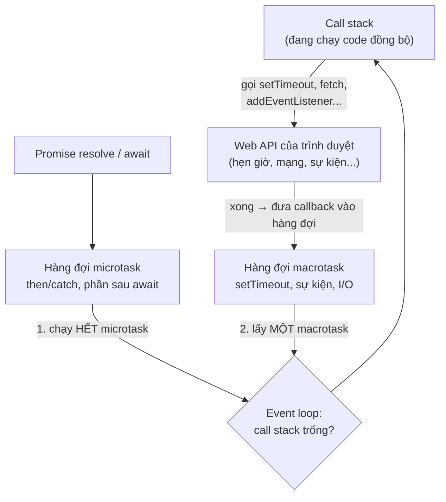
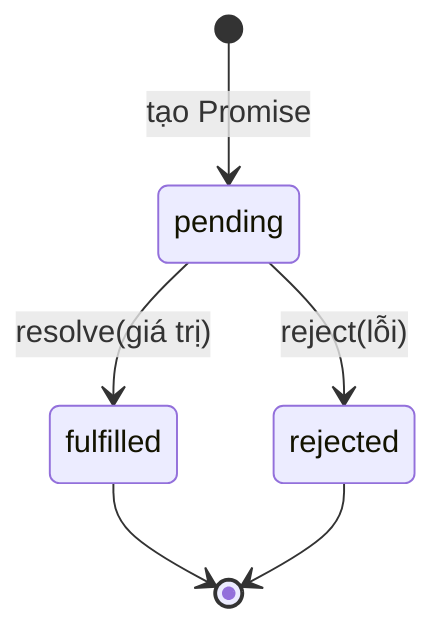

# Bất đồng bộ: event loop, Promise, async/await

::: info Mục tiêu bài học
- Hiểu vì sao JavaScript cần **bất đồng bộ** và **event loop** hoạt động thế nào.
- Phân biệt **macrotask** (setTimeout) và **microtask** (Promise); dự đoán thứ tự chạy.
- Tạo và dùng **Promise**: `then`, `catch`, `finally`, chuỗi Promise.
- Viết code bất đồng bộ dễ đọc với **async/await** và `try...catch`.
- Chạy **song song** với `Promise.all`, `allSettled`, `race`, `any`; tránh các lỗi kinh điển.
:::

## 1. Vì sao cần bất đồng bộ?

JavaScript trong trình duyệt chạy trên **một luồng** (single thread): tại một thời điểm chỉ làm một việc. Nếu tải dữ liệu từ server mất 2 giây mà JavaScript **đứng chờ**, toàn bộ trang bị đơ: không bấm được nút, không cuộn được.

Vì vậy những việc **tốn thời gian chờ** (gọi mạng, hẹn giờ, đọc tệp) được giao cho trình duyệt làm "ở hậu trường". JavaScript đăng ký "khi nào xong thì gọi hàm này", rồi tiếp tục chạy phần còn lại. Đó là **bất đồng bộ** (asynchronous):

```js run
console.log('1. Bắt đầu đặt món');

setTimeout(() => {
  console.log('3. Món ăn đã xong! (sau 1 giây)');
}, 1000);

console.log('2. Trong lúc chờ, lướt điện thoại');
```

Giống như gọi món ở quán ăn: bạn không đứng nhìn đầu bếp nấu. Bạn nhận một cái thẻ rung, về bàn ngồi, khi thẻ rung thì ra lấy món.

## 2. Event loop



Vòng lặp sự kiện (event loop) lặp mãi theo thứ tự:

1. Chạy hết code đồng bộ đang có trên **call stack** (ngăn xếp lời gọi hàm).
2. Khi call stack trống: chạy **hết** các **microtask** (callback của Promise, phần code sau `await`).
3. Trình duyệt có thể vẽ lại màn hình.
4. Lấy **một** **macrotask** (callback của `setTimeout`, sự kiện click, tin nhắn...) ra chạy, rồi quay lại bước 2.

```js run
console.log('A — đồng bộ');

setTimeout(() => console.log('B — macrotask (setTimeout 0)'), 0);

Promise.resolve().then(() => console.log('C — microtask (Promise)'));

queueMicrotask(() => console.log('D — microtask'));

console.log('E — đồng bộ');
```

Kết quả: A, E (đồng bộ) → C, D (microtask) → B (macrotask). `setTimeout(..., 0)` không có nghĩa là "chạy ngay", mà là "chạy sớm nhất có thể sau khi mọi thứ khác đã xong".

::: warning Đừng chặn event loop
Một vòng lặp tính toán nặng (vài giây) trên luồng chính làm **đơ cả trang**: không bấm được, không cuộn được, animation đứng hình, vì event loop không có cơ hội chạy tiếp. Việc tính toán nặng nên chia nhỏ, hoặc chuyển sang **Web Worker** (một luồng riêng). Chỉ số INP ở [bài Hiệu năng](/nang-cao/hieu-nang) đo chính điều này.
:::

## 3. Callback và "callback hell"

Cách cũ nhất để xử lý bất đồng bộ là callback: "khi xong thì gọi hàm này". Khi các bước phụ thuộc nhau, code lồng sâu dần:

```js
dangNhap(email, matKhau, (loi, nguoiDung) => {
  if (loi) return hienLoi(loi);
  layDonHang(nguoiDung.id, (loi, donHang) => {
    if (loi) return hienLoi(loi);
    layChiTiet(donHang[0].id, (loi, chiTiet) => {
      if (loi) return hienLoi(loi);
      hienThi(chiTiet);          // "kim tự tháp diệt vong" 😵
    });
  });
});
```

Khó đọc, xử lý lỗi lặp đi lặp lại, dễ quên một nhánh. **Promise** sinh ra để giải quyết chuyện này.

## 4. Promise

**Promise** là một object đại diện cho **kết quả sẽ có trong tương lai** của một việc bất đồng bộ, giống tờ hóa đơn hẹn lấy hàng:



```js run
function nauMon(ten, giay) {
  return new Promise((resolve, reject) => {
    setTimeout(() => {
      if (ten === 'cá nóc') {
        reject(new Error('Nhà hàng không phục vụ món này'));
      } else {
        resolve(`🍜 ${ten} đã xong`);
      }
    }, giay * 1000);
  });
}

nauMon('phở', 0.5)
  .then((mon) => console.log(mon))                 // khi thành công
  .catch((loi) => console.log('Lỗi:', loi.message)) // khi thất bại
  .finally(() => console.log('Dọn bàn'));          // luôn chạy

nauMon('cá nóc', 0.8)
  .then((mon) => console.log(mon))
  .catch((loi) => console.log('Lỗi:', loi.message));
```

- `new Promise((resolve, reject) => {...})`: hàm bên trong chạy ngay; gọi `resolve(giaTri)` khi thành công, `reject(loi)` khi thất bại (nên dùng object `Error`).
- `.then(fn)` nhận giá trị khi thành công; `.catch(fn)` nhận lỗi; `.finally(fn)` luôn chạy.
- Promise chỉ đổi trạng thái **một lần**: đã fulfilled thì không thể rejected nữa.

Thực tế bạn hiếm khi tự viết `new Promise`. Phần lớn API của trình duyệt (`fetch`, `navigator.clipboard`...) và thư viện đã trả về Promise sẵn.

**Chuỗi Promise:** `then` trả về một Promise mới, nên các bước nối tiếp nhau thành một đường thẳng thay vì lồng sâu:

```js run
const doi = (ms) => new Promise((resolve) => setTimeout(resolve, ms));

doi(300)
  .then(() => {
    console.log('Bước 1: đăng nhập xong');
    return { id: 7, ten: 'An' };            // giá trị return → then tiếp theo nhận được
  })
  .then((nguoiDung) => {
    console.log('Bước 2: chào', nguoiDung.ten);
    return doi(300).then(() => ['Đơn #1', 'Đơn #2']);   // return Promise → chờ nó xong
  })
  .then((donHang) => console.log('Bước 3: có', donHang.length, 'đơn hàng'))
  .catch((loi) => console.log('Một bước nào đó lỗi:', loi.message));   // một catch cho cả chuỗi
```

## 5. async/await

`async`/`await` là cách viết Promise **trông như code đồng bộ**, dễ đọc hơn hẳn:

```js run
const doi = (ms) => new Promise((resolve) => setTimeout(resolve, ms));

async function dangNhap(email) {
  await doi(300);                                // tạm dừng HÀM NÀY tới khi Promise xong
  if (!email.includes('@')) throw new Error('Email không hợp lệ');
  return { id: 7, email };
}

async function layDonHang(idNguoiDung) {
  await doi(300);
  return ['Đơn #101', 'Đơn #102'];
}

async function khoiDong() {
  try {
    const nguoiDung = await dangNhap('an@example.com');
    console.log('Đã đăng nhập:', nguoiDung.email);
    const donHang = await layDonHang(nguoiDung.id);
    console.log('Đơn hàng:', donHang);
    await dangNhap('sai-dinh-dang');
  } catch (loi) {
    console.log('Có lỗi:', loi.message);       // bắt được lỗi của MỌI await phía trên
  } finally {
    console.log('Ẩn biểu tượng đang tải');
  }
}

khoiDong();
console.log('Dòng này chạy NGAY, không chờ khoiDong()');
```

- Đặt `async` trước hàm thì hàm đó **luôn trả về Promise**: `return x` thành Promise fulfilled với `x`, `throw` thành Promise rejected.
- `await` chỉ dùng **trong hàm async** (hoặc ở cấp cao nhất của module). Nó tạm dừng **hàm đó** cho tới khi Promise xong, rồi trả về giá trị (hoặc ném lỗi). Trong lúc chờ, trang **vẫn hoạt động bình thường**: `await` không chặn event loop.
- Xử lý lỗi bằng `try...catch...finally` quen thuộc.
- Gọi hàm async mà không `await` thì code phía sau chạy tiếp ngay, như dòng cuối của ví dụ.

## 6. Tuần tự và song song

```js run
const doi = (ms, giaTri) => new Promise((resolve) => setTimeout(() => resolve(giaTri), ms));

async function soSanh() {
  console.time('Tuần tự');
  const a = await doi(400, 'thời tiết');
  const b = await doi(400, 'tỉ giá');
  const c = await doi(400, 'tin tức');
  console.timeEnd('Tuần tự');                     // ~1200 ms

  console.time('Song song');
  const [x, y, z] = await Promise.all([
    doi(400, 'thời tiết'),
    doi(400, 'tỉ giá'),
    doi(400, 'tin tức'),
  ]);
  console.timeEnd('Song song');                   // ~400 ms
  console.log(x, y, z);
}

soSanh();
```

Khi các việc **không phụ thuộc nhau**, hãy khởi động chúng cùng lúc và chờ chung. Bộ công cụ:

| Hàm | Kết quả | Thất bại khi |
| --- | --- | --- |
| `Promise.all([...])` | Mảng kết quả **theo đúng thứ tự** | **Một** cái bị reject (dừng ngay) |
| `Promise.allSettled([...])` | Mảng `{status, value \| reason}` của từng cái | Không bao giờ |
| `Promise.race([...])` | Kết quả của cái **xong đầu tiên** (dù thành công hay thất bại) | Cái đầu tiên xong là reject |
| `Promise.any([...])` | Cái **thành công đầu tiên** | Tất cả đều reject |

```js run
const doi = (ms, giaTri, loi) =>
  new Promise((resolve, reject) => setTimeout(() => (loi ? reject(new Error(loi)) : resolve(giaTri)), ms));

async function taiTrangChu() {
  const ketQua = await Promise.allSettled([
    doi(200, 'Widget thời tiết'),
    doi(300, null, 'Máy chủ tỉ giá không phản hồi'),
    doi(100, 'Widget tin tức'),
  ]);
  for (const kq of ketQua) {
    console.log(kq.status, kq.status === 'fulfilled' ? kq.value : kq.reason.message);
  }

  // Đặt thời gian chờ tối đa cho một việc
  const quaHan = (ms) => new Promise((_, reject) => setTimeout(() => reject(new Error(`Quá ${ms} ms`)), ms));
  try {
    await Promise.race([doi(2000, 'chậm quá'), quaHan(500)]);
  } catch (loi) {
    console.log('race:', loi.message);
  }
}

taiTrangChu();
```

::: tip Top-level await
`await` ở ngoài mọi hàm chỉ hợp lệ trong **module** (`<script type="module">`, tệp `.mjs`, dự án Vite): ở đó bạn viết thẳng `const ketQua = await Promise.allSettled(...)`. Trong `<script>` thường, như các ví dụ trong bài, hãy đặt code trong một hàm async như trên.
:::

## 7. Những lỗi kinh điển

```js run
const layGia = async (id) => id * 1000;

async function vanDe() {
  // ❌ 1. Quên await → nhận Promise chứ không phải giá trị
  const gia = layGia(5);
  console.log('Quên await:', gia);              // Promise {…}

  // ❌ 2. await trong forEach → forEach KHÔNG chờ
  let tong = 0;
  [1, 2, 3].forEach(async (id) => {
    tong += await layGia(id);
  });
  console.log('Tổng sau forEach:', tong);       // 0 — các callback chưa chạy xong

  // ✅ Dùng for...of (tuần tự) hoặc Promise.all + map (song song)
  let tong2 = 0;
  for (const id of [1, 2, 3]) tong2 += await layGia(id);
  const cacGia = await Promise.all([1, 2, 3].map(layGia));
  console.log('Đúng:', tong2, cacGia.reduce((a, b) => a + b, 0));
}

vanDe();
```

3. **Không xử lý lỗi**: Promise bị reject mà không có `catch` sinh ra lỗi `Uncaught (in promise)` và tính năng âm thầm hỏng. Mỗi chuỗi `await` cần một `try...catch` ở tầng phù hợp.
4. **Tuần tự không cần thiết**: `await` từng request độc lập một làm trang chậm gấp nhiều lần.
5. **Trộn lẫn `then` và `await`** lung tung trong cùng một hàm: chọn một kiểu, thường là `await`.

## Thực hành

**Bài 1.** Làm bài **Tải dữ liệu bất đồng bộ** trong [Code Playground](/thuc-hanh/playground).

::: details Xem gợi ý
Đặt `trangThai.textContent = 'Đang tải...'` **trước** `await`; bọc `await layNguoiDung(id)` trong `try...catch`; trong `catch` ghi `error.message` ra `#trang-thai`.
:::

**Bài 2.** Dự đoán thứ tự in ra, rồi chạy để kiểm tra:

```js run
console.log(1);
setTimeout(() => console.log(2), 0);
(async () => {
  console.log(3);
  await null;
  console.log(4);
})();
Promise.resolve().then(() => console.log(5));
console.log(6);
```

::: details Xem lời giải
`1 3 6 4 5 2`. Code đồng bộ: 1, phần đầu của hàm async chạy đồng bộ tới `await`: 3, rồi 6. Microtask theo thứ tự đăng ký: phần sau `await` (4), callback `then` (5). Cuối cùng macrotask `setTimeout`: 2.
:::

**Bài 3.** Viết hàm `thuLai(ham, soLan, choMs)`: gọi hàm async `ham`; nếu lỗi thì chờ `choMs` mili giây rồi thử lại, tối đa `soLan` lần; hết lượt thì ném lỗi cuối cùng. Thử với một hàm thất bại ngẫu nhiên 70%.

::: details Xem lời giải
```js run
const doi = (ms) => new Promise((resolve) => setTimeout(resolve, ms));

async function thuLai(ham, soLan, choMs) {
  for (let lan = 1; lan <= soLan; lan++) {
    try {
      return await ham();
    } catch (loi) {
      console.log(`Lần ${lan} lỗi: ${loi.message}`);
      if (lan === soLan) throw loi;
      await doi(choMs * lan);        // chờ lâu dần mỗi lần (backoff)
    }
  }
}

const goiMayChu = async () => {
  if (Math.random() < 0.7) throw new Error('Máy chủ bận');
  return 'Dữ liệu OK';
};

thuLai(goiMayChu, 4, 200)
  .then((kq) => console.log('Thành công:', kq))
  .catch((loi) => console.log('Bỏ cuộc:', loi.message));
```
Chạy lại vài lần để thấy các kết quả khác nhau. `return await` bên trong `try` là cần thiết: thiếu `await`, lỗi của Promise sẽ không bị bắt bởi `catch` này.
:::

## Lỗi thường gặp

- **Quên `await`** → làm việc với Promise thay vì dữ liệu.
- **`await` trong `forEach`/`map` mà không gom bằng `Promise.all`.**
- **Không bắt lỗi** → `Uncaught (in promise)`.
- **`await` tuần tự những việc độc lập.**
- **Nghĩ `setTimeout(fn, 0)` chạy ngay**, hoặc nghĩ `await` làm đơ trang.
- **Tính toán nặng trên luồng chính** → trang đơ.

## Tóm tắt

- JS chạy một luồng; việc tốn thời gian chờ được giao cho trình duyệt, kết quả quay lại qua callback.
- Event loop: chạy hết code đồng bộ → **hết microtask** (Promise) → **một macrotask** (setTimeout, sự kiện) → lặp lại.
- Promise: pending → fulfilled/rejected; `then`, `catch`, `finally`; chuỗi Promise thay cho callback lồng nhau.
- `async` luôn trả Promise; `await` tạm dừng hàm (không chặn trang); lỗi bắt bằng `try...catch`.
- Song song: `Promise.all` (cần tất cả), `allSettled` (biết từng cái), `race` (nhanh nhất, timeout), `any` (thành công đầu tiên).

## Kiểm tra kiến thức

<Quiz />
