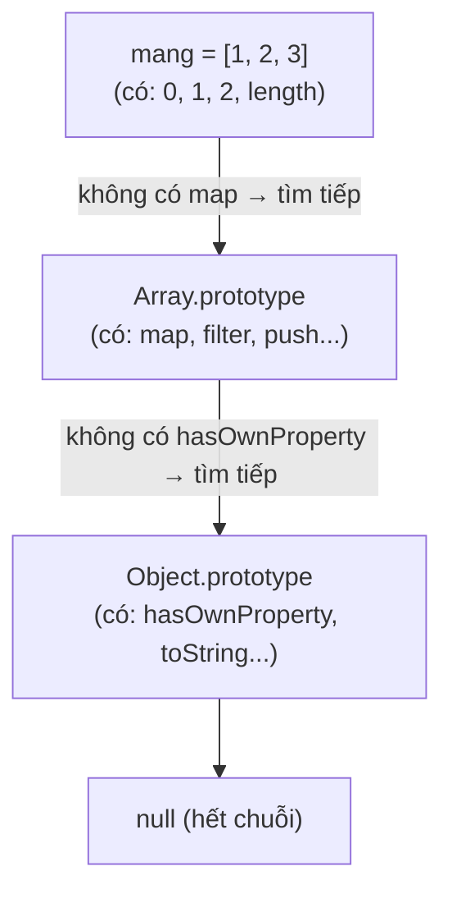

# this, prototype & class

::: info Mục tiêu bài học
- Hiểu `this` được xác định **lúc gọi hàm** và các quy tắc của nó; dùng `bind`, `call`, `apply`.
- Biết vì sao arrow function **không có `this` riêng** và khi nào điều đó có lợi.
- Hiểu **prototype** và chuỗi prototype: nền móng của kế thừa trong JavaScript.
- Viết **class**: constructor, phương thức, getter/setter, thuộc tính riêng tư `#`, `static`.
- Kế thừa với `extends` và `super`; biết khi nào không nên dùng kế thừa.
:::

## 1. `this` là gì?

`this` là một biến đặc biệt bên trong hàm, trỏ tới **object đang "sở hữu" lời gọi hàm**. Điều quan trọng nhất cần nhớ: với hàm thường, `this` được xác định **lúc gọi**, không phải lúc viết.

```js run
'use strict';   // như code trong module và class

const sanPham = {
  ten: 'Bàn phím',
  inTen() {
    console.log('Tên:', this?.ten);
  },
};

sanPham.inTen();               // gọi qua sanPham. → this là sanPham

const hamRoi = sanPham.inTen;  // tách hàm ra khỏi object
hamRoi();                      // gọi trơn → this là undefined → in "Tên: undefined"

const sanPham2 = { ten: 'Chuột', inTen: sanPham.inTen };
sanPham2.inTen();              // cùng một hàm, nhưng this là sanPham2
```

| Cách gọi | `this` là |
| --- | --- |
| `obj.ham()` | `obj`, object đứng trước dấu chấm |
| `ham()` gọi trơn | `undefined` (strict mode, module, class); `window` ở script cũ không strict |
| `new Ham()` | Object mới đang được tạo |
| `ham.call(x, ...)`, `ham.apply(x, [...])` | `x` |
| `ham.bind(x)` | Trả về hàm mới luôn có `this` là `x` |
| Arrow function | Không có `this` riêng, dùng `this` của phạm vi bao ngoài |
| Listener `addEventListener` (hàm thường) | Phần tử gắn listener (`event.currentTarget`) |

Lỗi kinh điển là **truyền phương thức làm callback**: phương thức bị tách khỏi object nên mất `this`.

```js run
const dongHo = {
  giay: 0,
  tang() {
    this.giay++;
    console.log('Giây:', this.giay);
  },
};

// ❌ setTimeout(dongHo.tang, 0) → this không còn là dongHo → lỗi
// ✅ Cách 1: bọc trong arrow function — vẫn gọi qua dongHo.
setTimeout(() => dongHo.tang(), 0);
// ✅ Cách 2: bind cố định this
setTimeout(dongHo.tang.bind(dongHo), 0);
```

## 2. `call`, `apply`, `bind`

```js run
function gioiThieu(loiChao, dauCham) {
  return `${loiChao}, tôi là ${this.ten}${dauCham}`;
}

const an = { ten: 'An' };

console.log(gioiThieu.call(an, 'Xin chào', '!'));        // gọi ngay, đối số liệt kê
console.log(gioiThieu.apply(an, ['Chào bạn', '.']));     // gọi ngay, đối số trong mảng
const anChao = gioiThieu.bind(an, 'Hello');              // KHÔNG gọi ngay, trả về hàm mới
console.log(anChao('?'));
```

Ngày nay bạn ít khi cần `call`/`apply` (spread `...` thay được `apply`), nhưng sẽ gặp chúng khi đọc code thư viện.

## 3. Arrow function và `this`

Arrow function **không có `this` riêng**: nó dùng `this` của nơi nó được viết. Điều này vừa có lợi vừa có hại:

```js run
const doiBong = {
  ten: 'Hà Nội FC',
  cauThu: ['Quang', 'Hùng', 'Văn'],

  // ✅ Lợi: callback arrow bên trong phương thức giữ được this của doiBong
  danhSach() {
    return this.cauThu.map((ct) => `${ct} (${this.ten})`);
  },

  // ❌ Hại: arrow function làm phương thức → this là của phạm vi ngoài, không phải doiBong
  tenSai: () => this?.ten,
};

console.log(doiBong.danhSach());
console.log(doiBong.tenSai());
```

**Quy tắc thực tế:** phương thức của object/class viết bằng cú pháp phương thức (`ten() {}`); callback bên trong phương thức viết bằng arrow function.

## 4. Prototype: kế thừa kiểu JavaScript

Bạn đã gọi `[1, 2].map(...)` hay `'abc'.toUpperCase()` mà chưa bao giờ định nghĩa `map` hay `toUpperCase`. Chúng ở đâu ra?

Mỗi object trong JavaScript có một liên kết ẩn tới một object khác gọi là **prototype** (nguyên mẫu). Khi đọc một thuộc tính mà object không có, JavaScript tìm tiếp trên prototype, rồi prototype của prototype... Đó là **chuỗi prototype**:



```js run
const mang = [1, 2, 3];
console.log(Object.getPrototypeOf(mang) === Array.prototype);   // true
console.log(Object.hasOwn(mang, 'map'));                        // false — map không nằm trên mang
console.log('map' in mang);                                     // true — nhưng tìm thấy qua chuỗi

// Tự tạo chuỗi prototype
const dongVat = {
  an() { return `${this.ten} đang ăn`; },
};
const meo = Object.create(dongVat);   // prototype của meo là dongVat
meo.ten = 'Mướp';
console.log(meo.an());                // tìm thấy an() trên dongVat
```

Các phương thức nằm trên prototype được **dùng chung** cho mọi object: một triệu mảng vẫn chỉ có một hàm `map`. Đó là kế thừa kiểu JavaScript (prototypal inheritance). Cú pháp `class` ở phần sau thực chất là cách viết dễ đọc hơn dựa trên chính cơ chế này.

::: warning Đừng sửa prototype của đối tượng có sẵn
Thêm phương thức vào `Array.prototype` hay `String.prototype` (kiểu `Array.prototype.tong = ...`) ảnh hưởng tới **mọi** mảng, có thể xung đột với thư viện khác và với tính năng JavaScript tương lai. Hãy viết hàm riêng.
:::

## 5. Class

**Class** là bản thiết kế để tạo ra nhiều object cùng cấu trúc và hành vi:

```js run
class SanPham {
  constructor(ten, gia, soLuong = 0) {    // chạy khi gọi new SanPham(...)
    this.ten = ten;
    this.gia = gia;
    this.soLuong = soLuong;
  }

  // Phương thức: nằm trên SanPham.prototype, dùng chung cho mọi sản phẩm
  conHang() {
    return this.soLuong > 0;
  }

  nhapThem(soLuong) {
    this.soLuong += soLuong;
    return this;                          // trả về this để gọi nối tiếp
  }

  // Getter: đọc như thuộc tính, nhưng được tính toán
  get giaHienThi() {
    return this.gia.toLocaleString('vi-VN') + ' ₫';
  }
}

const banPhim = new SanPham('Bàn phím', 450000, 10);
const chuot = new SanPham('Chuột', 150000);

console.log(banPhim.conHang(), chuot.conHang());
chuot.nhapThem(5).nhapThem(3);
console.log(chuot.soLuong, chuot.giaHienThi);    // giaHienThi không có ()
console.log(banPhim instanceof SanPham);
console.log(typeof SanPham);                     // 'function' — class thực chất là hàm
```

- Tên class viết **PascalCase**. Tạo object (gọi là **instance**) bằng `new`.
- `constructor` khởi tạo thuộc tính cho từng instance.
- Code trong class luôn chạy ở **strict mode**.

**Thuộc tính khai báo sẵn, riêng tư và static:**

```js run
class TaiKhoan {
  static #soTaiKhoanDaTao = 0;            // riêng tư và static: dùng chung cho cả class
  loai = 'thanh toán';                    // thuộc tính công khai khai báo sẵn
  #soDu = 0;                              // RIÊNG TƯ: chỉ code trong class truy cập được

  constructor(chuTaiKhoan) {
    this.chuTaiKhoan = chuTaiKhoan;
    TaiKhoan.#soTaiKhoanDaTao++;
  }

  napTien(soTien) {
    if (soTien <= 0) throw new RangeError('Số tiền nạp phải lớn hơn 0');
    this.#soDu += soTien;
  }

  get soDu() {                            // chỉ có getter → đọc được, không gán được từ ngoài
    return this.#soDu;
  }

  static tongSoTaiKhoan() {               // gọi trên class: TaiKhoan.tongSoTaiKhoan()
    return TaiKhoan.#soTaiKhoanDaTao;
  }
}

const tk = new TaiKhoan('Lan');
tk.napTien(2_000_000);
console.log(tk.soDu, tk.loai);
console.log(TaiKhoan.tongSoTaiKhoan());
console.log(Object.keys(tk));             // #soDu không lộ ra ngoài
// tk.#soDu = 999;                        // SyntaxError nếu bỏ dấu //
```

## 6. Kế thừa: `extends` và `super`

```js run
class HinhHoc {
  constructor(ten) {
    this.ten = ten;
  }
  dienTich() {
    return 0;
  }
  moTa() {
    return `${this.ten} có diện tích ${this.dienTich().toFixed(2)}`;
  }
}

class HinhTron extends HinhHoc {
  constructor(banKinh) {
    super('Hình tròn');          // gọi constructor của lớp cha — BẮT BUỘC trước khi dùng this
    this.banKinh = banKinh;
  }
  dienTich() {                   // ghi đè (override) phương thức của cha
    return Math.PI * this.banKinh ** 2;
  }
}

class HinhChuNhat extends HinhHoc {
  constructor(dai, rong) {
    super('Hình chữ nhật');
    this.dai = dai;
    this.rong = rong;
  }
  dienTich() {
    return this.dai * this.rong;
  }
  moTa() {
    return super.moTa() + ` (${this.dai} × ${this.rong})`;   // gọi phương thức của cha
  }
}

const cacHinh = [new HinhTron(2), new HinhChuNhat(3, 4)];
for (const hinh of cacHinh) {
  console.log(hinh.moTa());      // mỗi hình tự biết cách tính diện tích của mình
}
console.log(cacHinh[0] instanceof HinhHoc);
```

Mọi class lỗi có sẵn (`TypeError`, `RangeError`...) đều kế thừa `Error`. Bạn sẽ tự tạo class lỗi riêng bằng `extends Error` ở [bài Xử lý lỗi](/nang-cao/xu-ly-loi-debug), và tạo phần tử HTML riêng bằng `extends HTMLElement` ở [bài Web Components](/nang-cao/web-components).

::: tip Ưu tiên kết hợp hơn kế thừa
Cây kế thừa sâu (`DongVat → ThuCung → Cho → ChoNhaNuoi...`) nhanh chóng trở nên cứng nhắc: đổi lớp cha là vỡ cả loạt lớp con. Phần lớn trường hợp, **kết hợp** (object chứa object khác, hoặc hàm nhận object) đơn giản và linh hoạt hơn. Dùng `extends` khi quan hệ "là một" rõ ràng và ổn định. Nhiều codebase JavaScript hiện đại thậm chí chủ yếu dùng hàm và object thuần thay vì class.
:::

## Thực hành

**Bài 1.** Đoạn code sau báo lỗi khi bấm nút. Giải thích và sửa bằng hai cách.

```js
class BoDem {
  constructor(nut) {
    this.soLan = 0;
    nut.addEventListener('click', this.tang);
  }
  tang() {
    this.soLan++;
    console.log(this.soLan);
  }
}
```

::: details Xem lời giải
Khi trình duyệt gọi listener, `this` là **nút được bấm** chứ không phải object `BoDem`, nên `this.soLan` là `undefined` và kết quả in ra `NaN`. Sửa:

```html live
<button id="nut" type="button">Bấm</button>
<script>
  class BoDem {
    soLan = 0;
    constructor(nut) {
      nut.addEventListener('click', () => this.tang());   // Cách 1: bọc arrow function
      // nut.addEventListener('click', this.tang.bind(this)); // Cách 2: bind
    }
    tang() {
      this.soLan++;
      console.log('Đã bấm', this.soLan, 'lần');
    }
  }
  new BoDem(document.querySelector('#nut'));
</script>
```
Cách 3 hay gặp: khai báo `tang = () => { ... }` như một thuộc tính class (arrow function giữ `this` của instance).
:::

**Bài 2.** Viết class `GioHang` có: thuộc tính riêng tư `#danhSach` (mảng); `them(sanPham, soLuong = 1)` (cộng dồn nếu sản phẩm đã có, so theo `ten`); `xoa(ten)`; getter `tongTien`; getter `soMon`.

::: details Xem lời giải
```js run
class GioHang {
  #danhSach = [];

  them(sanPham, soLuong = 1) {
    const daCo = this.#danhSach.find((muc) => muc.ten === sanPham.ten);
    if (daCo) daCo.soLuong += soLuong;
    else this.#danhSach.push({ ...sanPham, soLuong });
    return this;
  }

  xoa(ten) {
    this.#danhSach = this.#danhSach.filter((muc) => muc.ten !== ten);
    return this;
  }

  get tongTien() {
    return this.#danhSach.reduce((t, muc) => t + muc.gia * muc.soLuong, 0);
  }

  get soMon() {
    return this.#danhSach.length;
  }
}

const gio = new GioHang();
gio.them({ ten: 'Áo', gia: 199000 }).them({ ten: 'Mũ', gia: 89000 }, 2).them({ ten: 'Áo', gia: 199000 });
console.log(gio.soMon, gio.tongTien);   // 2 576000
gio.xoa('Mũ');
console.log(gio.soMon, gio.tongTien);   // 1 398000
```
:::

**Bài 3.** Tạo class `NhanVien` (tên, lương cơ bản, phương thức `tinhLuong()` trả về lương cơ bản) và class con `QuanLy` có thêm `phuCap`, ghi đè `tinhLuong()` = lương của cha + phụ cấp (dùng `super.tinhLuong()`).

::: details Xem lời giải
```js run
class NhanVien {
  constructor(ten, luongCoBan) {
    this.ten = ten;
    this.luongCoBan = luongCoBan;
  }
  tinhLuong() {
    return this.luongCoBan;
  }
}

class QuanLy extends NhanVien {
  constructor(ten, luongCoBan, phuCap) {
    super(ten, luongCoBan);
    this.phuCap = phuCap;
  }
  tinhLuong() {
    return super.tinhLuong() + this.phuCap;
  }
}

const ds = [new NhanVien('An', 12_000_000), new QuanLy('Bình', 18_000_000, 5_000_000)];
for (const nv of ds) console.log(nv.ten, nv.tinhLuong().toLocaleString('vi-VN'));
```
:::

## Lỗi thường gặp

- **Truyền phương thức làm callback** (`addEventListener('click', this.xuLy)`) → mất `this`.
- **Dùng arrow function làm phương thức object** rồi dùng `this` bên trong.
- **Quên `new`** khi tạo instance từ class → `TypeError: Class constructor ... cannot be invoked without 'new'`.
- **Dùng `this` trước `super()`** trong class con.
- **Gọi getter có ngoặc** (`gio.tongTien()`) → `TypeError: ... is not a function`.
- **Cây kế thừa quá sâu** cho những quan hệ không thật sự là "là một".

## Tóm tắt

- `this` của hàm thường do **cách gọi** quyết định: `obj.ham()` → `obj`; gọi trơn → `undefined`; `new` → object mới; `bind`/`call`/`apply` → chỉ định.
- Arrow function dùng `this` của phạm vi bao ngoài: tốt cho callback, không dùng làm phương thức.
- Mọi object có prototype; thuộc tính không có sẽ được tìm tiếp theo chuỗi prototype.
- `class`: `constructor`, phương thức (trên prototype), `get`/`set`, `#riengTu`, `static`; tạo instance bằng `new`.
- `extends` + `super(...)` để kế thừa và gọi lớp cha; ưu tiên kết hợp hơn kế thừa sâu.

## Kiểm tra kiến thức

<Quiz />
