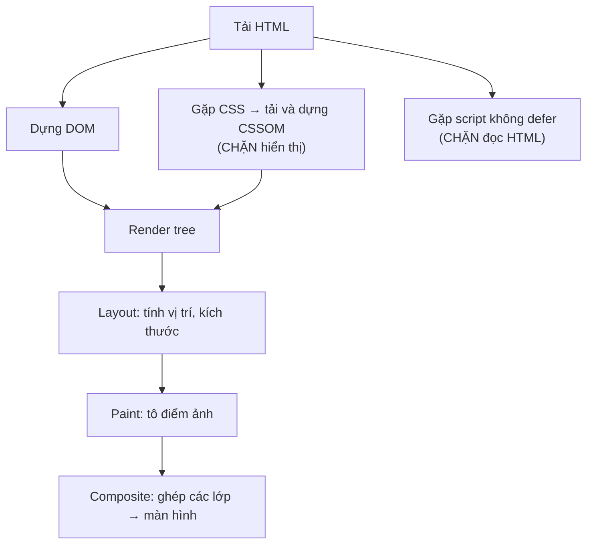

# Hiệu năng web

::: info Mục tiêu bài học
- Hiểu vì sao tốc độ quan trọng và ba chỉ số **Core Web Vitals**: LCP, INP, CLS.
- Nắm **quá trình hiển thị trang** và những gì chặn hiển thị.
- Tối ưu **tải tài nguyên**: HTML, CSS, JS, ảnh, font.
- Tối ưu **lúc chạy**: tránh layout thrashing, dùng debounce/throttle, `requestAnimationFrame`, `IntersectionObserver`, Web Worker.
- **Đo đạc** bằng Lighthouse và tab Performance trước khi tối ưu.
:::

## 1. Vì sao tốc độ quan trọng?

- Người dùng rời đi khi trang chậm: mỗi giây chờ thêm làm giảm đáng kể tỉ lệ ở lại và mua hàng.
- Nhiều người dùng ở Việt Nam truy cập bằng **điện thoại tầm trung** và **mạng di động** không ổn định. Trang chạy mượt trên máy tính của lập trình viên có thể rất chậm trên máy của họ.
- Google dùng tốc độ trải nghiệm (Core Web Vitals) làm một yếu tố xếp hạng.

Nguyên tắc vàng: **đo trước, tối ưu sau**. Đừng tối ưu theo cảm tính.

## 2. Core Web Vitals

| Chỉ số | Đo | Tốt khi |
| --- | --- | --- |
| **LCP** (Largest Contentful Paint) | Thời điểm phần nội dung **lớn nhất** (ảnh banner, khối chữ chính) hiện ra | ≤ 2,5 giây |
| **INP** (Interaction to Next Paint) | Độ trễ từ lúc người dùng **tương tác** (bấm, gõ) tới lúc trang vẽ phản hồi | ≤ 200 ms |
| **CLS** (Cumulative Layout Shift) | Mức nội dung bị **xô lệch** bất ngờ | ≤ 0,1 |

Ba chỉ số tương ứng với ba câu hỏi của người dùng: *Trang có hiện nhanh không? Bấm vào có phản hồi ngay không? Nội dung có nhảy lung tung không?*

## 3. Quá trình hiển thị trang



- **CSS chặn hiển thị**: trình duyệt không vẽ gì cho tới khi có đủ CSS (để tránh "nháy" trang chưa có kiểu). CSS nên gọn và tải sớm.
- **Script thường chặn việc đọc HTML**: dùng `defer` hoặc `type="module"` ([bài head](/html/head-media#_1-ben-trong-head)).
- Mỗi khi JavaScript đổi DOM hay style, trình duyệt có thể phải chạy lại **layout → paint → composite**. Đổi `transform`/`opacity` chỉ cần composite; đổi kích thước, vị trí kéo theo cả layout ([bài Animation](/css/transition-animation#_5-animate-the-nao-cho-muot)).

## 4. Tối ưu tải trang

**Gửi ít hơn:**

- **Nén** và **thu gọn** (minify) HTML, CSS, JS; bật nén gzip/brotli trên server. Vite làm sẵn khi `npm run build`.
- **Bớt JavaScript**: đây thường là thứ đắt nhất, vì ngoài tải về còn phải phân tích và chạy. Cân nhắc trước mỗi thư viện; dùng `import()` động để tách phần chỉ cần đôi khi dùng.
- **Lưu đệm** (cache): tệp có mã băm trong tên (`app.3f9a1c.js`) có thể lưu đệm cả năm.

**Ảnh** thường chiếm phần lớn dung lượng trang:

| Việc | Cách |
| --- | --- |
| Định dạng hiện đại | WebP, AVIF nhẹ hơn JPEG/PNG đáng kể |
| Đúng kích thước | `srcset` + `sizes`: điện thoại không tải ảnh 2000px |
| Tải trễ | `loading="lazy"` cho ảnh dưới màn hình đầu tiên |
| Ưu tiên ảnh LCP | Ảnh banner chính **không** lazy, thêm `fetchpriority="high"` |
| Chống xô lệch | Luôn có `width`/`height` hoặc `aspect-ratio` |

**Font:**

- Chỉ tải những độ đậm cần dùng; định dạng `woff2`; `font-display: swap`.
- `<link rel="preconnect">` tới tên miền chứa font (như Google Fonts) để bắt tay kết nối sớm.
- Hoặc dùng `font-family: system-ui, ...`: không tải gì cả, hiện ngay lập tức.

**Gợi ý tải trước:**

```html
<link rel="preconnect" href="https://api.example.com">            <!-- mở kết nối sớm -->
<link rel="preload" href="/fonts/be-vietnam-pro.woff2" as="font" type="font/woff2" crossorigin>
<link rel="prefetch" href="/thanh-toan.html">                    <!-- trang có thể mở tiếp theo -->
```

## 5. Tránh làm trình duyệt tính lại bố cục liên tục

**Layout thrashing**: xen kẽ **ghi** (đổi style) rồi **đọc** (kích thước, vị trí) trong vòng lặp buộc trình duyệt tính lại layout ngay lập tức ở mỗi vòng.

```js
// ❌ Mỗi vòng: ghi rồi đọc → trình duyệt phải tính layout 1000 lần
for (const the of cacThe) {
  the.style.width = '50%';
  console.log(the.offsetHeight);
}

// ✅ Đọc hết trước, ghi hết sau → chỉ tính layout một lần
const chieuCao = cacThe.map((the) => the.offsetHeight);
cacThe.forEach((the) => { the.style.width = '50%'; });
```

Các thuộc tính "đọc" gây tính layout: `offsetWidth/Height`, `clientWidth`, `scrollTop`, `getBoundingClientRect()`, `getComputedStyle()`...

**Gom thay đổi DOM**: tạo hết phần tử rồi chèn một lần (`append(...ds)`, `replaceChildren`), như ở [bài DOM](/javascript/dom#_6-tao-chen-xoa-phan-tu). Với danh sách hàng nghìn dòng, chỉ hiển thị phần đang nhìn thấy (kỹ thuật *virtual scrolling*), hoặc dùng CSS `content-visibility: auto` để trình duyệt bỏ qua việc vẽ phần ngoài màn hình.

## 6. Debounce và throttle

Một số sự kiện bắn ra **rất dày**: `input` (mỗi phím), `scroll`, `resize`, `pointermove` (hàng chục lần mỗi giây). Xử lý nặng ở mỗi lần là lãng phí.

```html live
<label>Gõ thử: <input id="o" autocomplete="off"></label>
<p>Sự kiện input: <b id="tho">0</b> · Debounce 400ms: <b id="deb">0</b> · Throttle 400ms: <b id="thr">0</b></p>

<script>
  // Debounce: chỉ chạy sau khi đã NGỪNG kích hoạt một khoảng thời gian
  function debounce(ham, ms) {
    let hen;
    return (...thamSo) => {
      clearTimeout(hen);
      hen = setTimeout(() => ham(...thamSo), ms);
    };
  }

  // Throttle: chạy tối đa MỘT lần mỗi khoảng thời gian
  function throttle(ham, ms) {
    let lanCuoi = 0;
    return (...thamSo) => {
      const bayGio = Date.now();
      if (bayGio - lanCuoi >= ms) {
        lanCuoi = bayGio;
        ham(...thamSo);
      }
    };
  }

  const dem = { tho: 0, deb: 0, thr: 0 };
  const tang = (id) => { document.querySelector('#' + id).textContent = ++dem[id]; };

  const o = document.querySelector('#o');
  o.addEventListener('input', () => tang('tho'));
  o.addEventListener('input', debounce(() => tang('deb'), 400));
  o.addEventListener('input', throttle(() => tang('thr'), 400));
</script>
```

| Kỹ thuật | Hành vi | Dùng cho |
| --- | --- | --- |
| **Debounce** | Hẹn giờ lại mỗi lần có sự kiện; chỉ chạy khi yên lặng đủ lâu | Ô tìm kiếm gọi API, tự lưu bản nháp, kiểm tra form khi gõ |
| **Throttle** | Chạy đều đặn, tối đa một lần mỗi khoảng | Cuộn vô hạn, kéo thả, theo dõi vị trí chuột |

Cả hai đều là ứng dụng của [closure](/nang-cao/scope-closure): chúng "nhớ" bộ hẹn giờ giữa các lần gọi.

## 7. `requestAnimationFrame`, `IntersectionObserver`, Web Worker

**`requestAnimationFrame(fn)`** chạy `fn` ngay **trước lần vẽ tiếp theo** của trình duyệt (khoảng 60 lần mỗi giây), tự dừng khi tab bị ẩn. Dùng cho animation bằng JavaScript, thay vì `setInterval`:

```js
function chay(thoiGian) {
  hop.style.transform = `translateX(${Math.sin(thoiGian / 500) * 100}px)`;
  requestAnimationFrame(chay);
}
requestAnimationFrame(chay);
```

**`IntersectionObserver`** báo cho bạn khi phần tử **đi vào/ra khỏi** khung nhìn, mà không cần nghe sự kiện `scroll`:

```html live height=300
<p>Cuộn xuống trong khung này ↓</p>
<div style="height: 360px"></div>
<p class="muc">Mục 1 hiện ra!</p>
<p class="muc">Mục 2 hiện ra!</p>
<p class="muc">Mục 3 hiện ra!</p>
<div style="height: 200px"></div>

<style>
  body { font-family: system-ui, sans-serif; }
  .muc { padding: 16px; margin: 24px 0; background: #ede9fe; border-radius: 8px;
         opacity: 0; transform: translateY(20px); transition: opacity 0.5s, transform 0.5s; }
  .muc.hien { opacity: 1; transform: none; }
</style>

<script>
  const quanSat = new IntersectionObserver((cacMuc) => {
    for (const muc of cacMuc) {
      if (muc.isIntersecting) {
        muc.target.classList.add('hien');
        quanSat.unobserve(muc.target);     // chỉ cần một lần
        console.log('Đã thấy:', muc.target.textContent);
      }
    }
  }, { threshold: 0.5 });                  // hiện ít nhất 50% mới tính

  document.querySelectorAll('.muc').forEach((el) => quanSat.observe(el));
</script>
```

Ứng dụng: tải ảnh hoặc dữ liệu trễ, cuộn vô hạn (quan sát một phần tử "lính canh" ở cuối danh sách), hiệu ứng xuất hiện, đếm lượt xem quảng cáo. Họ hàng của nó: `ResizeObserver` (phần tử đổi kích thước), `MutationObserver` (DOM thay đổi).

**Web Worker** chạy JavaScript ở **luồng riêng**, để tính toán nặng (xử lý ảnh, phân tích tệp lớn, mã hóa) không làm đơ giao diện:

```js
// main.js
const worker = new Worker(new URL('./tinh-toan.js', import.meta.url), { type: 'module' });
worker.postMessage({ soLuong: 50_000_000 });
worker.onmessage = (event) => console.log('Kết quả:', event.data);

// tinh-toan.js
self.onmessage = (event) => {
  let tong = 0;
  for (let i = 0; i < event.data.soLuong; i++) tong += i % 7;
  self.postMessage(tong);
};
```

Worker không truy cập được DOM; nó chỉ trao đổi dữ liệu với trang chính qua `postMessage`.

## 8. Đo đạc

- **Lighthouse** (DevTools → Lighthouse): chấm điểm hiệu năng, chỉ ra vấn đề và cách sửa. Chạy ở chế độ ẩn danh để tiện ích trình duyệt không làm sai kết quả, và chọn **Mobile**.
- **Tab Performance**: ghi lại những gì trình duyệt làm trong vài giây; thấy rõ tác vụ dài (khối màu đỏ), layout, paint. Bật **CPU throttling 4×** để giả lập điện thoại yếu.
- **Tab Network**: kiểm tra tổng dung lượng, tệp nào nặng, tệp nào chặn hiển thị; bật giả lập mạng **Slow 4G**.
- **PageSpeed Insights** ([pagespeed.web.dev](https://pagespeed.web.dev)): dữ liệu từ người dùng thật (nếu trang đủ lượt truy cập) cộng với Lighthouse.
- Trong code: `performance.now()`, `console.time()` để đo một đoạn xử lý.

## Thực hành

**Bài 1.** Chạy Lighthouse (chế độ Mobile) cho một trang bạn hay dùng. Ghi lại điểm và 3 gợi ý cải thiện quan trọng nhất cùng ước tính thời gian tiết kiệm được.

::: details Xem gợi ý
Gợi ý hay gặp: *Properly size images*, *Serve images in next-gen formats*, *Eliminate render-blocking resources*, *Reduce unused JavaScript*, *Image elements do not have explicit width and height* (gây CLS). Mỗi mục có danh sách tệp cụ thể và link hướng dẫn.
:::

**Bài 2.** Ô tìm kiếm dưới đây gọi một "API giả" mất 300ms mỗi lần gõ phím. Thêm debounce 350ms để giảm số lần gọi, và đảm bảo kết quả hiển thị luôn ứng với từ khóa **mới nhất**.

```html live
<input id="tim" placeholder="Tìm món ăn..." autocomplete="off">
<p>Số lần gọi API: <b id="so-lan">0</b></p>
<ul id="kq"></ul>

<script>
  const MON = ['phở bò', 'phở gà', 'bún chả', 'bún bò Huế', 'bánh mì', 'bánh xèo', 'cơm tấm'];
  let soLan = 0;
  function apiGia(tuKhoa) {
    document.querySelector('#so-lan').textContent = ++soLan;
    return new Promise((ok) => setTimeout(() => ok(MON.filter((m) => m.includes(tuKhoa))), 300));
  }

  document.querySelector('#tim').addEventListener('input', async (e) => {
    const kq = await apiGia(e.target.value.trim());
    document.querySelector('#kq').replaceChildren(...kq.map((m) => {
      const li = document.createElement('li');
      li.textContent = m;
      return li;
    }));
  });
</script>
```

::: details Xem lời giải
```html live
<input id="tim" placeholder="Tìm món ăn..." autocomplete="off">
<p>Số lần gọi API: <b id="so-lan">0</b></p>
<ul id="kq"></ul>

<script>
  const MON = ['phở bò', 'phở gà', 'bún chả', 'bún bò Huế', 'bánh mì', 'bánh xèo', 'cơm tấm'];
  let soLan = 0;
  function apiGia(tuKhoa) {
    document.querySelector('#so-lan').textContent = ++soLan;
    return new Promise((ok) => setTimeout(() => ok(MON.filter((m) => m.includes(tuKhoa))), 300));
  }

  function debounce(ham, ms) {
    let hen;
    return (...thamSo) => {
      clearTimeout(hen);
      hen = setTimeout(() => ham(...thamSo), ms);
    };
  }

  let lanGoiMoiNhat = 0;
  async function timKiem(tuKhoa) {
    const lanNay = ++lanGoiMoiNhat;
    const kq = await apiGia(tuKhoa);
    if (lanNay !== lanGoiMoiNhat) return;          // đã có lần gọi mới hơn → bỏ kết quả cũ
    document.querySelector('#kq').replaceChildren(...kq.map((m) => {
      const li = document.createElement('li');
      li.textContent = m;
      return li;
    }));
  }

  const timKiemDebounce = debounce(timKiem, 350);
  document.querySelector('#tim').addEventListener('input', (e) => timKiemDebounce(e.target.value.trim()));
</script>
```
Với `fetch` thật, hãy hủy request cũ bằng `AbortController` như ở [bài Gọi API](/nang-cao/fetch-api#_7-huy-request-va-thoi-gian-cho).
:::

## Lỗi thường gặp

- **Tối ưu theo cảm tính** mà không đo.
- **Chỉ thử trên máy tính mạnh với mạng nhanh.**
- **Ảnh không có kích thước** → CLS cao; **lazy-load ảnh LCP** → LCP chậm.
- **Cài thư viện nặng** cho việc nhỏ; gửi toàn bộ JavaScript ngay từ đầu.
- **Nghe `scroll`** để làm việc mà `IntersectionObserver` làm tốt hơn.
- **Tính toán nặng trên luồng chính** → INP kém, trang đơ.

## Tóm tắt

- Core Web Vitals: **LCP** ≤ 2,5s (hiện nhanh), **INP** ≤ 200ms (phản hồi nhanh), **CLS** ≤ 0,1 (không xô lệch).
- CSS chặn hiển thị, script thường chặn đọc HTML: CSS gọn, script `defer`/module.
- Gửi ít hơn: nén, bớt JS, `import()` động, ảnh đúng định dạng và kích thước, lazy-load hợp lý, font gọn.
- Lúc chạy: tránh xen kẽ đọc/ghi layout, gom thay đổi DOM, debounce/throttle sự kiện dày, `requestAnimationFrame` cho animation, `IntersectionObserver` thay cho `scroll`, Web Worker cho việc nặng.
- Đo bằng Lighthouse, Performance, Network, PageSpeed Insights.

## Kiểm tra kiến thức

<Quiz />
