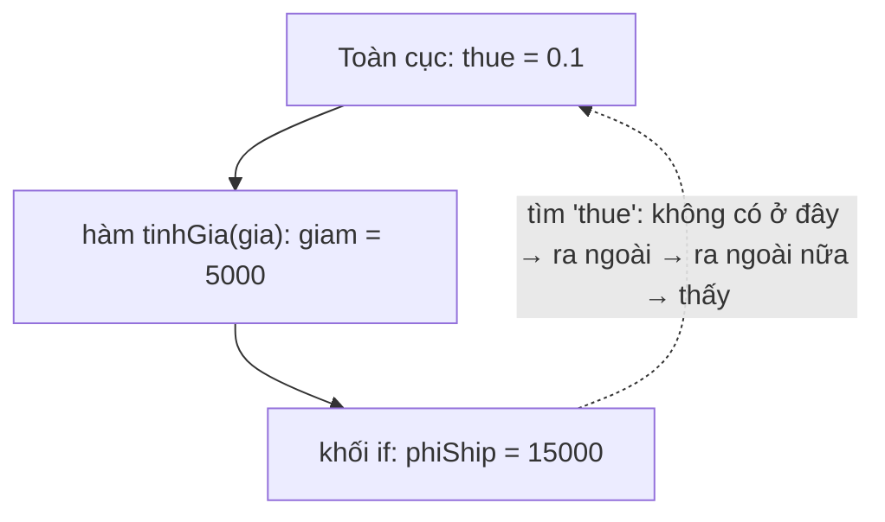

# Scope, hoisting & closure

::: info Mục tiêu bài học
- Hiểu **phạm vi** (scope): toàn cục, hàm, khối; **lexical scope** và **chuỗi phạm vi**.
- Giải thích được vì sao `let`/`const` an toàn hơn `var`: **hoisting** và **vùng chết tạm thời** (TDZ).
- Hiểu **closure** và dùng nó để tạo trạng thái riêng tư, hàm "nhớ", hàm chạy một lần.
- Nhận ra và sửa **lỗi kinh điển** của closure trong vòng lặp.
:::

## 1. Phạm vi (scope)

**Phạm vi** là vùng code mà một biến "nhìn thấy được". JavaScript có ba loại:

```js run
const toanCuc = 'thấy ở mọi nơi';             // phạm vi toàn cục (của script/module)

function hamNgoai() {
  const cuaHam = 'chỉ thấy trong hamNgoai';    // phạm vi hàm

  if (true) {
    const cuaKhoi = 'chỉ thấy trong khối if';  // phạm vi khối { }
    console.log(toanCuc, '|', cuaHam, '|', cuaKhoi);
  }

  console.log(typeof cuaKhoi);                 // 'undefined' — ra khỏi khối là mất
}

hamNgoai();
console.log(typeof cuaHam);                    // 'undefined'
```

**Lexical scope** (phạm vi theo vị trí viết): phạm vi được quyết định bởi **nơi code được viết ra**, theo cách các hàm và khối lồng nhau, chứ không phải nơi hàm được gọi. Khi gặp một tên biến, JavaScript tìm trong phạm vi hiện tại, không có thì tìm ra phạm vi bao ngoài, cứ thế tới phạm vi toàn cục. Đó là **chuỗi phạm vi** (scope chain):



```js run
const thue = 0.1;

function tinhGia(gia) {
  const giam = 5000;
  if (gia > 100000) {
    const phiShip = 0;
    return gia - giam + gia * thue + phiShip;   // thấy cả 4 biến
  }
  return gia + gia * thue;
}

console.log(tinhGia(200000));
```

Biến bên trong có thể **che** (shadow) biến cùng tên bên ngoài. Hợp lệ, nhưng dễ gây nhầm, nên đặt tên khác nhau.

## 2. `var`, `let`, `const` và hoisting

**Hoisting** ("nâng lên"): trước khi chạy một phạm vi, JavaScript đã "biết" mọi khai báo trong phạm vi đó. Cách mỗi loại khai báo được đối xử khác nhau:

```js run
// 1. function declaration: nâng lên TOÀN BỘ → gọi trước khi viết được
console.log(chao('An'));
function chao(ten) {
  return `Chào ${ten}`;
}

// 2. var: nâng lên và gán sẵn undefined → không lỗi, nhưng che giấu lỗi
console.log(soLuong);     // undefined (không báo gì!)
var soLuong = 5;

// 3. let/const: nâng lên nhưng nằm trong "vùng chết tạm thời" (TDZ) tới dòng khai báo
try {
  console.log(gia);
} catch (loi) {
  console.log(loi.name + ': ' + loi.message);
}
const gia = 100;
```

**Vì sao tránh `var`?**

| | `var` | `let` / `const` |
| --- | --- | --- |
| Phạm vi | **Hàm** (bỏ qua khối `if`, `for`) | **Khối** `{ }` |
| Dùng trước khai báo | `undefined`, không báo lỗi | `ReferenceError` (TDZ): lỗi lộ ra ngay |
| Khai báo lại cùng tên | Được, âm thầm ghi đè | Lỗi cú pháp |
| Ở cấp cao nhất script | Thành thuộc tính của `window` | Không |

```js run
if (true) {
  var roRi = 'var thoát ra khỏi khối if';
  let anToan = 'let ở yên trong khối';
}
console.log(roRi);
console.log(typeof anToan);
```

Mọi điểm khác biệt đều nghiêng về `let`/`const`: lỗi được báo sớm, phạm vi hẹp và dễ đoán. Đó là lý do khóa học bảo bạn quên `var` đi. Bạn chỉ cần hiểu nó để đọc code cũ.

## 3. Closure

Xem lại ví dụ ở [bài Hàm](/javascript/ham):

```js run
function taoBoDem() {
  let dem = 0;                       // biến cục bộ của taoBoDem
  return function () {
    dem++;                           // hàm bên trong dùng biến của hàm ngoài
    return dem;
  };
}

const boDemA = taoBoDem();
const boDemB = taoBoDem();

console.log(boDemA(), boDemA(), boDemA());   // 1 2 3
console.log(boDemB());                       // 1 — bộ đếm riêng
```

`taoBoDem()` đã chạy xong, theo lẽ thường biến `dem` phải biến mất. Nhưng hàm được trả về vẫn **giữ tham chiếu** tới phạm vi nơi nó được tạo ra, nên `dem` tiếp tục sống. Hàm cùng với phạm vi đó gọi là **closure** (bao đóng). Mỗi lần gọi `taoBoDem()` tạo ra một phạm vi **mới**, nên `boDemA` và `boDemB` có `dem` riêng.

Thật ra **mọi** hàm trong JavaScript đều là closure. Bạn đã dùng closure suốt từ đầu khóa mà không gọi tên:

```js
const tien = new Intl.NumberFormat('vi-VN', { style: 'currency', currency: 'VND' });
nut.addEventListener('click', () => {
  hienThi(tien.format(gia));   // callback "nhớ" tien, gia, hienThi từ phạm vi ngoài
});
```

## 4. Ứng dụng của closure

**Dữ liệu riêng tư:** bên ngoài không sửa trực tiếp được, chỉ qua các hàm được cho phép:

```js run
function taoTaiKhoan(soDuBanDau) {
  let soDu = soDuBanDau;          // "riêng tư": không ai chạm vào được từ bên ngoài

  return {
    napTien(soTien) {
      if (soTien <= 0) throw new Error('Số tiền phải dương');
      soDu += soTien;
      return soDu;
    },
    rutTien(soTien) {
      if (soTien > soDu) throw new Error('Không đủ số dư');
      soDu -= soTien;
      return soDu;
    },
    xemSoDu: () => soDu,
  };
}

const tk = taoTaiKhoan(1_000_000);
tk.napTien(500_000);
tk.rutTien(200_000);
console.log(tk.xemSoDu());        // 1300000
console.log(tk.soDu);             // undefined — không truy cập trực tiếp được
```

**Hàm nhà máy** (factory): tạo ra các hàm "cấu hình sẵn":

```js run
function taoDinhDang(ngonNgu, tienTe) {
  const fmt = new Intl.NumberFormat(ngonNgu, { style: 'currency', currency: tienTe });
  return (soTien) => fmt.format(soTien);
}

const vnd = taoDinhDang('vi-VN', 'VND');
const usd = taoDinhDang('en-US', 'USD');
console.log(vnd(250000), '|', usd(9.99));
```

**Chạy một lần** và **ghi nhớ kết quả** (memoize):

```js run
function motLan(ham) {
  let daChay = false;
  let ketQua;
  return (...thamSo) => {
    if (!daChay) {
      daChay = true;
      ketQua = ham(...thamSo);
    }
    return ketQua;
  };
}

const khoiTao = motLan(() => {
  console.log('Đang khởi tạo... (chỉ in một lần)');
  return 'sẵn sàng';
});
console.log(khoiTao(), khoiTao(), khoiTao());

function ghiNho(ham) {
  const boNho = new Map();
  return (n) => {
    if (!boNho.has(n)) boNho.set(n, ham(n));
    return boNho.get(n);
  };
}

const tinhCham = (n) => {
  let tong = 0;
  for (let i = 0; i < n * 1_000_000; i++) tong += i % 7;
  return tong;
};
const tinhNhanh = ghiNho(tinhCham);

console.time('lần 1');
tinhNhanh(30);
console.timeEnd('lần 1');
console.time('lần 2 (đã nhớ)');
tinhNhanh(30);
console.timeEnd('lần 2 (đã nhớ)');
```

Kỹ thuật **debounce** và **throttle** ở [bài Hiệu năng](/nang-cao/hieu-nang) cũng chính là closure: chúng "nhớ" bộ hẹn giờ giữa các lần gọi.

## 5. Lỗi kinh điển: closure trong vòng lặp

```js run
// Với var: chỉ có MỘT biến i dùng chung cho mọi vòng
for (var i = 0; i < 3; i++) {
  setTimeout(() => console.log('var:', i), 0);
}

// Với let: MỖI vòng lặp có một biến j riêng
for (let j = 0; j < 3; j++) {
  setTimeout(() => console.log('let:', j), 0);
}
```

Ba callback `var` cùng "nhớ" **một** biến `i`. Khi chúng chạy (sau khi vòng lặp xong), `i` đã là 3. Với `let`, mỗi vòng lặp tạo một biến mới. Lỗi này từng khiến hàng triệu lập trình viên đau đầu, cho tới khi `let` ra đời năm 2015. Ngày nay chỉ cần nhớ: **dùng `let` trong vòng lặp**.

## 6. Module pattern: từ IIFE tới ES module

Trước khi có module, người ta dùng closure để tránh "xả rác" biến ra phạm vi toàn cục, qua **IIFE** (hàm chạy ngay khi định nghĩa):

```js
const ungDung = (function () {
  const cauHinh = { phienBan: '1.0' };       // riêng tư
  function khoiDong() { /* ... */ }
  return { khoiDong };                       // chỉ công khai những gì cần
})();
```

Ngày nay, **ES module** làm việc này gọn gàng hơn: mỗi tệp là một phạm vi riêng, chỉ những gì `export` mới được nhìn thấy từ bên ngoài ([bài Module](/nang-cao/module-cong-cu)). Bạn vẫn gặp IIFE trong code cũ và trong các đoạn script nhúng.

## 7. Closure và bộ nhớ

Closure giữ các biến nó dùng **còn sống** chừng nào chính closure còn sống. Thường không sao, nhưng cần để ý khi một listener trên `window` hay một `setInterval` giữ tham chiếu tới dữ liệu lớn hoặc phần tử DOM đã bị xóa: chúng sẽ không được dọn khỏi bộ nhớ cho tới khi bạn gỡ listener hay `clearInterval`.

## Thực hành

**Bài 1.** Viết `taoBoDem(batDau = 0, buoc = 1)` trả về object có ba phương thức `tang()`, `giam()`, `datLai()`, mỗi phương thức trả về giá trị hiện tại. Hai bộ đếm tạo ra phải độc lập.

::: details Xem lời giải
```js run
function taoBoDem(batDau = 0, buoc = 1) {
  let giaTri = batDau;
  return {
    tang: () => (giaTri += buoc),
    giam: () => (giaTri -= buoc),
    datLai: () => (giaTri = batDau),
  };
}

const a = taoBoDem();
const b = taoBoDem(100, 10);
console.log(a.tang(), a.tang(), b.giam(), a.datLai(), b.giam());   // 1 2 90 0 80
```
Phép gán `(giaTri += buoc)` cũng là một biểu thức trả về giá trị mới, nên arrow function trả về được luôn.
:::

**Bài 2.** Dự đoán kết quả trước khi chạy và giải thích:

```js run
let x = 'ngoài';

function inX() {
  console.log(x);
}

function chay() {
  let x = 'trong chay';
  inX();
}

chay();
```

::: details Xem lời giải
In ra `'ngoài'`. Lexical scope: `inX` được **viết** ở phạm vi toàn cục, nên nó tìm `x` ở đó, không quan tâm nó được **gọi** từ bên trong `chay`.
:::

**Bài 3.** Viết `gioiHanLanGoi(ham, toiDa)` trả về một hàm chỉ chạy `ham` tối đa `toiDa` lần; những lần sau in cảnh báo và trả về `undefined`. Thử với một hàm gửi mã OTP, giới hạn 3 lần.

::: details Xem lời giải
```js run
function gioiHanLanGoi(ham, toiDa) {
  let soLan = 0;
  return (...thamSo) => {
    if (soLan >= toiDa) {
      console.warn(`Đã vượt quá ${toiDa} lần cho phép`);
      return undefined;
    }
    soLan++;
    return ham(...thamSo);
  };
}

const guiOTP = gioiHanLanGoi((sdt) => `Đã gửi OTP tới ${sdt}`, 3);
for (let i = 0; i < 4; i++) console.log(guiOTP('0901234567'));
```
Giới hạn trên trình duyệt chỉ để tiện cho người dùng. Giới hạn thật sự (chống spam OTP) phải nằm ở server.
:::

## Lỗi thường gặp

- **Dùng `var`** và bất ngờ vì biến "thoát" khỏi khối, hoặc là `undefined` thay vì báo lỗi.
- **Dùng biến trước khi khai báo** (`let`/`const`) → `ReferenceError` do TDZ.
- **Nghĩ hàm nhìn biến theo nơi gọi** thay vì nơi viết.
- **Closure trong vòng lặp `var`.**
- **Quên gỡ listener/interval** giữ closure tham chiếu dữ liệu lớn.

## Tóm tắt

- Ba loại phạm vi: toàn cục, hàm, khối. Phạm vi theo vị trí **viết** code (lexical); tìm biến từ trong ra ngoài theo chuỗi phạm vi.
- Hoisting: function declaration được nâng toàn bộ; `var` được nâng và là `undefined`; `let`/`const` nằm trong TDZ cho tới dòng khai báo.
- Closure = hàm + phạm vi nơi nó được tạo; giữ biến sống sau khi hàm ngoài kết thúc.
- Ứng dụng: dữ liệu riêng tư, hàm nhà máy, chạy một lần, ghi nhớ kết quả, debounce.
- Trong vòng lặp có callback, dùng `let` để mỗi vòng có biến riêng.

## Kiểm tra kiến thức

<Quiz />
