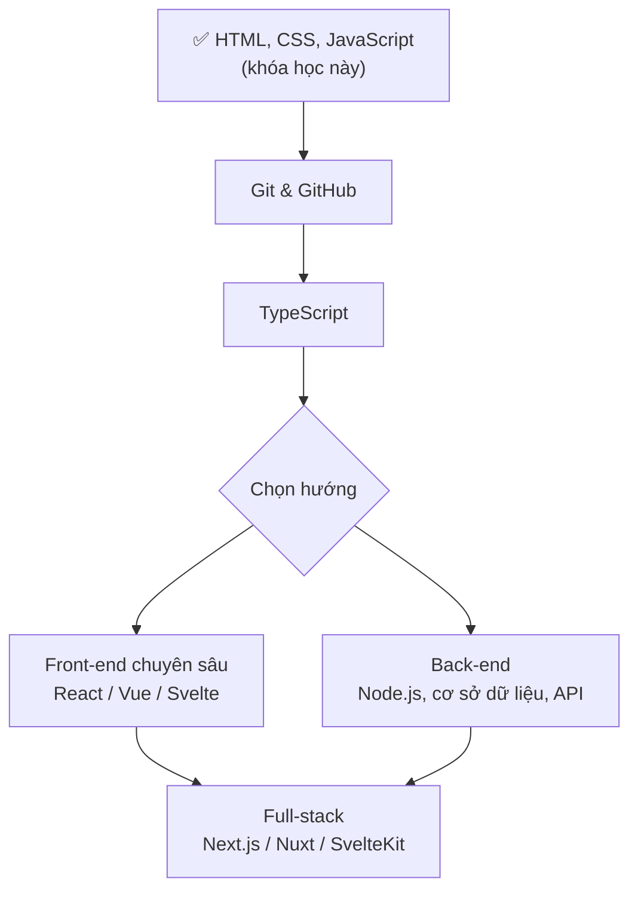

# Tài nguyên học tiếp

Hoàn thành khóa học là bước đầu. Trang này gom những nguồn đáng tin để tra cứu, luyện tập và gợi ý con đường tiếp theo.

## Tài liệu tra cứu

| Nguồn | Dùng để | Ghi chú |
| --- | --- | --- |
| [MDN Web Docs](https://developer.mozilla.org/vi/) | Tra cứu mọi thẻ HTML, thuộc tính CSS, API JavaScript | Nguồn chuẩn nhất; có một phần bản tiếng Việt, bản tiếng Anh đầy đủ hơn |
| [web.dev](https://web.dev) | Hướng dẫn của Google về hiệu năng, accessibility, CSS hiện đại | Có các khóa học miễn phí: *Learn HTML*, *Learn CSS*, *Learn Accessibility* |
| [javascript.info](https://javascript.info) | Giáo trình JavaScript từ cơ bản đến nâng cao | Giải thích rất kỹ, nhiều bài tập |
| [caniuse.com](https://caniuse.com) | Kiểm tra tính năng đã được trình duyệt nào hỗ trợ | Kết hợp với nhãn **Baseline** trên MDN |
| [HTML Living Standard](https://html.spec.whatwg.org) | Đặc tả HTML chính thức | Đọc khi cần câu trả lời chính xác tuyệt đối |
| [ECMAScript (TC39)](https://tc39.es/ecma262/) | Đặc tả JavaScript; [danh sách đề xuất](https://github.com/tc39/proposals) cho tính năng sắp có | Nâng cao |
| [WAI-ARIA Authoring Practices](https://www.w3.org/WAI/ARIA/apg/) | Mẫu chuẩn cho tab, menu, hộp thoại... dễ tiếp cận | Kèm ví dụ code |

::: tip Đọc tài liệu tiếng Anh
Phần lớn tài liệu kỹ thuật tốt nhất là tiếng Anh. Bạn không cần giỏi tiếng Anh giao tiếp: vốn từ kỹ thuật khá hạn chế và lặp lại nhiều. Khi bí, dùng tính năng dịch của trình duyệt, nhưng hãy giữ nguyên các thuật ngữ (xem [Thuật ngữ](/tham-khao/thuat-ngu)).
:::

## Công cụ

| Công cụ | Dùng để |
| --- | --- |
| [Visual Studio Code](https://code.visualstudio.com) + Prettier, ESLint, Live Preview | Viết code |
| DevTools của Chrome/Edge/Firefox | Kiểm tra, debug, đo hiệu năng |
| [W3C Validator](https://validator.w3.org) | Kiểm tra lỗi HTML |
| [regex101](https://regex101.com) | Thử và giải thích biểu thức chính quy |
| [PageSpeed Insights](https://pagespeed.web.dev) | Đo hiệu năng với dữ liệu người dùng thật |
| axe DevTools, [WebAIM Contrast Checker](https://webaim.org/resources/contrastchecker/) | Kiểm tra accessibility, độ tương phản |
| [Git](https://git-scm.com) + [GitHub](https://github.com) | Quản lý phiên bản, làm việc nhóm, đưa trang lên GitHub Pages |
| [Code Playground](/thuc-hanh/playground) của khóa học | Thử nhanh HTML/CSS/JS, chia sẻ bằng link |

## Luyện tập

- **Làm lại giao diện có thật**: chọn một trang bạn thích (trang tin tức, trang sản phẩm), tự dựng lại bằng HTML/CSS. Không cần giống 100%; mục tiêu là luyện bố cục và responsive.
- **Frontend Mentor** ([frontendmentor.io](https://www.frontendmentor.io)): đề bài có sẵn thiết kế, từ dễ tới khó, có cộng đồng nhận xét.
- **Exercism** ([exercism.org](https://exercism.org/tracks/javascript)): bài tập JavaScript có người hướng dẫn.
- **CSS Grid Garden**, **Flexbox Froggy**: trò chơi luyện Grid và Flexbox.
- **Mỗi tuần một dự án nhỏ**: đồng hồ đếm ngược, máy tính bỏ túi, trò chơi đoán số, ứng dụng ghi chú, trang thời tiết (API Open-Meteo), từ điển (API công khai)...

## Lộ trình học tiếp

1. **Git và GitHub** (1–2 tuần): bắt buộc khi làm việc nhóm. Học `commit`, `branch`, `merge`, `pull request`. Đưa dự án cuối khóa lên GitHub.
2. **TypeScript** (2–3 tuần): JavaScript có kiểu dữ liệu, bắt lỗi ngay khi gõ. Đa số công việc front-end hiện nay dùng TypeScript. Tài liệu: [typescriptlang.org](https://www.typescriptlang.org/docs/).
3. **Một framework giao diện** (1–2 tháng):
   - **React** ([react.dev](https://react.dev)): phổ biến nhất, nhiều việc làm nhất.
   - **Vue** ([vuejs.org](https://vuejs.org)): dễ bắt đầu, tài liệu tốt (chính website này dùng Vue qua VitePress).
   - **Svelte** ([svelte.dev](https://svelte.dev)): gọn nhẹ, cú pháp gần với HTML/CSS/JS thuần.
   Chọn một, học tới mức làm được một dự án thật. Khi đã vững JavaScript, chuyển sang framework khác rất nhanh.
4. **Back-end cơ bản**: Node.js, viết API REST, cơ sở dữ liệu (PostgreSQL hoặc SQLite), xác thực người dùng. Giúp bạn hiểu "phía bên kia" của `fetch`.
5. **Full-stack framework**: Next.js (React), Nuxt (Vue), SvelteKit: kết hợp giao diện và server, render phía server, tối ưu SEO và hiệu năng.

Song song suốt quá trình: viết **kiểm thử**, để ý **accessibility** và **hiệu năng**, đọc code của người khác trên GitHub.

## Hồ sơ năng lực (portfolio)

Nhà tuyển dụng quan tâm bạn **làm được gì** hơn là bạn **đã học gì**:

- **Trang cá nhân**: giới thiệu ngắn, kỹ năng, 3–5 dự án tiêu biểu, liên hệ. Tự làm bằng HTML/CSS/JS là một dự án luôn.
- **Mỗi dự án**: link chạy thử + link mã nguồn GitHub + tệp `README.md` nói rõ dự án làm gì, dùng công nghệ gì, bạn đã giải quyết khó khăn nào.
- **Chất lượng hơn số lượng**: một dự án hoàn chỉnh, responsive, dễ tiếp cận, code sạch, có kiểm thử, giá trị hơn mười bản sao từ video hướng dẫn.
- Dự án cuối khóa **Sổ chi tiêu** là ứng viên tốt: hãy thêm một hai tính năng mở rộng để nó mang dấu ấn riêng của bạn.

## Cộng đồng

- Đặt câu hỏi rõ ràng: mô tả bạn muốn làm gì, đã thử gì, lỗi chính xác là gì, kèm đoạn code tối thiểu tái hiện lỗi. Dùng **link chia sẻ** của [Code Playground](/thuc-hanh/playground) để người khác chạy được ngay code của bạn.
- Tìm kiếm trước khi hỏi: Stack Overflow, GitHub Issues, tài liệu chính thức.
- Các nhóm cộng đồng lập trình viên Việt Nam trên Facebook, Discord; các buổi gặp mặt (meetup) công nghệ ở Hà Nội, Đà Nẵng, TP. Hồ Chí Minh.

Chúc bạn học tốt và làm ra những trang web thật hữu ích! 🚀
