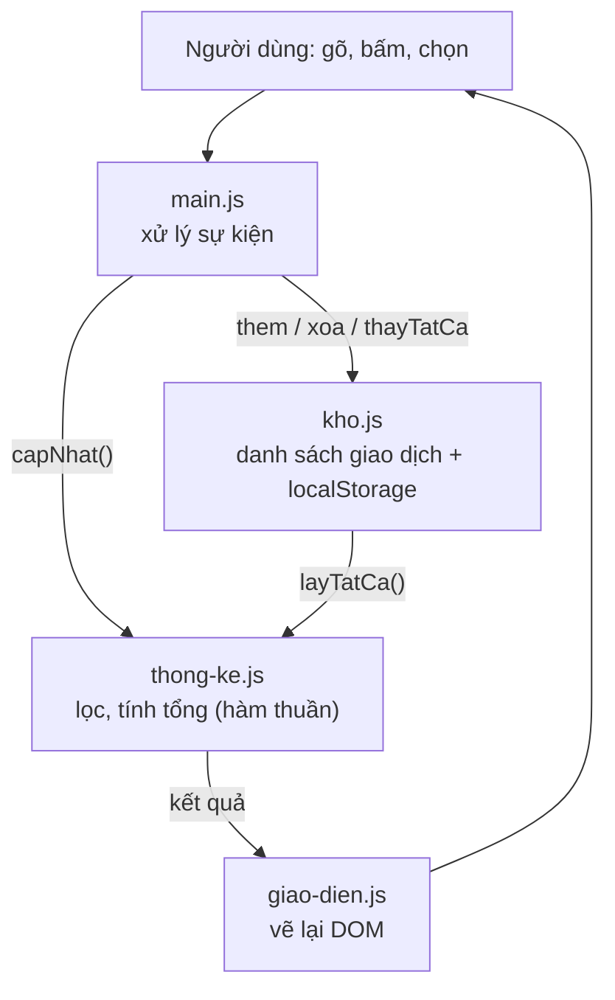

<script setup>
import { withBase } from 'vitepress'
</script>

# Dự án cuối khóa: Sổ chi tiêu

::: info Mục tiêu dự án
- Tự tay xây một **ứng dụng web hoàn chỉnh** chỉ bằng HTML, CSS và JavaScript thuần, không framework.
- Áp dụng gần như mọi thứ đã học: HTML ngữ nghĩa, form, Flexbox/Grid, responsive, biến CSS và chế độ tối, DOM, sự kiện, module, localStorage, JSON, xử lý lỗi, accessibility, kiểm thử.
- Có một sản phẩm thật để đưa vào hồ sơ năng lực (portfolio) và chia sẻ bằng một đường link.
:::

## 1. Bạn sẽ xây gì?

**Sổ chi tiêu** giúp ghi lại các khoản thu chi hằng ngày và xem tổng kết theo tháng:

- Thêm giao dịch: mô tả, số tiền, thu hay chi, danh mục, ngày.
- Tổng thu, tổng chi, số dư của tháng đang xem; biểu đồ chi tiêu theo danh mục.
- Danh sách giao dịch có lọc theo loại và tìm kiếm không phân biệt dấu; xóa có hoàn tác.
- Dữ liệu lưu trên trình duyệt; xuất ra tệp JSON để sao lưu và nhập lại.
- Giao diện sáng/tối, chạy tốt trên điện thoại, dùng được hoàn toàn bằng bàn phím.

<p>
  <a class="nut-demo" :href="withBase('/du-an-mau/')" target="_blank" rel="noopener">▶ Mở bản chạy thử</a>
</p>

Trong bản chạy thử, bấm **✨ Thêm dữ liệu mẫu** để có sẵn vài giao dịch. Đừng xem mã nguồn của bản này vội: hãy thử tự làm trước theo các mốc bên dưới.

## 2. Yêu cầu chức năng

- [ ] Thêm giao dịch với đủ 5 thông tin; mặc định ngày hôm nay, mặc định là khoản chi.
- [ ] Danh mục thay đổi theo loại: khoản chi (Ăn uống, Đi lại, Mua sắm, Hóa đơn, Giải trí, Sức khỏe, Học tập, Khác), khoản thu (Lương, Thưởng, Bán hàng, Được cho, Khác).
- [ ] Báo lỗi rõ ràng ngay cạnh ô nhập khi thiếu mô tả hoặc số tiền không hợp lệ; chấp nhận cả cách gõ `45000`, `45.000`.
- [ ] Chọn tháng để xem; hiển thị tổng thu, tổng chi, số dư của tháng đó, định dạng `1.250.000 ₫`.
- [ ] Biểu đồ thanh ngang: chi tiêu theo danh mục của tháng, kèm số tiền và phần trăm.
- [ ] Danh sách giao dịch của tháng, mới nhất ở trên; lọc theo loại; tìm theo mô tả (gõ "ca phe" vẫn ra "Cà phê").
- [ ] Xóa giao dịch, có thông báo kèm nút **Hoàn tác** trong vài giây.
- [ ] Dữ liệu còn nguyên sau khi tải lại trang.
- [ ] Xuất toàn bộ dữ liệu ra tệp `.json`; nhập lại từ tệp (bỏ qua dòng hỏng, hỏi trước khi ghi đè).
- [ ] Nút chuyển giao diện **Tự động → Sáng → Tối**, nhớ lựa chọn.

## 3. Yêu cầu kỹ thuật

- [ ] HTML ngữ nghĩa: `header`, `main`, `section` có tiêu đề, `form` với `label` cho mọi ô, `fieldset` cho nhóm radio. Không lỗi khi kiểm tra bằng W3C Validator.
- [ ] Responsive, mobile-first: một cột trên điện thoại, hai cột từ khoảng 900px. Không có thanh cuộn ngang ở bề rộng 360px.
- [ ] Màu sắc, khoảng cách quản lý bằng **biến CSS**; chế độ tối bằng `color-scheme` + `light-dark()` (hoặc media query).
- [ ] JavaScript chia **module** (`type="module"`), mỗi tệp một nhiệm vụ. Không biến toàn cục.
- [ ] Dữ liệu người dùng **chỉ** hiển thị qua `textContent` hoặc thuộc tính, không dùng `innerHTML`.
- [ ] Đọc localStorage và tệp nhập vào trong `try...catch`, kiểm tra từng giao dịch trước khi dùng.
- [ ] Ủy quyền sự kiện cho nút xóa; debounce ô tìm kiếm.
- [ ] Accessibility: dùng được bằng bàn phím, viền focus rõ, skip link, thông báo lỗi nối với ô qua `aria-describedby`, thông báo nổi có `role="status"`, quản lý focus khi xóa.
- [ ] Lighthouse (Mobile) đạt từ 90 điểm ở cả Performance, Accessibility, Best Practices.

## 4. Gợi ý thiết kế

**Mô hình dữ liệu:** một mảng giao dịch, mỗi giao dịch là một object:

```js
{
  id: 'b3f1c2...',          // crypto.randomUUID()
  moTa: 'Cà phê với bạn',
  soTien: 55000,            // số nguyên, đơn vị đồng
  loai: 'chi',              // 'thu' | 'chi'
  danhMuc: 'Ăn uống',
  ngay: '2026-10-27',       // chuỗi 'YYYY-MM-DD', không dùng Date để khỏi lệch múi giờ
}
```

**Cấu trúc tệp và luồng dữ liệu:**

```text
so-chi-tieu/
├── index.html
├── css/style.css
└── js/
    ├── main.js          ← nối mọi thứ: đọc form, gắn sự kiện, gọi capNhat()
    ├── kho.js           ← dữ liệu: đọc/ghi localStorage, thêm, xóa, kiểm tra hợp lệ
    ├── thong-ke.js      ← hàm thuần: lọc theo tháng, tính tổng, nhóm theo danh mục
    ├── giao-dien.js     ← vẽ DOM từ dữ liệu: danh sách, tổng kết, biểu đồ, thông báo
    ├── dinh-dang.js     ← định dạng tiền, ngày; bỏ dấu
    └── du-lieu-mau.js   ← dữ liệu mẫu để thử
```



Nguyên tắc chính: **dữ liệu là nguồn sự thật duy nhất**. Mỗi khi dữ liệu hay bộ lọc thay đổi, gọi một hàm `capNhat()` vẽ lại mọi thứ từ dữ liệu. Đừng sửa DOM lẻ tẻ ở từng nơi; cách đó nhanh chóng làm giao diện và dữ liệu lệch nhau. Đây cũng chính là ý tưởng cốt lõi của React, Vue.

## 5. Các mốc thực hiện

Làm lần lượt từng mốc, chạy thử và commit (nếu dùng Git) sau mỗi mốc.

### Mốc 1 — Khung HTML (khoảng 20 phút)

- [ ] Khung trang chuẩn, `lang="vi"`, title, description.
- [ ] `header` có tên ứng dụng và nút giao diện; `main` có 4 `section`: Thêm giao dịch, Tổng kết tháng, Giao dịch, Dữ liệu.
- [ ] Form đầy đủ ô nhập có label; danh sách và biểu đồ tạm để trống.

Ôn lại: [Form](/html/form), [HTML ngữ nghĩa](/html/html-ngu-nghia).

### Mốc 2 — CSS và bố cục (khoảng 40 phút)

- [ ] Biến CSS cho màu, khoảng cách, bo góc. Reset nhẹ, `box-sizing: border-box`.
- [ ] Mỗi `section` là một "thẻ" có nền, viền, bo góc.
- [ ] Bố cục Grid với `grid-template-areas`: một cột mặc định, hai cột từ 900px.
- [ ] Viền focus rõ ràng, skip link.

Ôn lại: [Grid](/css/grid), [Responsive](/css/responsive), [Biến CSS](/css/css-hien-dai).

### Mốc 3 — Thêm và hiển thị giao dịch (khoảng 40 phút)

- [ ] Bắt sự kiện `submit`, `preventDefault`, đọc và kiểm tra dữ liệu, hiện lỗi cạnh ô.
- [ ] Lưu vào một mảng, vẽ danh sách bằng `<template>` + `textContent`.
- [ ] Định dạng tiền bằng `Intl.NumberFormat('vi-VN', ...)`, ngày theo dạng `DD/MM/YYYY`.

Ôn lại: [Sự kiện](/javascript/su-kien), [DOM](/javascript/dom), [Chuỗi, số & ngày giờ](/javascript/chuoi-so-ngay).

::: tip Gợi ý mốc 3
Viết hàm `veDanhSach(ds)` vẽ **toàn bộ** danh sách từ mảng (dùng `replaceChildren`), thay vì `append` từng dòng mỗi khi thêm. Đơn giản và luôn đúng; với vài trăm dòng thì vẫn rất nhanh.
:::

### Mốc 4 — Lưu trữ và xóa (khoảng 30 phút)

- [ ] Ghi mảng vào localStorage sau mỗi thay đổi, đọc lại khi mở trang (có `try...catch` và kiểm tra hợp lệ).
- [ ] Nút xóa mỗi dòng, xử lý bằng ủy quyền sự kiện; hoàn tác trong vài giây.
- [ ] Sau khi xóa, chuyển focus tới dòng kế bên.

Ôn lại: [Object & JSON](/javascript/object-json#_8-luu-du-lieu-vao-localstorage), [Bảo mật & a11y](/nang-cao/bao-mat-a11y).

### Mốc 5 — Tổng kết, biểu đồ, bộ lọc (khoảng 40 phút)

- [ ] Viết các hàm thuần trong `thong-ke.js`: `locTheoThang`, `tinhTong`, `chiTheoDanhMuc`, `locGiaoDich`.
- [ ] Ô chọn tháng (`<input type="month">`), lọc loại, tìm kiếm có debounce.
- [ ] Biểu đồ thanh: mỗi danh mục một dòng, độ dài thanh đặt qua biến CSS `--ti-le`.

Ôn lại: [Mảng](/javascript/mang), [Hiệu năng (debounce)](/nang-cao/hieu-nang#_6-debounce-va-throttle).

::: tip Gợi ý vẽ biểu đồ bằng CSS
```css
.thanh::before {
  content: '';
  display: block;
  width: var(--ti-le);
  height: 100%;
  background: linear-gradient(90deg, #f97316, #7c3aed);
}
```
```js
thanh.style.setProperty('--ti-le', `${(soTien / lonNhat) * 100}%`);
```
:::

### Mốc 6 — Hoàn thiện (khoảng 40 phút)

- [ ] Giao diện sáng/tối: thuộc tính `data-theme` trên `<html>`, lưu lựa chọn; đặt giao diện **trước** khi trang hiện ra để không nháy màu.
- [ ] Xuất JSON bằng `Blob` + `URL.createObjectURL`; nhập bằng `<input type="file">` + `file.text()`.
- [ ] Tách module, viết kiểm thử cho `thong-ke.js` bằng Vitest.
- [ ] Chạy Lighthouse, sửa các vấn đề được báo; thử toàn bộ ứng dụng chỉ bằng bàn phím.

Ôn lại: [Module, npm & Vite](/nang-cao/module-cong-cu), [Xử lý lỗi](/nang-cao/xu-ly-loi-debug).

## 6. Tự đánh giá

| Tiêu chí | Đạt | Tốt | Xuất sắc |
| --- | --- | --- | --- |
| Chức năng | Thêm, hiển thị, lưu được | Đủ yêu cầu ở mục 2 | Thêm tính năng mở rộng (mục 9) |
| HTML | Chạy được | Ngữ nghĩa, không lỗi validator | Accessibility tree rõ ràng, dùng tốt với trình đọc màn hình |
| CSS | Gọn gàng trên máy tính | Responsive, biến CSS | Chế độ tối hoàn chỉnh, chuyển động tôn trọng `prefers-reduced-motion` |
| JavaScript | Chạy được | Module, không `innerHTML` với dữ liệu người dùng, xử lý lỗi | Hàm thuần có kiểm thử, code dễ đọc như lời giải tham khảo |
| Chất lượng | — | Lighthouse ≥ 90 | Lighthouse 100 ở Accessibility, không lỗi console |

## 7. Đưa lên Internet

Ứng dụng chỉ gồm tệp tĩnh nên đưa lên rất dễ, miễn phí:

- **GitHub Pages**: đẩy code lên một repo GitHub, vào *Settings → Pages*, chọn nhánh `main` và thư mục gốc. Vài phút sau trang có địa chỉ `https://<tên-bạn>.github.io/<tên-repo>/`.
- **Netlify Drop** ([app.netlify.com/drop](https://app.netlify.com/drop)): kéo thả thư mục dự án vào trang là xong.
- Nếu dùng Vite: chạy `npm run build` rồi đưa thư mục `dist/` lên.

Ứng dụng dùng module và `crypto.randomUUID()` nên cần chạy qua `http://localhost` (Live Preview) hoặc HTTPS, không mở trực tiếp tệp bằng `file://`.

## 8. Lời giải tham khảo

Lời giải dưới đây là **một** cách làm, không phải cách duy nhất. Hãy so sánh với bài của bạn: cái gì bạn làm khác, cách nào dễ đọc hơn, vì sao?

::: details index.html
<<< @/public/du-an-mau/index.html
:::

::: details css/style.css
<<< @/public/du-an-mau/css/style.css
:::

::: details js/main.js
<<< @/public/du-an-mau/js/main.js
:::

::: details js/kho.js
<<< @/public/du-an-mau/js/kho.js
:::

::: details js/thong-ke.js
<<< @/public/du-an-mau/js/thong-ke.js
:::

::: details js/giao-dien.js
<<< @/public/du-an-mau/js/giao-dien.js
:::

::: details js/dinh-dang.js
<<< @/public/du-an-mau/js/dinh-dang.js
:::

::: details js/du-lieu-mau.js
<<< @/public/du-an-mau/js/du-lieu-mau.js
:::

::: details js/thong-ke.test.js (kiểm thử với Vitest)
<<< @/public/du-an-mau/js/thong-ke.test.js
:::

## 9. Mở rộng thêm

Hoàn thành xong? Thử thách bản thân với một trong các ý tưởng sau:

1. **Sửa giao dịch**: bấm vào một dòng để nạp dữ liệu vào form và lưu lại.
2. **Ngân sách**: đặt hạn mức chi cho từng danh mục, cảnh báo khi vượt 80% và 100%.
3. **Giao dịch định kỳ**: tiền nhà, tiền điện tự thêm vào đầu mỗi tháng.
4. **Biểu đồ theo ngày** bằng SVG hoặc `<canvas>`; hoặc dùng thư viện Chart.js cài qua npm và Vite.
5. **Đa tiền tệ**: lưu kèm mã tiền tệ, định dạng theo từng loại.
6. **Chạy offline và cài như ứng dụng** (PWA): thêm Web App Manifest và Service Worker.
7. **Đồng bộ lên mạng**: viết một API nhỏ (ví dụ bằng Node.js), gọi bằng `fetch`. Khi đó hãy nghĩ tới đăng nhập và bảo mật như bài [Bảo mật](/nang-cao/bao-mat-a11y).

Chúc mừng bạn đã đi hết lộ trình! Xem gợi ý học tiếp ở trang [Tài nguyên học tiếp](/tham-khao/tai-nguyen).

## Kiểm tra kiến thức

<Quiz />
